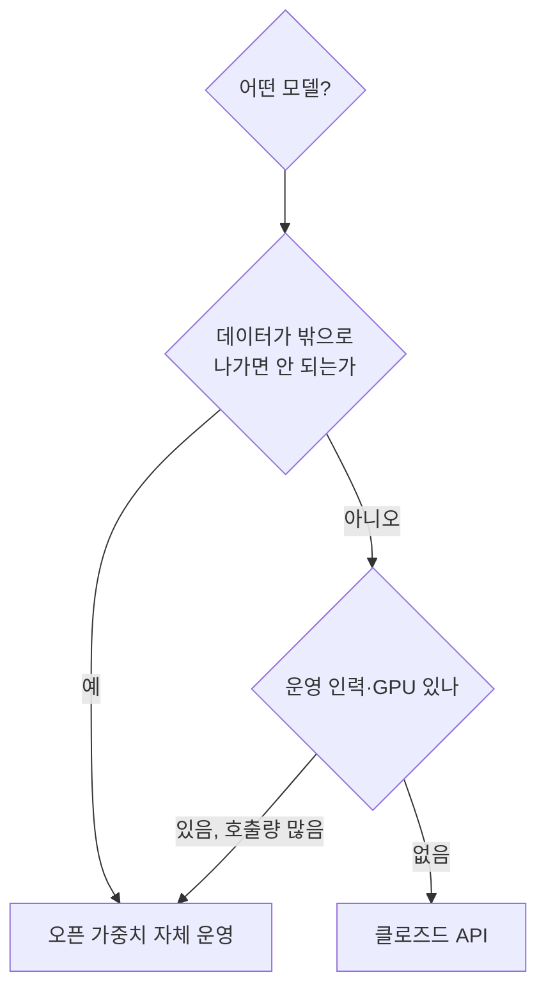
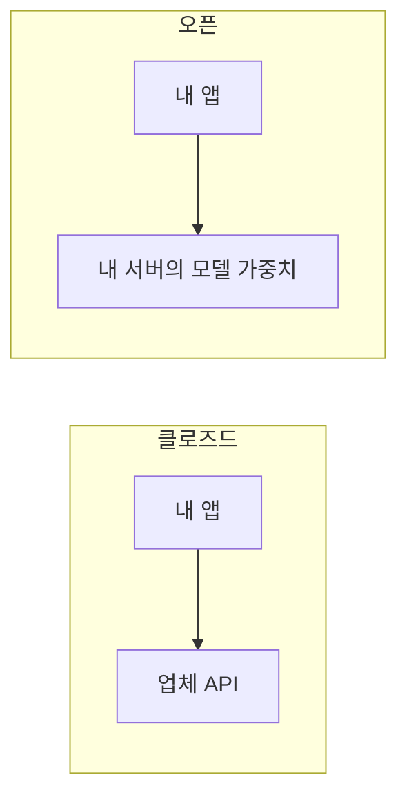

# 오픈 모델 vs 클로즈드 모델

> 클로즈드 모델은 API로만 쓰고 가중치를 볼 수 없는 모델, 오픈 모델은 **가중치(parameters)를 내려받아 직접 돌릴 수 있는** 모델이다. "오픈"의 정도는 라이선스와 공개 범위에 따라 다르다.

## 쉽게 말하면
식당 음식(클로즈드)과 밀키트·레시피(오픈)의 차이다. 식당은 편하고 맛이 보장되지만 조리법을 못 보고 가격·메뉴를 식당이 정한다. 밀키트는 집 주방(내 서버)에서 직접 조리해야 하지만 맛·재료·보관을 내가 통제한다.

## 자세히
- **클로즈드(API형)**: 사용량 과금, 인프라 운영 불필요, 보통 최상위 성능과 빠른 갱신. 대신 데이터가 외부 업체로 나가고, 모델 변경·종료·가격 인상에 의존한다.
- **오픈 가중치(open-weights)**: 가중치를 받아 내 서버·노트북에서 실행, 미세조정 가능, 데이터가 밖으로 안 나감. 대신 GPU 운영·보안·업데이트를 내가 책임진다. 가중치만 공개하고 학습 데이터·코드는 비공개인 경우가 많아 "open-weights"라고 따로 부른다.
- **"오픈소스 AI"의 엄밀한 정의**: Open Source Initiative의 Open Source AI Definition 1.0은 사용·연구·수정·배포 4가지 자유와, 수정에 필요한 형태로 **데이터 정보·코드·파라미터**를 모두 제공할 것을 요구한다(열어서 확인, 발행일은 페이지에 없음). 이 기준으로는 가중치만 푼 모델은 엄밀한 오픈소스가 아닐 수 있다.
- 라이선스는 모델마다 다르다(상업 이용 제한, 사용자 수 제한, 금지 용도 등). 도입 전에 원문을 읽는다.
- 선택 기준: 데이터 민감도, 호출량(많으면 자체 운영이 쌀 수 있음), 성능 요구, 운영 인력, 규제. 현실에서는 **섞어 쓴다**(어려운 작업은 API, 대량·민감 작업은 오픈 모델) → [api-vs-self-host](#api-vs-self-host).
- 성능 격차와 모델 목록은 빠르게 바뀌므로 판단 시점의 벤치마크·가격을 다시 확인한다.

## 그림으로 보기

## 예시
- 법무팀이 계약서를 요약하는데 외부 전송이 금지 → 사내 서버에 오픈 모델을 올린다.
- 스타트업이 첫 프로토타입 → 클로즈드 API로 빠르게 만들고, 호출량이 늘면 일부를 오픈 모델로 옮겨 비용을 비교한다.

## 헷갈리는 것과 비교
| 개념 | 차이 |
|---|---|
| 클로즈드 모델 | 가중치 비공개, API 사용 |
| 오픈 가중치 | 가중치 공개, 데이터·코드는 비공개일 수 있음 |
| 오픈소스 AI(OSI) | 데이터 정보·코드·가중치 모두 제공 |
| [API vs 자체 호스팅](#api-vs-self-host) | 사용 방식의 선택, 모델의 공개 여부와 별개 축 |

## 더 읽을거리
- [Open Source AI Definition 1.0 (OSI)](https://opensource.org/ai/open-source-ai-definition) — 4가지 자유와 필수 구성 요소(열어서 확인).
