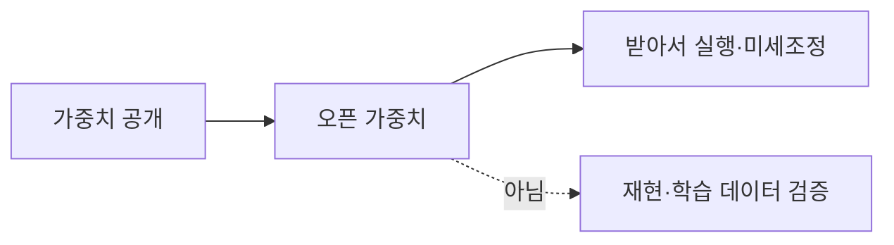
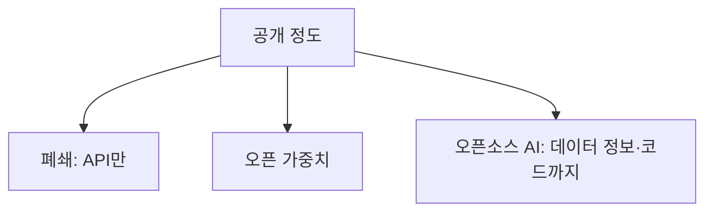

# 오픈 가중치(open-weights)

> 모델의 **가중치를 내려받아 쓸 수 있게 공개**했지만, 학습 데이터·학습 코드까지 공개한다는 뜻은 아닌 배포 방식. "오픈소스"와 같은 말이 아니다.

## 쉽게 말하면
구운 빵을 통째로 받아 먹고 자르고 다른 요리에 쓸 수는 있지만, 밀가루 출처와 반죽 레시피는 모르는 상태다. 빵(가중치)은 내 것처럼 쓸 수 있어도 똑같이 새로 굽긴 어렵다.

## 자세히
(검색 결과 요약 기준.)
- 구분: 가중치를 받을 수 있어도 [OSI 기준](#osi-open-source-ai)을 못 채울 수 있다. 예로 Qwen은 오픈 가중치이며 허용적·OSI 승인 라이선스지만, 개발자가 같은 결과를 재현할 도구·코드·데이터는 없다는 설명이 있다.
- 용어: 현실에서는 "open weight"가 라이선스와 무관하게 공개·자체 호스팅 가능한 모델 전반을 가리키는 느슨한 용어로도 쓰인다.
- 사용 제한: 오픈 가중치 생성형 모델은 보통 기업 규모와 용도에 따라 사용을 제한한다. Llama 라이선스는 군사 목적 금지와 일정 사용자 수 이상 기업 제한이 있다는 설명이 있다(구체 사용자 수 기준은 이번 검색에서 확인 못 함).
- Meta는 Llama 4를 "오픈소스가 아닌 오픈 가중치"라고 부르며 응답했다고 보도된다.
- 장점: 자체 호스팅·미세조정·데이터 반출 없는 운용 가능([호스팅 결정](#hosting-decision-checklist) 참고). 단점: 재현·감사 한계, 라이선스 조건 확인 필요.

## 그림으로 보기

## 예시
- 모델 파일을 내려받아 사내 서버에서 돌리고 사내 데이터로 LoRA 미세조정.
- 교육: "오픈"이라는 이름만 믿지 말고 무엇이 공개됐는지 체크하는 실습.

## 헷갈리는 것과 비교
| 개념 | 차이 |
|---|---|
| 오픈 가중치 | 가중치 중심 공개 |
| [오픈소스 AI](#osi-open-source-ai) | 데이터 정보·코드까지, 4자유 |
| [모델 라이선스](#model-license) | 사용 조건을 규정 |

## 더 읽을거리
- [PBS: 폐쇄·오픈소스·오픈 가중치 AI의 차이](https://pbs.org/newshour/science/whats-the-difference-between-closed-open%E2%80%91source-and-open-weight-ai-a-researcher-explains) — 연구자 설명(검색 결과 확인).
- [OSI Calls Out Meta](https://itsfoss.com/news/osi-meta-ai/) — 용어 논쟁(검색 결과 확인).
