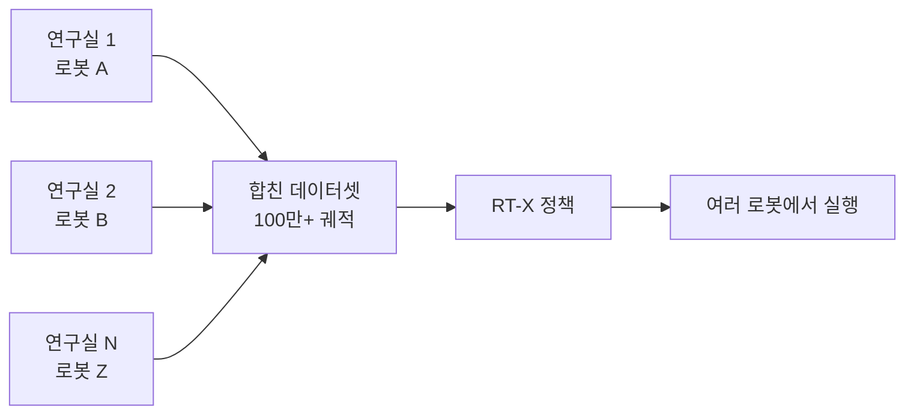
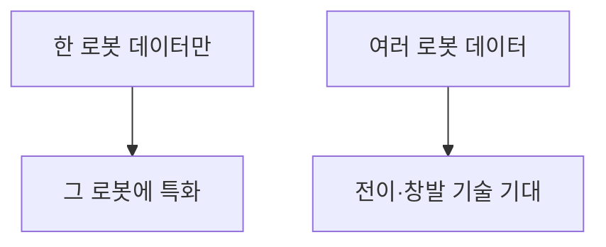

# Open X-Embodiment

> 여러 연구기관이 각자 모은 로봇 시연 데이터를 하나의 공개 데이터셋으로 합치고, 그 데이터로 **여러 로봇에 통하는 정책(RT-X)**을 학습한 협업 프로젝트다.

## 쉽게 말하면
각 학교가 따로 모은 요리 영상을 한 도서관에 모아, 그 도서관으로 공부한 학생이 어느 주방에서든 쓸모 있는지 보는 실험이다. 책이 다양할수록 한 가지 주방에만 맞춘 학생보다 낫다는 가설이다.

## 자세히
- 프로젝트 페이지 기준: **21개 기관**, 34개 연구실 데이터, **22종 로봇**(단일 팔·양팔·사족보행 포함), 기존 **60개 데이터셋**, **100만 개 이상** 실제 로봇 궤적, 527개 기술·160,266개 과제.
- 모델: **RT-1-X**와 **RT-2-X**. 주장(페이지 기준)으로 RT-1-X는 소규모 데이터 영역에서 기존 방식보다 50% 높고, RT-2-X는 새 기술(emergent skill) 평가에서 RT-2의 3배다. 가장 큰 RT-2-X는 55B 파라미터.
- 의미: 로봇마다 데이터를 새로 모으는 대신 **교차 로봇 전이(cross-embodiment transfer)**가 가능하다는 근거. LLM이 인터넷 글로 규모를 키운 것처럼 로봇도 데이터 풀링으로 규모를 키우려는 시도다.
- 한계: 로봇마다 센서·행동 공간이 달라 형식을 통일해야 하고, 데이터 품질 편차([시연 데이터 품질](#demonstration-quality))가 크다. 위 수치는 프로젝트 페이지 요약이며 논문 본문은 확인하지 않았다.

## 그림으로 보기

## 예시
- 새 연구실이 자기 로봇으로 소량 시연만 모아도 공개 데이터와 합쳐 미세조정.
- 교육: 데이터를 공유하는 것이 모델 성능에 미치는 효과를 "공동 학습 자료" 비유로 설명.

## 헷갈리는 것과 비교
| 개념 | 차이 |
|---|---|
| Open X-Embodiment | 데이터셋+연합 프로젝트 |
| RT-X | 그 데이터로 학습한 모델 |
| [모방 학습](#imitation-learning) | 이 데이터를 쓰는 학습 방식 |

## 더 읽을거리
- [Open X-Embodiment 프로젝트 페이지](https://robotics-transformer-x.github.io/) — 규모·결과(읽음).
