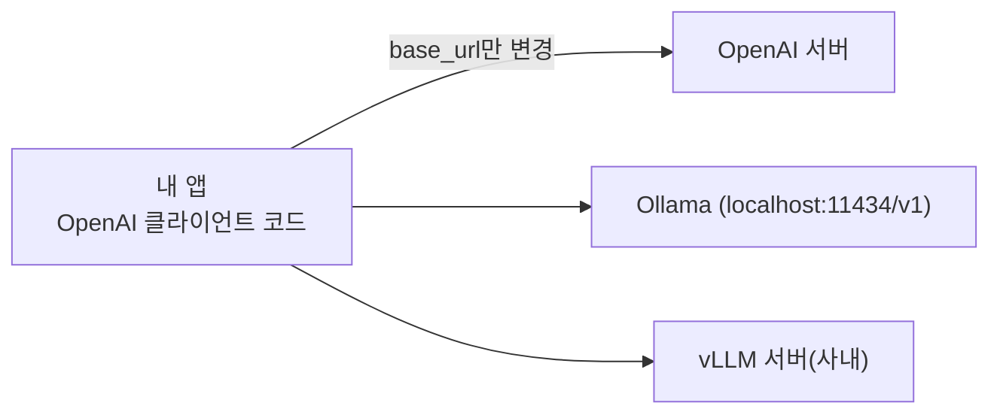
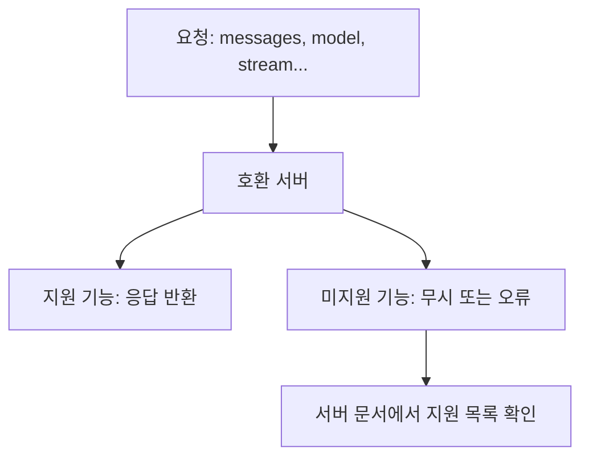

# OpenAI 호환 API

> OpenAI의 Chat Completions 같은 요청·응답 형식을 따라 만들어, 클라이언트 코드를 거의 바꾸지 않고 주소(`base_url`)만 바꿔 로컬 모델·다른 업체 서버로 갈아 끼울 수 있게 하는 사실상의 표준 관행.

## 쉽게 말하면
전자제품의 표준 콘센트 규격과 같다. 규격이 같으면 TV가 어느 회사 제품이든 같은 벽 콘센트에 꽂힌다. LLM 서버도 같은 "요청 모양"을 받아 주면, 내 앱은 코드를 거의 안 바꾸고 OpenAI 서버, 내 PC의 Ollama, 사내 vLLM 서버를 바꿔 가며 쓸 수 있다.

## 자세히
- **기본 아이디어**: OpenAI 파이썬 클라이언트를 쓰되 `base_url`과 `api_key`만 바꾼다. 요청은 `messages` 배열 같은 같은 구조, 응답은 `choices[0].message.content`에 담긴다.
- **Ollama(공식 문서 기준)**: 로컬에서는 `http://localhost:11434/v1/`. API 키는 클라이언트가 요구하지만 Ollama는 무시하므로 아무 값(예: `"ollama"`)이나 쓴다. 클라우드는 `https://ollama.com/v1`과 `OLLAMA_API_KEY`. 지원 엔드포인트: `/v1/chat/completions`(스트리밍, JSON 모드, 비전, 도구, 추론 제어), `/v1/completions`, `/v1/models`, `/v1/embeddings`, `/v1/responses`(상태 없는 방식만), 오디오(음성 생성·전사·번역). **미지원**: chat completions의 logprobs, `tool_choice`, `logit_bias`, `user`, `n`. 모델은 먼저 pull해야 하고 컨텍스트 크기는 OpenAI API로 못 정해 Modelfile의 `num_ctx`로 설정한다.
- **vLLM(공식 문서 기준)**: `vllm serve <모델>`로 OpenAI 호환 서버를 띄운다. 지원 API: Completions, Chat Completions, Responses, Embeddings, 음성 전사·번역. (연결 주소·포트·`--api-key` 상세는 이 세션에서 문서로 확인하지 못했으므로 vLLM 문서 확인 필요.)
- **장점**: 업체 종속 줄이기, 개발은 로컬(무료)·운영은 API 같은 전환, [모델 라우팅](#model-routing)이나 비교 평가 코드 재사용.
- **함정**:
  1. **"호환"은 부분 호환이다**: 위처럼 `tool_choice`·`logit_bias` 같은 기능이 빠져 있을 수 있다. 쓰려는 기능이 지원되는지 서버 문서에서 확인한다.
  2. 모델마다 채팅 템플릿·시스템 프롬프트 처리가 달라 같은 요청도 응답이 다를 수 있다.
  3. 컨텍스트 길이·속도 제한·가격 정책은 서버마다 다르다.
  4. 응답 형식은 같아도 업체 고유 기능(예: 프롬프트 캐싱 파라미터, 확장 사고)은 호환 범위 밖이다.
- **Anthropic 등 다른 형식**: 각 업체가 자기 API 형식을 따로 둔다. 호환 계층(게이트웨이)이나 SDK의 호환 모드로 형식을 맞추기도 한다.

## 그림으로 보기




## 예시
```python
from openai import OpenAI

# 로컬 Ollama
client = OpenAI(base_url="http://localhost:11434/v1/", api_key="ollama")
r = client.chat.completions.create(
    model="llama3.2",   # 미리 pull한 모델 이름(예시)
    messages=[{"role": "user", "content": "한 문장으로 RAG를 설명해 줘"}],
)
print(r.choices[0].message.content)
```
같은 코드에서 `base_url`과 `api_key`, `model`만 바꾸면 다른 호환 서버로 전환된다.

## 헷갈리는 것과 비교
| 개념 | 차이 |
|---|---|
| OpenAI 호환 API | 요청·응답 형식이 같다는 약속. 기능 전체가 같다는 뜻은 아님 |
| [Ollama](#ollama) | 로컬 실행용 서버(호환 엔드포인트 제공) |
| [vLLM](#vllm) | 다중 사용자 서빙 엔진(호환 서버 제공) |
| [LLM API 기본](#llm-api-basics) | 업체 API의 일반 구조 |
| [로컬+API 혼합](#hybrid-local-api) | 호환 API 덕분에 쉽게 구성 가능한 패턴 |

## 더 읽을거리
- [OpenAI compatibility (Ollama 문서)](https://docs.ollama.com/api/openai-compatibility) — 주소·지원 엔드포인트·미지원 기능
- [OpenAI-compatible server (vLLM 문서)](https://docs.vllm.ai/en/latest/serving/online_serving/) — 지원 API 목록
