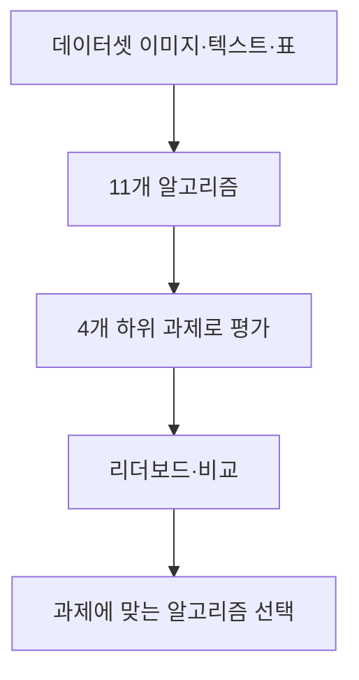

# OpenDataVal

> 데이터 가치 평가(Data Shapley 계열 등) 알고리즘을 **한 곳에서 같은 조건으로 비교하는 오픈소스 벤치마크·라이브러리**다(arXiv 2306.10577, NeurIPS 2023 Datasets and Benchmarks). 어떤 알고리즘이 모든 과제에서 최고인 것은 아니라는 결과를 보고한다.

## 쉽게 말하면
요리 대회에서 같은 재료·같은 심사 기준으로 여러 조리법을 겨루게 하는 대회장이다. 어떤 조리법이 항상 이기지는 않고 심사 과목에 따라 순위가 달라진다.

## 자세히
(논문 초록을 직접 열어 확인. 세부 과제 이름·수치는 본문 미열람)
- **구성(초록)**: 이미지·자연어·표 형식 데이터셋의 다양한 모음, **11개의 최신 데이터 가치 평가 알고리즘** 구현, 데이터 가치를 평가하기 위한 **4개의 하위 머신러닝 과제** 제안(초록에는 과제 이름이 없어 미확인).
- **라이브러리**: 문서가 갖춰진 공개 라이브러리이며, **scikit-learn 모델을 받는 예측 모델 API**와 새 평가 알고리즘을 비교하는 **리더보드**를 제공한다.
- **핵심 발견(초록)**: "어떤 단일 알고리즘도 모든 과제에서 가장 좋지 않다." 그래서 **하위 과제에 맞춰 알고리즘을 고르라**고 권한다.
- **활용 방법(제안)**
  1. 내 목적을 정한다: 오라벨 탐지, 가치 높은 데이터 추가·낮은 데이터 제거, 잡음 특징 탐지 등.
  2. 같은 데이터·모델로 여러 알고리즘([KNN-Shapley](#knn-shapley), [TMC-Shapley](#tmc-shapley), [Beta Shapley](#beta-shapley), [LOO](#leave-one-out-value))을 돌려 목적 지표(예: 오라벨 탐지의 정밀도)로 비교.
  3. 내 데이터에서 직접 검증한다. 벤치마크 순위는 데이터·과제 조건에 한정된다.
  4. 계산 비용(학습 횟수)과 안정성(시드별 순위 변동)을 함께 본다([수렴 점검](#shapley-convergence-check)).
  5. 낮은 값의 데이터는 후보로 사람이 확인([가치 평가와 삭제](#valuation-vs-deletion)).
- **설치·사용 예는 이 노드에서 실제로 실행해 보지 않았다.** 사용 전 공식 문서의 설치 안내와 예제를 확인한다.
- **교훈**: 벤치마크가 "알고리즘 A가 최고"가 아니라 "과제별로 다르다"를 보여 주므로, 데이터 가치 평가는 도구를 고르기 전에 목적을 먼저 정의해야 한다.

## 그림으로 보기

## 예시
- 오라벨 탐지가 목적일 때 KNN-Shapley·TMC-Shapley·LOO를 같은 데이터에서 돌려 하위 100개 중 실제 오류 비율로 비교(개념 예, 직접 실행하지 않음).
- 교육: 벤치마크 결과를 읽는 법("전체 최고"가 아니라 "과제별 최고").

## 헷갈리는 것과 비교
| 개념 | 차이 |
|---|---|
| OpenDataVal | 데이터 가치 평가 알고리즘의 벤치마크·라이브러리 |
| Data Shapley·Beta Shapley | 개별 평가 알고리즘 |
| 벤치마크 리더보드 | 비교 기준과 순위 |
| [수정된 시험 세트](#corrected-test-labels) | 라벨 오류 벤치마크(다른 목적) |

## 더 읽을거리
- [OpenDataVal (arXiv 2306.10577)](https://arxiv.org/abs/2306.10577) — 벤치마크 개요(초록 확인).
- [Data Shapley (arXiv 1904.02868)](https://arxiv.org/abs/1904.02868) — 평가 대상 알고리즘의 기반(초록 확인).
