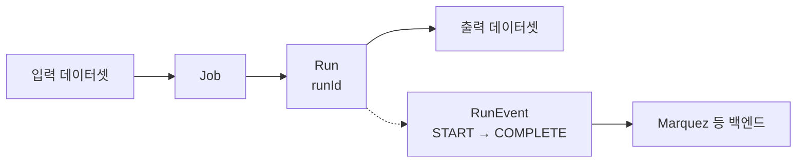
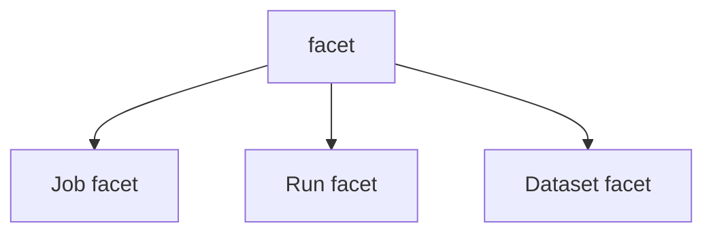

# OpenLineage

> 데이터가 어떤 작업(job)의 어떤 실행(run)을 거쳐 어떤 데이터셋에서 만들어졌는지 **계보(lineage) 메타데이터를 같은 형식으로 주고받게 하는 오픈 규격**이다. 도구가 달라도 한 그림으로 이어 볼 수 있다.

## 쉽게 말하면
택배 송장 번호를 회사마다 다르게 매기면 물건이 어디를 거쳤는지 이어 볼 수 없다. 모든 택배사가 같은 송장 형식을 쓰면 한 번의 조회로 전 경로가 나온다. OpenLineage는 데이터 파이프라인판 공통 송장 형식이다.

## 자세히
(OpenLineage 공식 문서의 개요·객체 모델 페이지를 직접 읽었다.)
- **무엇인가**: 데이터 계보를 수집·분석하기 위한 확장 가능한 오픈 프레임워크이자 규격. 데이터셋·작업·실행을 모델링하고 **facet**(사용자 정의 메타데이터)로 풍부하게 만든다. **LF AI & Data 재단**에서 Graduate 단계라고 문서에 적혀 있다.
- **핵심 엔티티**
  - **Job**: 데이터셋을 소비·생성하는 과정(오케스트레이터 태스크, 쿼리, 모델 등). 네임스페이스 안에서 이름이 고유. facet: `sourceCodeLocation`, `sourceCode`.
  - **Run**: 한 Job의 한 번의 실행. 클라이언트가 만드는 UUID(`runId`, UUIDv7 권장)로 식별. facet: `nominalTime`, `parent`, `errorMessage`, `sql`.
  - **Dataset**: 테이블·버킷 객체 같은 데이터 묶음. 정적 메타데이터는 데이터셋 facet(`schema`, `dataSource`, `lifecycleStateChange`, `version`), 실행별 정보는 입력 facet(`dataQualityMetrics`, `dataQualityAssertions`)·출력 facet(`outputStatistics`).
- **이벤트 종류**: RunEvent(실행 상태 갱신, 보통 시작·종료 시), JobEvent(소스 위치·입출력 선언 같은 설계 시점 정보), DatasetEvent(실행과 무관한 스키마·문서·거버넌스 정보). Run은 보통 START로 시작해 COMPLETE로 끝나며 갱신은 누적된다. 그 밖의 상태(FAIL 등)는 읽은 페이지에 없다.
- **이름 규칙**: 데이터셋 이름은 물리적 위치에서 파생하며 네임스페이스+이름이 고유해야 한다(세부는 Naming Conventions 페이지).
- **연동**: Apache Airflow, Flink, Hive, Spark, dbt, Feast, Great Expectations, SQL, Trino 등. 스케줄러·처리 프레임워크 안에 통합을 넣는 방향. 참조 구현은 **Marquez**(LF AI & Data 프로젝트). 이벤트 전송 프로토콜은 설정 가능한 백엔드(어떤 프로토콜이 있는지는 해당 페이지에 없음).
- **한계**: 읽은 문서에 예시 JSON이 없어 이벤트 필드 구조를 적지 않았다.

## 그림으로 보기

## 예시
- Airflow의 일일 집계 태스크가 `raw.orders`를 읽어 `mart.daily_sales`를 만들 때 START/COMPLETE 이벤트를 보내면, 백엔드에 "이 표의 상류는 이 표"라는 그래프가 쌓인다.
- 교육 소재: "이 숫자는 어디서 왔나?"를 계보 그래프로 거슬러 올라가 보기.

## 헷갈리는 것과 비교
| 개념 | 차이 |
|---|---|
| OpenLineage | 계보 이벤트를 주고받는 오픈 규격(수집 형식) |
| [W3C PROV](#w3c-prov) | 출처 정보를 표현하는 W3C 일반 모델 |
| Marquez | OpenLineage의 참조 구현 백엔드 |
| [계보 그래프로 원인 찾기](#lineage-graph-debugging) | 수집한 계보를 활용하는 방법 |

## 더 읽을거리
- [OpenLineage 문서 개요](https://openlineage.io/docs/) — 목적·거버넌스·연동 목록.
- [OpenLineage Object Model](https://openlineage.io/docs/spec/object-model) — Job·Run·Dataset과 facet.
