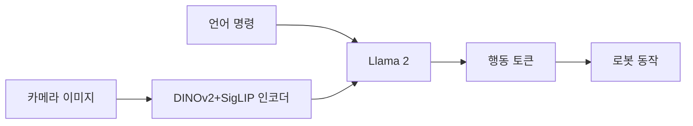
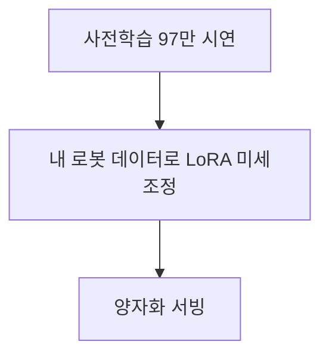

# OpenVLA

> **OpenVLA**는 이미지와 명령어를 보고 로봇 행동을 출력하는 **7B 파라미터 오픈소스 VLA(시각-언어-행동) 모델**이다(arXiv 2406.09246, 2024).

## 쉽게 말하면
"컵을 서랍에 넣어"라는 말과 카메라 화면을 받아 로봇 팔의 다음 동작을 말로 대답하듯 내놓는 모델이다. 대형 언어 모델에 눈과 손을 달아 준 셈이고, 코드와 가중치가 공개돼 있어 누구나 자기 로봇에 맞춰 손볼 수 있다.

## 자세히
(논문 초록 확인)
- **구성**: Llama 2 언어 모델 + DINOv2·SigLIP 특징을 합친 시각 인코더.
- **학습 데이터**: 실제 로봇 시연 약 **97만 개**(여러 로봇·과제).
- **성능**: 29개 과제·여러 로봇에서 550억 파라미터 RT-2-X보다 절대 성공률 **16.5%p 높음**(파라미터 약 7배 적음).
- **미세조정**: 다물체·다과제·언어 접지 환경에서 잘 적응하며, 처음부터 학습한 Diffusion Policy보다 20.4% 높다고 보고.
- **경량화**: LoRA로 소비자 GPU에서 미세조정, 양자화 서빙해도 성공률 유지.

## 그림으로 보기

## 예시
- 연구실에서 팔 로봇 시연 수십~수백 개를 모아 LoRA로 미세조정해 새 과제를 시키는 흐름.
- 교육 활용: "AI가 글에서 행동으로 넘어가는" 사례로 설명.

## 헷갈리는 것과 비교
| 개념 | 차이 |
|---|---|
| OpenVLA | 오픈소스 7B VLA, 행동을 토큰으로 출력 |
| RT-2-X | 55B 폐쇄 계열 비교 대상 |
| Diffusion Policy | 확산 기반 정책, 비교 기준선 |
| [플로 매칭](#flow-matching) | 연속 행동 생성에 쓰이는 다른 접근 |

## 더 읽을거리
- [OpenVLA: An Open-Source Vision-Language-Action Model](https://arxiv.org/abs/2406.09246) — 논문 초록.
