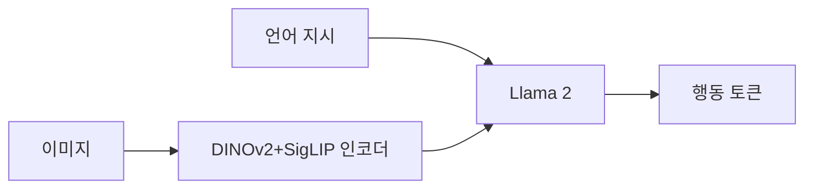
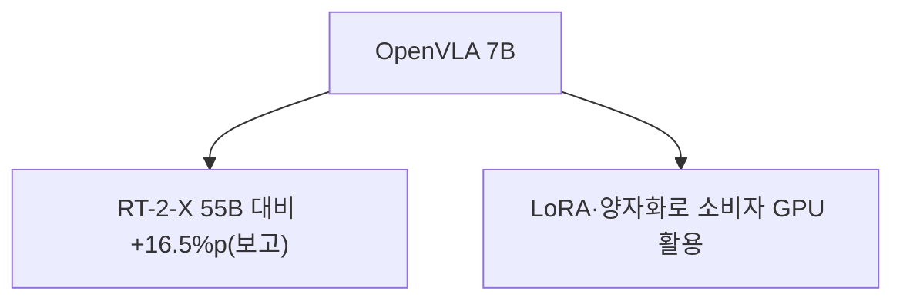

# OpenVLA

> **오픈소스 7B 파라미터 VLA 모델.** 97만 개 실제 로봇 시연으로 학습했고, Llama 2 언어모델에 DINOv2와 SigLIP을 합친 시각 인코더를 결합했다. 소비자 GPU에서 LoRA로 미세조정할 수 있다고 보고했다. (arXiv 2406.09246, 초록 읽음)

## 쉽게 말하면
RT-2 같은 큰 비공개 모델과 비슷한 일을 하는 모델을 누구나 내려받아 쓸 수 있게 작게 만든 것이다. 노트북급 GPU에서도 내 로봇에 맞게 조금 다시 가르칠 수 있다.

## 자세히
- 구성(초록): **7B 파라미터**, **97만 개** 실제 로봇 시연, 기반은 **Llama 2**, 시각 인코더는 **DINOv2+SigLIP 특징 결합**.
- 성능(저자 보고): 여러 로봇 형태에 걸친 **29개 과제**에서 RT-2-X(55B)보다 **절대 성공률 16.5%p 높고** 파라미터는 **7분의 1**.
- 효율: **LoRA**로 소비자 GPU에서 미세조정 가능, **양자화**해도 하류 성공률이 떨어지지 않는다고 보고([LoRA](#fine-tuning-open-model), [양자화 이름 읽기](#quant-naming)).
- 학습 데이터 맥락: 97만 시연은 [Open X-Embodiment](#open-x-embodiment) 같은 합쳐진 데이터에 기반한다고 알려져 있으나 이번 초록에서는 출처를 확인하지 못했다.
- 한계: 비교 대상과 평가 조건은 저자 설정이며 독립 재현은 확인하지 못했다. 평균 성공률의 절대값은 초록에 없다.

## 그림으로 보기

## 예시
- 내 로봇 팔의 시범 소량으로 LoRA 미세조정해 특정 작업 성능 향상.
- 교육: 모델 크기 대비 성능 비교와 공개 모델의 의미를 토론.

## 헷갈리는 것과 비교
| 개념 | 차이 |
|---|---|
| OpenVLA | 공개 7B VLA, 행동을 토큰으로 |
| [π0](#pi0-flow-model) | 플로 매칭 기반 VLA |
| [RT-2](#rt-2) | 비공개 대형 VLA(행동 텍스트 토큰) |

## 더 읽을거리
- [OpenVLA 논문](https://arxiv.org/abs/2406.09246) — 개요(초록 읽음).
