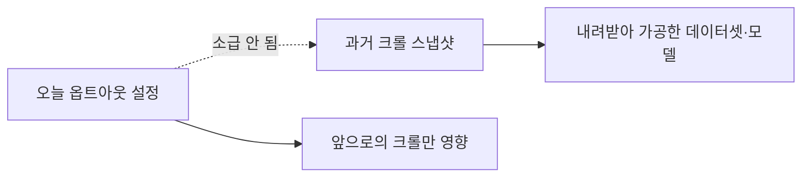
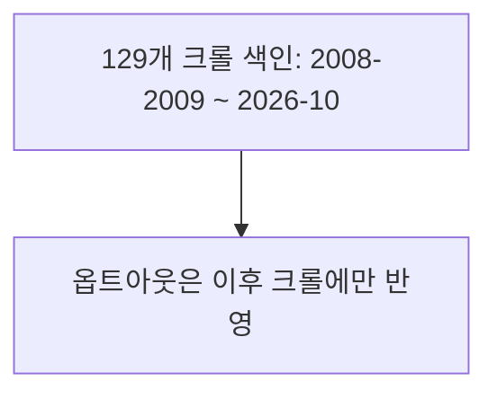

# 옵트아웃의 한계

> robots.txt 차단이나 TDM 유보 같은 **옵트아웃은 앞으로의 수집에만 작용**하며, 이미 공개 아카이브에 들어가 여러 사람이 내려받은 데이터를 거두어들이지는 못한다. 학습 데이터 거버넌스에서 "지금 막는 것"과 "이미 퍼진 것"을 구분해야 하는 이유다.

## 쉽게 말하면
도서관 입구에 "복사 금지"를 붙여도, 붙이기 전에 누가 이미 복사해 간 책은 되돌릴 수 없다. 표지판은 앞으로 오는 사람에게만 효과가 있다.

## 자세히
- **크롤은 시점별 스냅샷**: Common Crawl 색인 목록(`index.commoncrawl.org/collinfo.json`, 2026-11-20 직접 조회)에는 **129개** 크롤 색인이 있다. 최신은 `CC-MAIN-2026-43`(2026년 10월), 가장 오래된 것은 `2008 - 2009 ARC Files Index`다. 옛 크롤은 목록에 그대로 남아 있다.
- 따라서 오늘 robots.txt에 CCBot 차단을 넣으면 **다음 크롤부터** 수집되지 않지만, 과거 크롤 속 내 사이트 페이지는 해당 스냅샷에 남는다(그 아카이브 삭제를 별도로 요청하는 절차는 이 글에서 확인하지 않았다).
- 이미 만들어진 파생 데이터도 문제: 과거 스냅샷을 내려받아 가공한 정제 데이터셋과 그걸로 학습한 모델은 별개의 복사본이라 옵트아웃이 닿지 않는다([FineWeb 예제](#datatrove-fineweb-example)가 크롤 덤프 위에 만들어진 구조).
- 옵트아웃 신호의 범위(제안): [robots.txt](#robots-txt-basics)는 접근, [TDMRep](#tdm-reservation-protocol)은 마이닝 권리 유보 표시. 둘 다 미래 수집자에게 보내는 신호이며 **수집자가 지켜야 효과**가 있다. 사칭 크롤러는 따르지 않을 수 있다([IP 검증](#crawler-ip-verification)).
- 실무 시사점(제안): ① 차단은 가능한 빨리 ② 이미 노출된 콘텐츠는 각 데이터셋 운영자의 삭제·제외 요청 절차를 별도로 확인 ③ 학습 쪽은 수집 시점·소스·제외 규칙을 기록해 사후 대응이 가능하게 한다(데이터 계보) ④ 법·계약 문제는 신호가 아니라 법적 수단으로 다룬다([개인정보·저작권](#privacy-copyright)).

## 그림으로 보기

## 예시
- 2026년 11월에 CCBot을 차단한 사이트: 2026-43 이후 크롤에는 안 들어가지만 2019년 크롤의 페이지는 그 스냅샷에 남는다.
- 교육: 인터넷에 한 번 공개된 정보의 "회수 불가능성"을 설명.

## 헷갈리는 것과 비교
| 개념 | 차이 |
|---|---|
| 옵트아웃 | 앞으로의 수집 방지 |
| 삭제 요청 | 이미 수집된 사본의 제거(운영자별 절차) |
| 모델 언러닝 | 학습된 모델에서 정보 영향을 줄이는 연구 분야 |

## 더 읽을거리
- [Common Crawl 색인 목록 collinfo.json](https://index.commoncrawl.org/collinfo.json) — 크롤 목록과 최신·최초 스냅샷(직접 조회).
