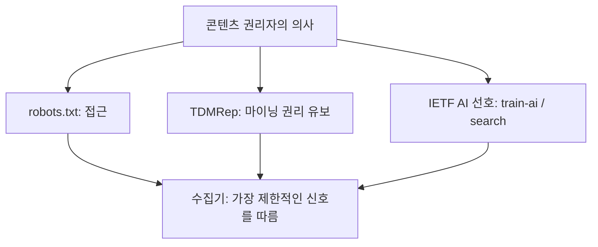
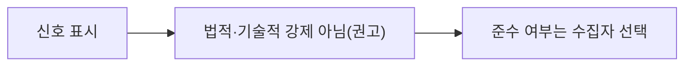

# 옵트아웃 신호 지형

> AI 수집·학습에 대한 콘텐츠 권리자의 의사를 알리는 신호는 **robots.txt, TDMRep(HTTP 헤더·meta·tdmrep.json), IETF AI 선호 어휘** 등 여러 층에 흩어져 있다. 서로 목적·강제력·표준화 단계가 다르다.

## 쉽게 말하면
집 앞에 "출입 금지" 푯말(robots.txt), "복사·분석 금지" 안내문(TDMRep), 그리고 모두가 같은 단어로 쓰도록 만드는 표준 표기법(IETF 어휘)이 따로 붙어 있는 상황이다. 어느 것도 문을 잠그는 자물쇠는 아니다.

## 자세히
- **robots.txt (RFC 9309)**: 크롤러의 *접근* 허용 여부를 경로별 규칙으로 전한다([가장 긴 일치 규칙](#robots-longest-match)). 목적이 "수집 접근 제어"라서 "학습에 써도 되는가"를 직접 표현하지 못한다.
- **TDMRep (W3C 커뮤니티 그룹 보고서, 2024-05-10)**: 텍스트·데이터 마이닝 **권리 유보**(`tdm-reservation` 1/0)와 허가 방법 정책(`tdm-policy`)을 HTTP 헤더·HTML meta·`/.well-known/tdmrep.json`으로 선언한다([tdmrep.json 파일](#tdmrep-json-file), [TDM 정책 문서](#tdm-policy-document)).
- **IETF AI Preferences 어휘(draft-ietf-aipref-vocab-07, 2026-08-19)**: 표준화 트랙(Standards Track 의도)의 **작업 초안**이며 문서 스스로 "작업 그룹의 합의를 반영하지 않는다"고 적는다(저자 Paul Keller, Martin Thomson). 어휘는 **두 범주**뿐이다 — `train-ai`(생성형 AI 모델 학습에 사용)와 `search`(검색 목적 사용; 출처 링크 등 조건이 있고 요약 생성은 제외). 값은 `y`/`n`이고 `train-ai=y, search=n`처럼 쓴다(Structured Fields 사전 형식 예). 범주는 계층 없는 평면 구조다.
  - **미표시는 "알 수 없음"**: 선호가 없으면 모든 범주가 unknown이며 잘못된 값도 오류가 아니라 unknown으로 처리한다.
  - **여러 진술이 충돌하면 금지 우선**: 하나라도 금지하면 금지, 아니면 하나라도 허용하면 허용, 아니면 unknown — "가장 제한적인 선호가 적용"된다.
  - **권고적(advisory)**: 선호가 지켜지도록 보장하지 않으며 따를지는 수신자의 선택이다. 계약·법적 장치가 선호를 덮을 수 있고 "선호는 보안 메커니즘이 아니다"라고 명시한다.
- **업계 맥락 — RFC 9969 (2026년 5월, 정보성)**: IAB의 AI-CONTROL 워크숍(2024-09-19~20) 보고서. 참가자들이 현재 생태계가 지속 가능하지 않다고 보았고(한 참가자의 말: "robots.txt is broken and we broke it"), 선호는 수집 시점에 표시되지만 학습된 모델은 추론 시 선택 적용이 어렵고 선호가 이후 바뀔 수 있으며, 준수 감시가 없어 신뢰가 낮아 AI 크롤러 차단이 늘고 있다고 정리한다. 합의된 어휘는 없으나 복잡한 어휘는 성공하기 어렵다는 의견, 표준화 후보로 **위치 기반 부착, HTTP 헤더 같은 IETF 형식 내장, 핵심 어휘 정의, 여러 출처 선호의 결합 규칙**을 제시한다. 집행·등록소·크롤러 인증·감사는 초기 범위 밖이다.
- 검색에서는 `noai` meta 태그나 `ai.txt`에 대한 신뢰할 만한 명세는 확인하지 못했다(현황 불명, 이 문서에서 다루지 않음).
- 비교 요약:
  | 신호 | 표현 대상 | 위치 | 단계 |
  |---|---|---|---|
  | robots.txt | 크롤러 접근 허용 | `/robots.txt` | IETF RFC 9309 표준 |
  | TDMRep | 마이닝 권리 유보 + 허가 정책 | 헤더·meta·`/.well-known/tdmrep.json` | W3C 커뮤니티 그룹 보고서 |
  | AI Preferences | 학습·검색 사용 선호(y/n) | (robots.txt·HTTP 헤더 부착 논의 중) | IETF 작업 초안 |
- 실무(제안): 여러 신호를 모두 확인하고 **더 제한적인 쪽**을 따르며, 근거(어떤 신호를 언제 읽었는지)를 기록한다. 법적 판단은 별도 전문가에게 맡긴다(이 문서는 법률 자문이 아님).

## 그림으로 보기

## 예시
- 사이트 A: robots.txt는 허용이지만 TDMRep는 `tdm-reservation: 1` → 학습용 수집은 보류하고 정책 URL을 확인.
- 교육: 데이터 수집 설계에서 "신호 우선순위·충돌 규칙"을 정하는 실습.

## 헷갈리는 것과 비교
| 개념 | 차이 |
|---|---|
| 접근 제어(robots) | 크롤러가 가져가도 되는가 |
| 권리 유보(TDMRep) | 가져간 뒤 마이닝해도 되는가 |
| 선호 어휘(AI Prefs) | 용도별(학습·검색) 사용 의사를 같은 말로 표현 |
| 기술적 차단(WAF·인증) | 신호가 아니라 실제 막는 수단 |

## 더 읽을거리
- [draft-ietf-aipref-vocab-07](https://www.ietf.org/archive/id/draft-ietf-aipref-vocab-07.html) — 두 범주·결합 규칙·권고적 성격(읽음).
- [RFC 9969: Report from the IAB Workshop on AI-CONTROL](https://www.rfc-editor.org/rfc/rfc9969.txt) — 워크숍 결론(읽음).
- [W3C TDMRep Final Report](https://www.w3.org/community/reports/tdmrep/CG-FINAL-tdmrep-20240510/) — 권리 유보 프로토콜(읽음).
