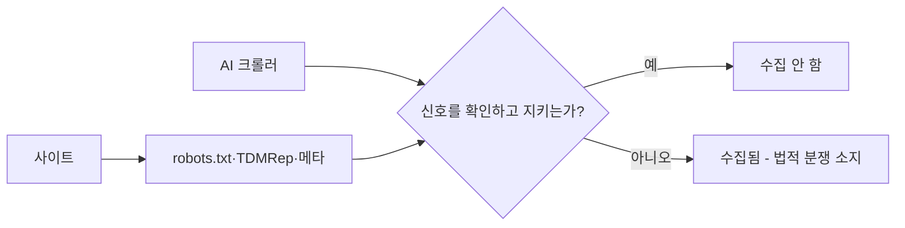
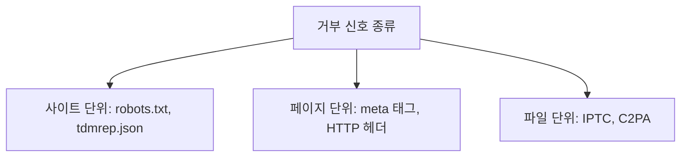

# 학습 거부(opt-out)

> 저작권자·사이트 운영자가 "내 콘텐츠를 AI 학습에 쓰지 말라"는 의사를 기계가 읽을 수 있는 형태로 표시하는 것. EU 저작권 지침(DSM) 제4조는 상업적 텍스트·데이터 마이닝을 허용하되 권리자가 적절한 방식으로 유보할 수 있게 한다.

## 쉽게 말하면
가게 문 앞의 "전단지 사절" 스티커와 같다. 스티커를 붙여도 법적으로 막을 수 있는 곳(EU)이 있고, 예의 바른 배포자만 지키는 곳도 있다. 스티커가 안 보이는 곳(로봇이 읽지 못하는 형태)에서는 효력이 약하다.

## 자세히
- **robots.txt**: `User-agent: GPTBot` + `Disallow: /`처럼 크롤러별로 거부. 가장 흔한 방식. IPTC 조사(504개 매체)에서 49.6%가 AI·스크래퍼 UA를 하나 이상 차단, CCBot 41.3%·GPTBot 38.1% 순.
- **Google-Extended**: 검색 노출에는 영향 없이 Gemini 학습만 거부하는 토큰(보조 출처 설명).
- **TDMRep**: `/.well-known/tdmrep.json` 또는 `<meta name="tdm-reservation" content="1">`로 마이닝 유보 선언(각 1.8%).
- **그 밖**: Content-Signal·RSL(robots.txt 안), ai.txt, 이미지의 IPTC PLUS DataMining·C2PA 학습 표시, 비표준 `noai`/`noimageai`.
- **한계**: 신호끼리 겹침이 적고(GPTBot 차단 사이트 중 tdmrep.json 보유는 4%), UA는 자기 신고라 지키는 크롤러에만 효력이 있다. 이미 학습된 데이터를 되돌리지도 못한다.
- **법적 지위**: EU(독일 § 44b 등)에서는 유보가 효력 있고, 한국은 TDM 전용 조항이 없어 공정이용 판단에서 robots.txt 우회가 불리 요소가 된다([한국 공정이용 가이드](#fair-use-korea)). 미국은 별도 opt-out 제도가 없다(보조 출처, 미검증). 독일 법원이 "기계가 읽을 수 있는 형태여야 유효"라고 봤다는 보도도 있다(미검증).

## 그림으로 보기



## 예시
robots.txt 예:
```
User-agent: GPTBot
Disallow: /
User-agent: Google-Extended
Disallow: /
User-agent: CCBot
Disallow: /
```
이미지 작가는 파일 메타데이터에 IPTC DataMining 값을 넣고, 포트폴리오 사이트엔 tdm-reservation 메타를 추가한다.

## 헷갈리는 것과 비교
| 개념 | 차이 |
| --- | --- |
| opt-out | 학습 쓰지 말라는 의사 표시(권리자 몫) |
| 검색 차단(noindex) | 검색 노출 제어. 학습과 별개 |
| 워터마크·글레이즈 | 파일 자체를 변형해 학습을 방해하는 기술적 방어 |
| [AI 이미지 저작권](#ai-image-copyright) | 산출물의 저작권 — opt-out은 학습 입력 쪽 |

## 더 읽을거리
- [IPTC: AI preferences and opt-out signals](https://metawatch.iptc.org/ai-policy/) — 신호별 채택률 조사
- [법률신문: 공정이용 안내서 요약](https://www.lawtimes.co.kr/news/articleViewAmp.html?idxno=217415) — 한국에서 robots.txt 우회의 의미
