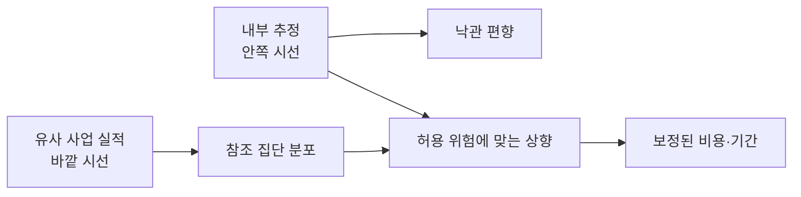
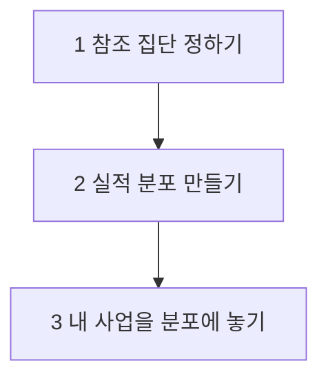

# 낙관 편향 조정

> 낙관 편향 조정은 사람들이 비용·기간을 실제보다 낮게, 효과를 높게 잡는 경향을 알고, 비슷한 과거 사업들의 실적 분포를 근거로 추정치를 체계적으로 올려 잡는 방법이다. 가장 대표적인 방법이 참조 집단 예측(reference class forecasting)이다.

## 쉽게 말하면
이사 준비에 "이틀이면 끝"이라고 생각하지만 지난 번 이사들은 모두 닷새쯤 걸렸다. 내 상황이 특별하다고 느끼는 "안쪽 시선" 대신 비슷한 이사들의 실제 기록이라는 "바깥 시선"으로 일정을 잡는 것이 낙관 편향 조정이다.

## 자세히
- **문제 인식(Green Book 보충 지침, 2013-04-21 게시, 열람)**: "사업 평가자는 지나치게 낙관하는 경향이 있다"고 하며 비용·편익·기간 추정을 과거나 유사한 사업의 자료로 조정하고 사업 특성에 맞게 다듬으라고 한다. 범주별 상향(uplift) 비율은 PDF에만 있어 이번에 확인하지 못했다.
- **참조 집단 예측의 3단계(Flyvbjerg, arXiv 1302.3642, PDF 본문 열람)**: ① 과거의 비슷한 사업으로 이루어진 참조 집단 정하기(통계적으로 충분히 넓고 비교 가능할 만큼 좁게) ② 그 집단의 실적(예: 비용 초과) 확률분포 만들기 ③ 내 사업을 그 분포에 놓고 가장 가능성 높은 결과 정하기. 개별 사건을 예측하는 대신 사업을 분포에 놓는 방식이며, 예측자의 최선의 추정을 집단 평균 쪽으로 당기고 신뢰구간은 집단의 구간 쪽으로 넓히는 것이라고 설명한다. 이론 기반은 불확실성 하 의사결정(Kahneman·Tversky)과 계획 오류(planning fallacy)다.
- **수치 예(같은 논문, 영국 교통부 자료)**: 도로 사업 172건의 분포에서 40%의 사업은 최대 비용 초과가 10%, 80%는 32%였다. 감수할 초과 위험이 50%면 필요한 상향은 도로 15%, 철도 40%이고, 위험을 10%만 감수하면 도로 45%, 철도 68%다. 위험을 낮출수록 상향이 커지고 그 비용은 철도·도로에서 20% 아래로 갈수록 급격히 늘어난다. 이 수치는 교통 인프라의 실측이며 AI 프로젝트에는 그대로 쓸 수 없다.
- **가상 계산(직접, 방법 설명용)**: AI 도입 예산이 5,000만 원이고 비슷한 사업들에서 위험 10% 수준의 상향이 45%라고 가정하면 5,000만 × 1.45 = 7,250만 원으로 잡는다. 이 45%는 교통 사례의 숫자를 빌린 설명용 값이다. 자기 조직의 과거 IT·AI 사업 실적이 있다면 그것으로 분포를 만든다.
- **계획 오류 일화(같은 논문)**: Kahneman이 이스라엘 고교 교육과정 개발 사업 팀의 개인 추정 18~30개월과, 비슷한 팀의 실제 기록(약 40%는 포기)을 비교한 사례를 소개한다(본문 전체는 일부만 읽음).
- **한계(해석)**: 비슷한 사업의 실적 자료가 없으면 분포를 만들 수 없다. 참조 집단이 너무 다르면 오히려 왜곡된다. 전략적 허위 표현(의도적 축소)은 편향과 구분되며 논문은 두 가지를 모두 우회한다고 주장한다.
- **[중단 기준 정하기](#stop-criteria)와 연결**: 낙관을 보정한 비용·편익으로 스위칭 값을 구하면 중단선이 더 현실적이다.

## 그림으로 보기

## 예시
- 사내 AI 도입 예산안: 과거 3년간 IT 사업 20건의 비용 초과 분포를 만들어 "초과 위험 20%까지 감수"할 때의 상향을 예산에 반영한다.
- 교육 활용: "내 프로젝트는 다르다"고 느끼는 순간을 찾아 바깥 시선 질문("비슷한 사업은 실제로 얼마나 걸렸나?")으로 바꿔 보는 연습.

## 헷갈리는 것과 비교
| 개념 | 차이 |
| --- | --- |
| 낙관 편향 | 인지 경향. 조정은 그것을 보정하는 절차 |
| 참조 집단 예측 | 낙관 편향 조정의 대표 방법 |
| 안전 마진(버퍼) | 임의로 얹는 여유. 참조 집단 방식은 실적 분포로 근거를 둠 |
| [중단 기준 정하기](#stop-criteria) | 보정된 수치로 정하는 약속 |

## 더 읽을거리
- [Flyvbjerg: From Nobel Prize to Project Management: Getting Risks Right](https://arxiv.org/abs/1302.3642) — 참조 집단 예측 3단계와 교통 사례
- [HM Treasury: Green Book supplementary guidance — optimism bias](https://www.gov.uk/government/publications/green-book-supplementary-guidance-optimism-bias) — 상향 적용 원칙
