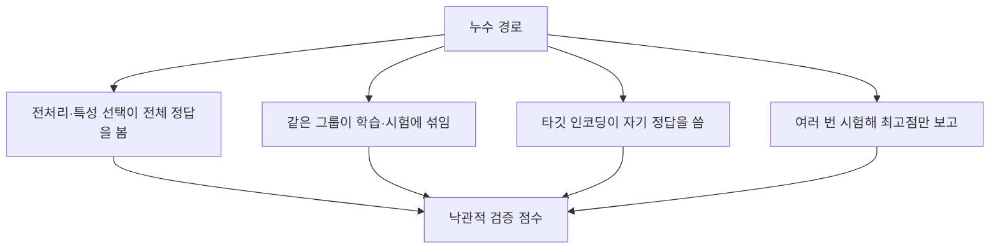

# 낙관적 검증 점수

> 낙관적 검증 점수는 누수 때문에 검증(또는 교차검증) 점수가 실제 운영 성능보다 높게 나오는 현상이다. 학습 점수와 검증 점수의 격차가 아니라 검증 점수가 "지나치게 좋은" 쪽의 문제라서 눈에 잘 띄지 않는다.

## 쉽게 말하면
시험 문제를 미리 본 학생의 모의고사 점수는 높게 나오지만 실제 수능에서는 떨어진다. 점수가 높다고 기뻐하기 전에 문제를 미리 본 경로가 없는지 의심해야 한다.

## 자세히
- **원인과 크기(앞선 노드들의 실험과 문서를 모음)**
  - 전처리를 분할 전에: scikit-learn 문서(Common pitfalls, 열람)의 예에서 표본 200개·무작위 특성 1만 개·무작위 정답인데 특성 선택을 분할 전에 하면 정확도 0.76, 분할 후면 0.5 수준이다([전처리 누수](#preprocessing-leakage-pipeline), [스케일러 누수](#scaler-leakage), [결측 대치 누수](#imputation-leakage)).
  - 타깃 인코딩: 정답이 무작위인 데이터에서 같은 데이터로 범주 평균을 구한 인코딩의 정답 상관이 0.69, 교차 적합은 −0.05(직접 시뮬레이션, [타깃 인코딩 누수](#target-encoding-leakage)).
  - 그룹 누수: 신호가 없는 합성 데이터에서 표본 단위 무작위 분할은 정확도 0.813, 그룹 단위 분할은 0.496(직접 시뮬레이션, [그룹 누수 방지](#group-leakage-prevention)).
  - 반복 시험 후 최고점만 보고: 노이즈가 5점일 때 변형 10개 중 최고점은 평균 +7.7점 부풀려진다(직접 시뮬레이션, [선택적 점수 공개](#selective-score-disclosure)).
- **의심 신호(해석)**: ① 문제 난이도에 비해 점수가 지나치게 높다 ② 운영·새 데이터에서 점수가 크게 떨어진다 ③ 무작위 정답으로도 점수가 우연보다 높다([무작위 라벨 점검](#random-label-sanity-check)) ④ 특성 중요도 1위가 정답과 의미상 가까운 열(정답의 사후 정보) ⑤ 분할 방식을 바꾸면 점수가 갑자기 떨어진다.
- **예방(해석)**: 분할을 가장 먼저 하고 전처리는 `Pipeline`으로 묶어 학습 데이터로만 학습한다. 분할 단위는 운영에서 모델이 겪을 단위(새 환자·미래)와 같게 한다([교차검증 분할기 고르기](#cv-splitter-selection)). 최종 점수는 한 번만 보류 데이터에서 낸다([보류 평가 세트](#held-out-eval-set)).
- **보고(해석)**: 분할 방식·전처리 순서·시험 횟수·시드를 함께 적는다.

## 그림으로 보기

## 예시
- 신제품 수요 예측 모델이 검증 R²는 0.95인데 출시 후 0.4라면 같은 상품의 여러 달 기록이 학습과 검증에 섞였는지(그룹 누수)와 미래 정보가 특성에 들어갔는지 먼저 확인한다.
- 교육 활용: 점수가 너무 좋을 때 "누수 체크리스트" 5개 항목을 훑어보는 습관을 가르친다.

## 헷갈리는 것과 비교
| 개념 | 차이 |
| --- | --- |
| [층화와 누수](#stratification-vs-leakage) | 상위 주제 |
| 과적합 | 학습 점수만 높고 검증 점수는 낮음. 낙관적 검증 점수는 검증도 높음 |
| 데이터 누수 | 원인. 낙관적 검증 점수는 그 결과 |
| [무작위 라벨 점검](#random-label-sanity-check) | 누수 탐지법 |

## 더 읽을거리
- [scikit-learn: Common pitfalls — Data leakage](https://scikit-learn.org/stable/common_pitfalls.html) — 누수 원인과 Pipeline
