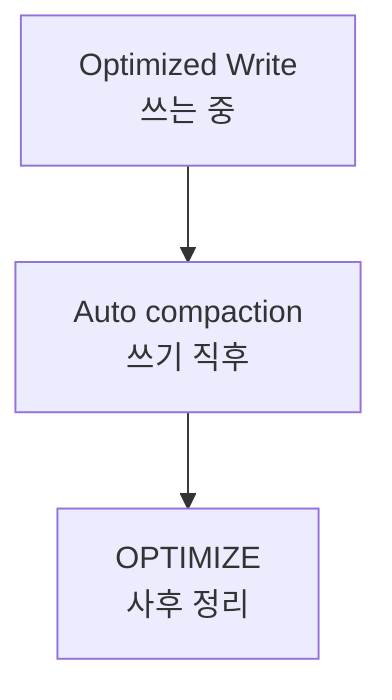

# Optimized Write

> Delta Lake에서 **쓰는 시점에** 데이터를 섞고 모아 작은 파일이 덜 만들어지게 하는 기능이다. 작은 파일을 사후에 합치는 압축과 달리 처음부터 적게 만드는 쪽이다.

## 쉽게 말하면
택배 상자를 보낼 때 물건 하나마다 상자를 따로 쓰는 대신, 보내기 직전에 물건을 모아 적당한 크기의 상자 몇 개에 나눠 담는 것이다. 상자(파일)가 덜 늘어난다. 대신 모으는 작업(셔플)이 쓰기 중에 추가된다.

## 자세히
(Delta Lake 공식 문서 "Optimizations"를 직접 읽었다. Delta Lake 3.1.0 이상 기준이다. 아래 기본값은 그 문서의 표기이며 다른 배포판(예: Databricks 런타임)은 다를 수 있다.)
- **기본 상태(문서)**: **기본적으로 꺼져 있다.**
- **켜는 법과 우선순위(문서)**: 테이블 속성 `delta.autoOptimize.optimizeWrite`, SQL 설정 `spark.databricks.delta.optimizeWrite.enabled`, DataFrameWriter 옵션 `optimizeWrite`. 우선순위는 **앞에서 뒤로 갈수록 높다**(옵션이 가장 높음).
- **설정값(문서)**
  - `spark.databricks.delta.optimizeWrite.binSize`: 출력 파일당 메모리상 목표 크기, 기본 **512MiB**.
  - `spark.databricks.delta.optimizeWrite.numShuffleBlocks`: 목표로 하는 최대 셔플 블록 수, 기본 **50,000,000**.
  - `spark.databricks.delta.optimizeWrite.maxShufflePartitions`: 최대 출력 버킷(reducer) 수, 기본 **2,000**.
- **원리(해석)**: 쓰기 전에 데이터를 재분배(셔플)해 파티션당 적절한 크기의 파일을 만들도록 한다. 문서는 내부 알고리즘을 자세히 설명하지 않아 이 설명은 일반적 이해다.
- **압축과의 비교(해석)**: 앞서 읽은 Athena 문서는 작은 파일을 "쓰기 전에" 합치는 것이 가장 좋다고 한다. Optimized Write는 그 접근에 가깝고, [Auto compaction](#auto-compaction)은 쓰기 후 합치고, [OPTIMIZE](#delta-optimize-compaction)는 쌓인 뒤 합친다.
- **주의(일반 원칙)**: 셔플 비용 때문에 쓰기 시간이 늘 수 있고, 이미 큰 배치로 쓰는 작업에는 이득이 작을 수 있다. 실제 효과는 작업마다 측정해야 하며 이 글의 출처에는 성능 수치가 없다.

## 그림으로 보기



## 예시
```sql
ALTER TABLE events SET TBLPROPERTIES ('delta.autoOptimize.optimizeWrite' = 'true');
```
- 교육 소재: 소량씩 자주 쓰는 작업에서 파일이 몇 개 생기는지 세어 보기.

## 헷갈리는 것과 비교
| 개념 | 차이 |
|---|---|
| Optimized Write | 쓰는 중에 작은 파일을 덜 만듦(기본 꺼짐) |
| [Auto compaction](#auto-compaction) | 쓰기 후 이미 생긴 작은 파일을 합침 |
| [OPTIMIZE](#delta-optimize-compaction) | 수동·예약으로 사후 압축 |
| [목표 파일 크기](#target-file-size) | 각 기능이 겨냥하는 파일 크기 |

## 더 읽을거리
- [Optimizations (Delta Lake docs)](https://docs.delta.io/latest/optimizations-oss.html) — Optimized Write 설정과 기본값(직접 읽음).
