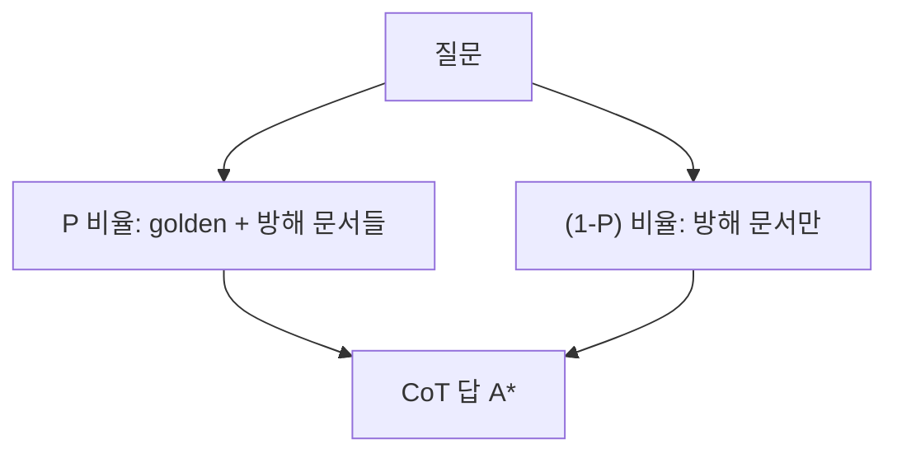

# 정답 문서(oracle document)

> RAFT 학습 데이터에서 **질문의 답을 이끌어 낼 수 있는 문서**("golden" 문서)다. 답과 무관한 방해 문서와 구분해 쓴다.

## 쉽게 말하면
시험장에 가져간 참고서들 중 *정말 답이 적힌 그 책*이 oracle 문서다. 나머지 책은 엉뚱한 내용이다. 연습할 때 "정답이 든 책이 섞여 있을 때도, 안 섞여 있을 때도" 풀어 보게 한다.

## 자세히
(Zhang 외 "RAFT: Adapting Language Model to Domain Specific RAG"(arXiv 2403.10131) PDF를 직접 읽었다. 저자 실험이며 Llama2-7B 중심이다.)
- **정의(논문)**: 'golden' 문서 D* = 질문의 답을 도출할 수 있는 문서. 'distractor' 문서 Di = 답과 무관한 문서. golden 문서는 **한 개일 필요가 없다**(HotpotQA는 여러 개).
- **학습 데이터 구성(논문)**: 질문 Q, 문서 집합, 한 문서에서 생성한 **CoT 스타일 답 A\***. **P 비율**의 질문에는 golden 문서 + 방해 문서를, **(1−P) 비율**에는 golden 없이 방해 문서만 준다.
  - P% 데이터: Q + D* + D1 + … + Dk → A*
  - (1−P)% 데이터: Q + D1 + … + Dk → A*
- **왜 일부는 golden을 뺄까(논문)**: golden이 없을 때는 모델이 컨텍스트로 유도하는 대신 **답을 기억하도록** 하는 효과. 논문은 P=100%가 최선이라는 직관과 달리 **P=80%** 같이 일부를 빼는 것이 RAG 성능을 높이는 사례를 보였다. 최적 P는 데이터셋마다 **40%, 60%, 100%**로 달랐다.
- **실험 설정(논문)**: 학습에서 golden 1개 + 방해 4개, 테스트도 같은 형식. 별도 실험에서 테스트는 retriever top-3 문서.
- **retriever 독립(논문)**: RAFT는 쓰는 retriever와 무관하다.

## 그림으로 보기

## 예시
- 사내 규정 Q&A 학습 데이터 만들기: 질문마다 정답 조항(golden)을 정하고 관련 없는 조항 4개를 방해 문서로 붙인다. 20% 정도는 golden을 빼 본다(제안, 논문의 P=80% 사례 참고).

## 헷갈리는 것과 비교
| 개념 | 차이 |
|---|---|
| oracle(golden) 문서 | 답이 들어 있는 문서 |
| 방해(distractor) 문서 | 답과 무관한 문서 |
| [인용구 포함 CoT](#verbatim-quote-cot) | golden 문서에서 구절을 인용하는 답 형식 |

## 더 읽을거리
- [RAFT 논문](https://arxiv.org/abs/2403.10131) — 직접 읽음.
