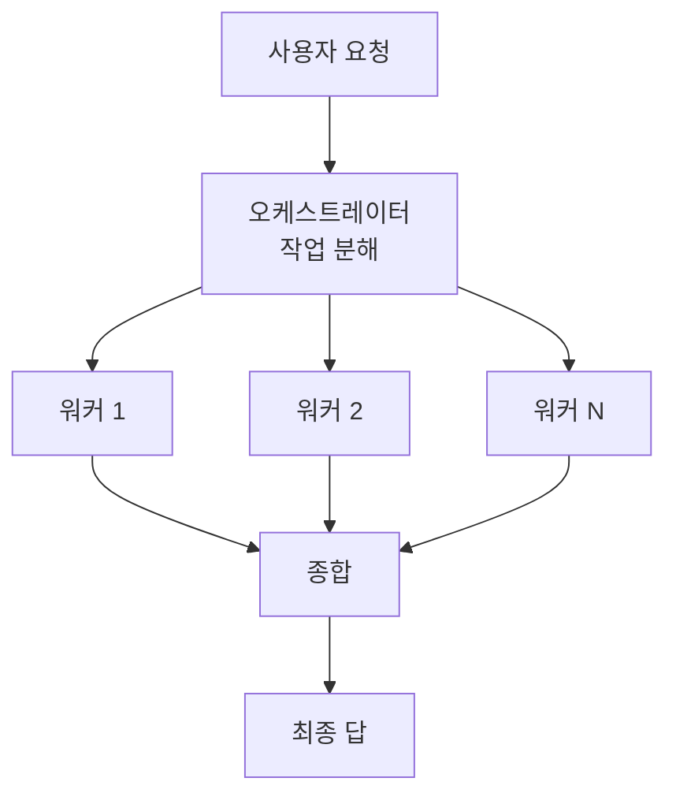

# 오케스트레이터-워커

> 중앙 LLM(오케스트레이터)이 작업을 그때그때 쪼개 워커 LLM들에게 맡기고, 결과를 모아 종합하는 워크플로 패턴.

## 쉽게 말하면
공사 현장 소장이다. 설계도(요청)를 보고 "배관은 A팀, 전기는 B팀"이라고 그날 나눠 맡기고, 끝나면 결과를 합쳐 건물을 완성한다. 무엇을 몇 팀에 나눌지는 도면을 본 뒤에야 정해진다.

## 자세히
Anthropic "Building effective agents" 기준:
- 정의: 중앙 LLM이 과제를 분해해 워커에게 위임하고 결과를 종합한다.
- 적합: 필요한 하위 작업을 **미리 예측할 수 없는** 복잡한 과제. 코딩에서 여러 파일을 고치는 변경, 여러 출처에서 정보를 모아 분석하는 검색.
- [병렬화](#routing-pattern)와의 핵심 차이: 병렬화는 하위 작업이 미리 정해져 있고, 여기서는 **오케스트레이터가 입력에 따라 정한다**.
- 워커는 각자 깨끗한 컨텍스트에서 일하므로 메인 컨텍스트가 덜 오염된다. 이 구조를 제품화한 것이 [서브에이전트](#subagents)다.
- 비용: 호출이 늘고 오케스트레이터가 병목·오류 원천이 된다. 워커 결과를 검증하는 단계가 필요하다([에이전트 검증 루프](#agent-verification)).

## 그림으로 보기

## 예시
- "이 라이브러리를 v2로 올려줘": 오케스트레이터가 영향받는 파일을 찾고 파일별 수정을 워커에게 맡긴 뒤 테스트로 합친다.
- 시장 조사: 경쟁사별 조사를 워커에게 나눠 맡기고 비교표로 종합.

## 헷갈리는 것과 비교
| 개념 | 차이 |
| --- | --- |
| 오케스트레이터-워커 | 하위 작업을 입력 보고 동적으로 결정 |
| 병렬화 | 하위 작업이 미리 정해짐 |
| [라우팅](#routing-pattern) | 한 갈래만 골라 보냄 |
| [프롬프트 체이닝](#prompt-chaining) | 고정된 순서의 단계 |

## 더 읽을거리
- [Building effective agents (Anthropic)](https://www.anthropic.com/engineering/building-effective-agents) — 패턴 정의와 적합 조건
