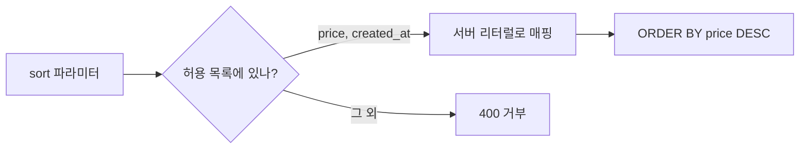

# ORDER BY 인젝션

> 정렬 기준(ORDER BY 뒤의 컬럼명·ASC/DESC)을 사용자 입력에서 그대로 가져와 SQL에 이어 붙일 때 생기는 SQL 인젝션이다. 컬럼명·키워드는 파라미터 바인딩이 안 되어 일반 방어(prepared statement)가 통하지 않으므로 허용 목록으로 막는다.

## 쉽게 말하면
식당 키오스크에서 "정렬: 가격순/인기순" 버튼을 누르면 주방에 주문서가 간다. 버튼 대신 손님이 직접 글을 써서 주방에 넘기게 하면, 정렬 방법 대신 "그리고 금고도 열어"라고 적을 수 있다. 버튼(허용 목록)만 쓰게 하는 것이 해법이다.

## 자세히
- 왜 일반 방어가 안 되나: OWASP 문서에 따르면 파라미터 마커는 **데이터 값**을 대신할 뿐 "테이블명·컬럼명·`ASC`/`DESC` 같은 SQL 키워드"는 대신할 수 없다. 이스케이프도 식별자엔 믿을 만하지 않다.
- 취약 코드: `"SELECT * FROM items ORDER BY " + req.query.sort` → `sort=price; DROP ...`나 `(CASE WHEN ... )` 같은 식으로 조건 추출(블라인드 인젝션)이 가능하다. 일부 DB는 `;` 다중 문장을 막아도 서브쿼리·CASE로 정보가 샌다.
- 방어(OWASP):
  1. 구조적 선택은 코드에 고정한다("Keep these structural choices fixed in code where possible").
  2. 사용자가 고른 값을 **서버가 가진 목록의 리터럴로 매핑**한다. 정렬 방향도 "요청 문자열을 붙이지 말고 리터럴 `ASC`/`DESC`로 매핑"한다.
  3. 목록에 없으면 거부한다(예: `unexpected ... name` 예외).
- 값 부분(WHERE의 값)은 여전히 파라미터화 쿼리를 쓴다. 검증은 보조 방어이지 대체재가 아니다.
- ORM 사용 시에도 `order_by(raw_string)` 같은 원시 문자열 API는 같은 위험이 있다([ORM 인젝션](#orm-injection)).
- AI 코드 생성 팁(주장): AI가 만든 정렬 API가 문자열 결합을 쓰지 않는지 코드 리뷰 때 확인한다.

## 그림으로 보기


## 예시
```python
SORTS = {"price": "price", "new": "created_at"}
DIRS = {"asc": "ASC", "desc": "DESC"}
col = SORTS.get(sort);  d = DIRS.get(direction)
if not col or not d: abort(400)
sql = f"SELECT * FROM items WHERE shop_id = %s ORDER BY {col} {d}"   # 값은 파라미터, 구조는 리터럴
```

## 헷갈리는 것과 비교
| 개념 | 차이 |
| --- | --- |
| 값 인젝션(WHERE) | 파라미터 바인딩으로 방어 |
| ORDER BY 인젝션 | 구조 위치라 허용 목록 매핑으로 방어 |
| [허용 목록 검증](#allowlist-validation) | 이 방어의 핵심 |
| [SQL 인젝션](#sql-injection) | 상위 개념 |

## 더 읽을거리
- [SQL Injection Prevention Cheat Sheet (OWASP)](https://cheatsheetseries.owasp.org/cheatsheets/SQL_Injection_Prevention_Cheat_Sheet.html) — 파라미터 마커 한계와 구조적 선택 매핑
