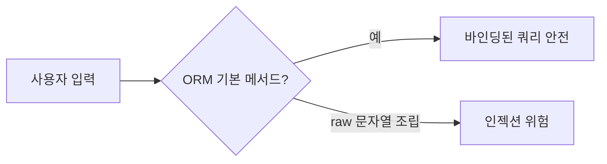
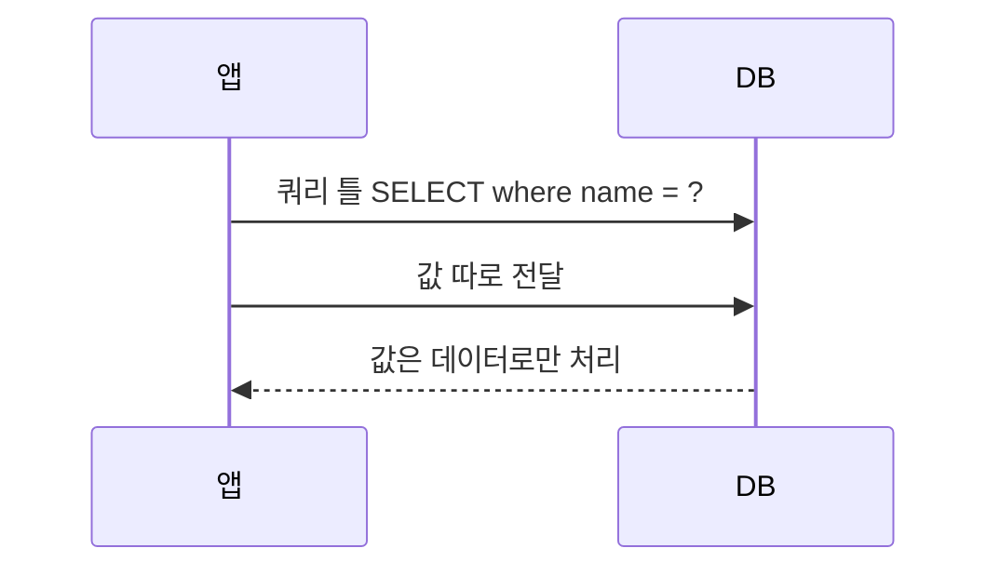

# ORM과 인젝션

> ORM(객체-관계 매핑)은 SQL 인젝션을 대부분 막아 주지만, raw 쿼리나 문자열 이어 붙이기를 쓰면 똑같이 뚫린다.

## 쉽게 말하면
ORM은 안전 가이드가 달린 자동 조리기다. 레시피대로 쓰면 안전하지만, 뚜껑을 열고 재료를 손으로 섞으면(문자열 직접 조립) 사고가 난다.

## 자세히
- 원리: 안전한 쿼리는 SQL 구조와 값을 분리해 보낸다. 바인드 변수는 입력이 "코드가 아니라 데이터"임을 DB에 알려 준다(OWASP).
- ORM의 기본 메서드(`filter(name=x)` 등)는 보통 이 방식으로 값을 바인딩한다.
- 위험 지점: ① raw/native 쿼리에 f-string·문자열 연결, ② 정렬 컬럼·테이블명처럼 바인딩 불가능한 부분을 사용자 입력으로 조립, ③ 일부 ORM의 `where("name = '#{x}'")` 식 interpolation.
- OWASP는 파라미터화가 서버 측에서 이뤄져야 하며, 클라이언트 라이브러리가 문자열을 이어 붙여 보내면 소용없다고 설명한다. 그리고 파라미터화와 별개로 입력 검증도 하라고 권한다.
- AI 코딩과의 연결: 바이브코딩으로 생성된 코드에 raw 쿼리 연결이 섞이지 않는지 리뷰한다([SQL 인젝션](#sql-injection)).

## 그림으로 보기

## 예시
- 위험: `db.execute(f"SELECT * FROM users WHERE name='{name}'")`
- 안전: `db.execute("SELECT * FROM users WHERE name = ?", (name,))`
- 정렬 컬럼은 허용 목록(allow-list)에 있는 값만 쓴다.

## 헷갈리는 것과 비교
| 개념 | 차이 |
|---|---|
| [SQL 인젝션](#sql-injection) | 쿼리 구조가 입력으로 바뀜 |
| ORM 인젝션 | ORM 쓰는데도 raw 부분에서 발생 |
| 프롬프트 인젝션 | LLM 지시가 입력으로 바뀜(비슷한 구조) |

## 더 읽을거리
- [OWASP Query Parameterization Cheat Sheet](https://cheatsheetseries.owasp.org/cheatsheets/Query_Parameterization_Cheat_Sheet.html) — 바인드 변수와 주의점.
