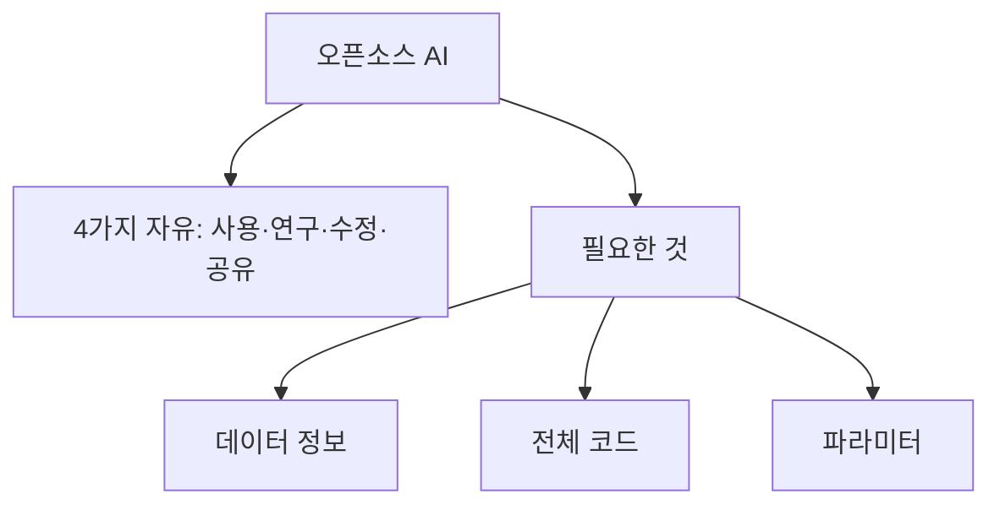
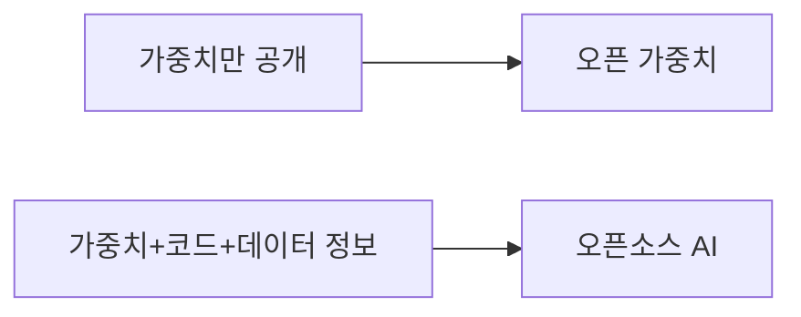

# OSI 오픈소스 AI 정의

> 오픈소스 이니셔티브(OSI)가 정한 **"오픈소스 AI" 기준(OSAID 1.0)**. 4가지 자유를 보장하고, 그 자유를 쓰려면 필요한 **데이터 정보·코드·파라미터**를 제공하라고 요구한다.

## 쉽게 말하면
완성된 요리를 먹게 해 주는 것(가중치 공개)과 레시피·재료 목록·조리 도구까지 모두 공개해 똑같이 만들 수 있게 해 주는 것(오픈소스 AI)의 차이다.

## 자세히
(OSI 공식 페이지 열람 2026-11-28. 페이지에 공개일은 적혀 있지 않았고 검색 결과는 v1.0을 2024-10로 인용한다.)
- **4가지 자유**: 어떤 목적으로든 **사용**, **연구**(구성요소 점검), **수정**(출력 변경 포함), **공유**(수정 여부와 무관하게 누구에게나). 시스템 전체와 개별 부분 모두에 적용된다.
- 자유를 행사하려면 **수정에 적합한 형태**에 접근해야 한다:
  - **데이터 정보**: 숙련자가 거의 동등한 시스템을 만들 수 있을 만큼 학습 데이터에 대한 상세 정보(데이터 자체의 공개를 의무로 하지는 않는다는 점이 논쟁거리, 해석).
  - **코드**: 데이터 처리·필터링, 학습, 검증, 추론, 모델 구조를 포함한 전체 소스.
  - **파라미터**: 가중치 등 설정값(중간 체크포인트·옵티마이저 상태 포함 가능).
- 의미: 이 기준에서는 가중치만 내려받을 수 있는 모델 다수가 오픈소스 AI가 아니다. 검색 결과에 따르면 OSI 대표는 기준이 높아 통과 모델이 매우 적다고 인정했고, OSI는 Meta의 Llama 라이선스가 오픈소스가 아니라고 밝혔다.
- 한계: 이 기준 자체도 데이터 요건 등에서 의견이 갈린다는 보도가 있으나, 이 글에서는 원 논쟁 문서를 읽지 않았다.

## 그림으로 보기

## 예시
- 어떤 모델이 가중치와 추론 코드만 공개하고 학습 데이터 정보가 없다면 OSAID 기준 미충족 가능성.
- 교육: "오픈"이라는 마케팅 단어를 점검표(4자유·3요소)로 검증하는 실습.

## 헷갈리는 것과 비교
| 개념 | 차이 |
|---|---|
| 오픈소스 AI(OSAID) | 4자유+데이터 정보·코드·파라미터 |
| [오픈 가중치](#open-weights) | 가중치 공개, 나머지는 선택 |
| [모델 라이선스](#model-license) | 개별 모델의 사용 조건 |

## 더 읽을거리
- [Open Source AI Definition (OSI)](https://opensource.org/ai/open-source-ai-definition) — 정의 원문(읽음).
- [OSI Calls Out Meta](https://itsfoss.com/news/osi-meta-ai/) — Llama 논쟁(검색 결과 확인).
