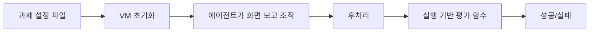
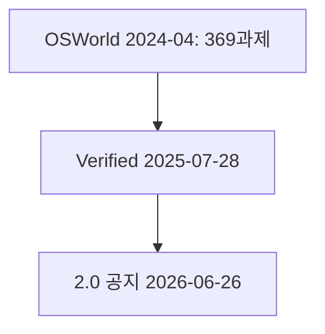

# OSWorld

> **OSWorld**는 멀티모달 에이전트가 실제 컴퓨터(Ubuntu·Windows·macOS)에서 과제를 수행하는지 **실행 기반으로 채점**하는 벤치마크다(arXiv 2404.07972). GUI 에이전트의 현재 실력을 가늠하는 잣대로 쓰인다.

## 쉽게 말하면
AI에게 가상 컴퓨터 한 대를 주고 "이 엑셀을 정리해서 이메일에 첨부해"라고 시킨 뒤, 파일이 실제로 맞게 만들어졌는지 검사하는 실기 시험이다. 필기시험(문답)이 아니라 실제 작업 결과로 채점한다.

## 자세히
(논문 초록과 프로젝트 페이지 확인)
- **구성**: **369개 과제**(웹·데스크톱 앱, OS 파일 입출력, 여러 앱에 걸친 작업). 구글 드라이브 과제 8개는 수동 설정이 필요하거나 제외할 수 있어 361개로 비교하기도 하며, 추가로 Windows 과제 43개가 저작권 때문에 활성화 후에만 쓸 수 있다.
- **채점**: 과제마다 초기화, 에이전트 상호작용, 후처리, 정보 수집, **실행 기반 평가 함수**를 담은 설정 파일이 있다. 한 호스트에서 환경을 병렬 실행하고 헤드리스도 지원한다.
- **원논문 결과(2024-04)**: 사람 **72.36% 이상**, 당시 최고 모델 **12.24%**. 약점은 GUI 접지·조작 지식 부족.
- **이후**: 2025-07-28 **OSWorld-Verified**로 업그레이드(오류 예시 수정, AWS 지원, 결과 갱신), 2026-06-26 공지에 따르면 **OSWorld 2.0**이 나왔다. 최신 상위 점수는 페이지에 로딩되지 않아 확인하지 못했다.
- **검증 리더보드**: 결과는 관리자가 직접 실행해야 하며, 에이전트 구현과 보고서를 제출한다(모델 API는 비공개 가능).

## 그림으로 보기

## 예시
- 에이전트를 새로 만들면 `run.py`에 연결해 한 환경에서 시험하고, 병렬 스크립트로 전체를 돌린다.
- 교육 활용: "AI 컴퓨터 사용 능력은 이렇게 측정한다"는 사례로 설명.

## 헷갈리는 것과 비교
| 개념 | 차이 |
|---|---|
| OSWorld | 실제 컴퓨터 환경 실행 기반 평가 |
| 웹 에이전트 벤치마크 | 브라우저 중심(일반 지식) |
| 필기형 벤치마크 | 정답 문장 비교 |
| [GUI 에이전트](#gui-agent) | 이 벤치마크가 측정하는 대상 |

## 더 읽을거리
- [OSWorld 논문](https://arxiv.org/abs/2404.07972)
- [OSWorld 프로젝트 페이지](http://osworld-v1.xlang.ai/)
