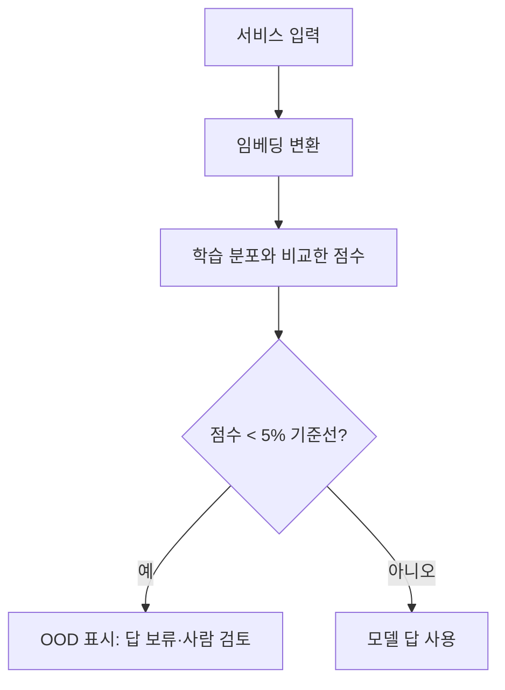

# OOD 탐지

> OOD(Out-of-Distribution) 탐지는 서비스에 들어온 입력이 모델이 학습한 데이터 분포 밖인지 알아내는 일이다. 학습 때 본 적 없는 종류의 입력에 모델이 자신 있게 틀린 답을 내는 것을 막으려는 안전장치다.

## 쉽게 말하면
고양이·개 사진만 배운 분류기에 자동차 사진이 들어오면 "고양이 62%" 같은 답을 낸다. 모델은 모른다는 말을 못 하기 때문이다. OOD 탐지는 문 앞에서 "이건 우리가 배운 종류가 아니다"라고 표시를 달아 주는 경비원이다.

## 자세히
- **cleanlab 방식(문서)**: 학습 데이터로 `fit_score(features=...)`를 하면 학습 샘플의 점수를 얻고, 이미 학습된 추정기로 `score(features=...)`를 하면 새 입력을 학습 분포에 비춰 채점한다. 점수는 0~1이며 낮을수록 비정형(OOD일 가능성 높음)이다. 특징 임베딩 대신 분류기의 `pred_probs`도 쓸 수 있는데 이때는 `labels`도 필요하다.
- **임계값 정하기(문서)**: 학습 데이터가 대부분 분포 안에 있다고 가정하고 학습 점수의 5번째 백분위수를 기준선으로 삼아, 그 아래 점수를 가진 새 입력을 OOD로 표시한다. 대략 5% 오탐을 겨냥하는 설정이다. 기준선 근처는 진짜 OOD와 드문 정상이 섞여 있다고 문서가 밝힌다.
- **한계(문서·해석)**: `pred_probs` 방식은 분류기 정확도와 확률의 신뢰도에 의존한다. 5%는 정해진 정답이 아니라 서비스의 오탐·미탐 비용에 맞춰 바꿀 값이다(해석).
- **운영(해석)**: ① 임베딩 모델을 고정해 학습·서비스에서 같은 방식으로 벡터화 ② OOD로 표시된 입력은 모델 답을 보류하고 사람에게 넘기거나 거절 ③ 표시된 입력을 모아 정기적으로 검토하면 새 클래스·데이터 변화(드리프트)를 발견해 재학습 후보가 된다. 점수의 기본 계산은 [kNN 이상치 점수](#knn-outlier-score)다.

## 그림으로 보기

## 예시
- 사내 문의 분류기: 학습에 없던 신제품 문의가 들어오면 OOD로 표시해 담당자에게 넘기고, 쌓이면 새 분류를 추가한다.
- 코드 예(문서 사용법): `ood = OutOfDistribution(); ood.fit_score(features=X_train); ood.score(features=X_new)`
- 교육 활용: 학습에 없는 유형의 입력을 모델에 넣어 "자신 있게 틀리는" 사례를 먼저 보여 준 뒤 탐지를 소개한다.

## 헷갈리는 것과 비교
| 개념 | 차이 |
| --- | --- |
| OOD 탐지 | 입력이 학습 분포 밖인지 |
| 라벨 오류 탐지 | 학습 라벨이 틀렸는지 |
| [kNN 이상치 점수](#knn-outlier-score) | OOD 점수를 만드는 계산 방법 |
| [코사인 vs 유클리드](#cosine-vs-euclidean-distance) | 이웃 거리 지표 선택 |

## 더 읽을거리
- [cleanlab OOD 튜토리얼](https://docs.cleanlab.ai/stable/tutorials/outliers.html) — fit_score·score·5% 백분위 임계값
- [cleanlab outlier 문서](https://docs.cleanlab.ai/stable/cleanlab/outlier.html) — 점수 계산과 파라미터
