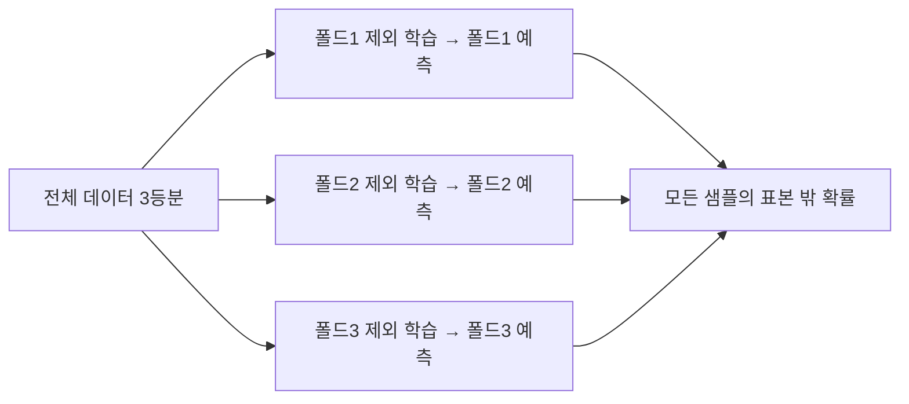
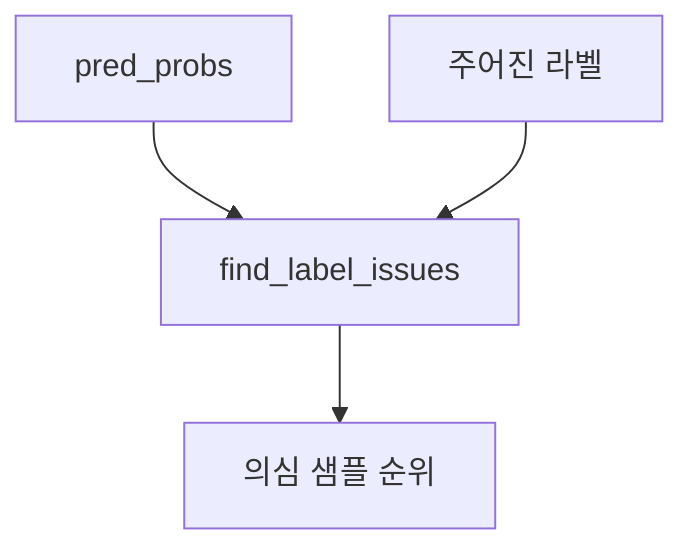

# 표본 밖 예측 확률

> 모델이 학습 때 본 적 없는 샘플에 대해 낸 클래스별 예측 확률이다. 보통 교차 검증으로 모든 샘플에 대해 "그 샘플을 빼고 학습한 모델"의 확률을 모아서 얻으며, [cleanlab](#cleanlab)의 라벨 오류 탐지에 반드시 필요한 입력이다.

## 쉽게 말하면
학생이 이미 풀어 본 문제를 다시 풀게 하면 정답을 외워서 맞힌다. 라벨이 틀린 문제도 "틀린 답"을 외워 맞힌다. 오류를 찾으려면 그 문제를 한 번도 못 본 학생(모델)이 푼 결과를 봐야 한다.

## 자세히
(cleanlab 공식 개요 튜토리얼을 직접 열어 확인.)
- cleanlab 워크플로의 일부 모듈은 입력으로 항상 **표본 밖 예측 확률**(예: 교차 검증)을 요구한다. 튜토리얼은 이유를 길게 설명하지 않는다. 이유는 제안: 학습에 쓰인 샘플은 틀린 라벨까지 외울 수 있어 오류 신호가 사라진다.
- **얻는 방법 1: scikit-learn**
```python
pred_probs = cross_val_predict(estimator=model, X=data, y=labels, cv=3, method="predict_proba")
```
- **방법 2: cleanlab**: `cleanlab.count.estimate_cv_predicted_probabilities(data, labels, clf=model, seed=SEED)`.
- 사용: `cleanlab.filter.find_label_issues(labels=labels, pred_probs=pred_probs, filter_by="both", return_indices_ranked_by="self_confidence")`. `filter_by`는 `prune_by_noise_rate`·`prune_by_class`·`both`·`confident_learning`·`predicted_neq_given`. 튜토리얼의 장난감 데이터에서는 `prune_by_noise_rate`의 F1이 0.807로 가장 높았고 `both`가 0.800이었다(장난감 데이터 결과일 뿐).
- 더 나은 모델일수록 입력이 좋아져 이슈 추정이 정확해진다. 시험 세트 예측도 표본 밖 예측이다.
- 폴드 수는 예제에서 cv=3. 일반적으로 클수록 학습량이 늘지만 비용도 커진다(제안).

## 그림으로 보기



## 예시
```python
from sklearn.model_selection import cross_val_predict
from sklearn.linear_model import LogisticRegression
pp = cross_val_predict(LogisticRegression(max_iter=1000), X, y, cv=5, method="predict_proba")
```
- 주의: 학습한 모델로 학습 데이터를 바로 `predict_proba`하면 안 된다.

## 헷갈리는 것과 비교
| 개념 | 차이 |
|---|---|
| 표본 밖 예측 | 그 샘플 없이 학습한 모델의 예측 |
| 표본 안 예측 | 학습에 쓴 샘플의 예측. 과신 |
| [k-겹 교차 검증](#k-fold-cross-validation) | 점수 추정이 주목적, 여기서는 예측값 수집이 목적 |
| [Confident Learning](#confident-learning) | 이 확률을 쓰는 방법론 |

## 더 읽을거리
- [cleanlab: In-depth overview 튜토리얼](https://docs.cleanlab.ai/stable/tutorials/indepth_overview.html) — pred_probs 얻는 법·find_label_issues(열어 확인).
