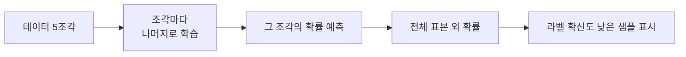
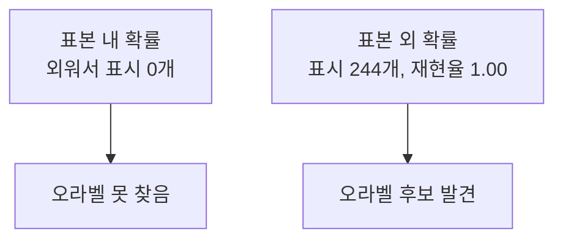

# 표본 외 예측 확률

> 표본 외 예측 확률은 각 샘플의 예측을 그 샘플을 학습에 쓰지 않은 모델로 구한 확률이다. 교차검증으로 만들며, 라벨 오류를 찾는 Confident Learning의 입력으로 쓴다. 학습에 쓴 샘플의 확률(표본 내)로는 오라벨을 못 찾는다.

## 쉽게 말하면
학생이 이미 풀어 본 문제를 다시 풀게 하면 정답을 외워서 틀린 답안지(오답)도 "맞다"고 우긴다. 그 문제를 한 번도 안 본 학생에게 풀게 해야 솔직한 판단이 나온다. 표본 외 확률은 "이 샘플을 안 본 모델의 의견"이다.

## 자세히
- **만드는 법**: `cross_val_predict(model, X, y, cv=5, method="predict_proba")`. 각 샘플의 확률이 그 샘플이 시험 조각에 있을 때의 모델에서 나온다.
- **직접 해 본 실험(숫자 손글씨 1,797개, 라벨의 약 10%(179개)를 무작위로 틀리게 바꿈, 랜덤 포레스트 200그루)**: 주어진(틀릴 수 있는) 라벨에 대한 모델의 확률(자기 확신도)이 0.3 미만이면 오라벨 의심으로 표시했다.

| 확률 종류 | 표시된 수 | 정밀도 | 재현율 | 오라벨 평균 확신도 | 깨끗한 샘플 평균 |
| --- | --- | --- | --- | --- | --- |
| 표본 내(전체 학습 후 같은 데이터에 예측) | 0 | 0.00 | 0.00 | 0.64 | 0.89 |
| 표본 외(5겹 교차검증) | 244 | 0.73 | 1.00 | 0.03 | 0.68 |

  표본 내 확률에서는 오라벨이 거의 모두 0.3 이상이라 하나도 못 찾았다. 랜덤 포레스트가 틀린 라벨까지 외웠기 때문이다. 표본 외에서는 오라벨 179개를 전부 표시했다(재현율 1.00). 정밀도 0.73은 표시된 244개 중 약 65개가 실제 오라벨이 아닌 어려운 샘플이라는 뜻이다. 임계값 0.3은 임의로 고른 값이다.
- **Confident Learning(논문 초록, 열람)**: 모델 예측이 아닌 데이터 라벨의 오류를 찾고 정량화하는 방법으로, 노이즈 데이터 가지치기·확률 임계값에 따른 개수 추정·순위 매기기 세 원리를 쓴다. 클래스 조건부 노이즈를 가정해 주어진 라벨과 진짜 라벨의 결합 분포를 추정한다. MNIST에서 라벨 오류를 찾았고, ImageNet에서 "missile"로 보이는 이미지 645개가 "projectile"로 잘못 라벨됐을 것으로 추정했다. 오픈소스 cleanlab으로 재현할 수 있다고 한다. 이 글에서는 cleanlab을 직접 실행하지 않았다.
- **주의(해석)**: 어려운 샘플도 낮은 확률을 받아 오탐이 생기므로 표시된 샘플은 사람이 확인한다([확신도와 라벨 불일치](#confidence-label-mismatch)). 폴드 수와 모델 선택이 결과에 영향을 준다.

## 그림으로 보기



## 예시
```python
oos = cross_val_predict(model, X, y_noisy, cv=5, method="predict_proba")
self_conf = oos[np.arange(len(y_noisy)), y_noisy]
suspects = np.where(self_conf < 0.3)[0]
```
교육 활용: 같은 코드로 표본 내 확률과 표본 외 확률의 표시 수 차이를 비교한다.

## 헷갈리는 것과 비교
| 개념 | 차이 |
| --- | --- |
| 표본 내 확률 | 학습에 쓴 샘플, 외워서 낙관적 |
| 표본 외 확률 | 샘플을 안 본 모델의 예측 |
| [Confident Joint](#confident-joint) | 표본 외 확률로 만드는 (진짜, 주어진) 쌍 개수 행렬 |
| [손실 보정](#loss-correction) | 전이 행렬로 학습 손실을 고침 |

## 더 읽을거리
- [Confident Learning (arXiv 1911.00068)](https://arxiv.org/abs/1911.00068) — 라벨 오류 탐지와 cleanlab
