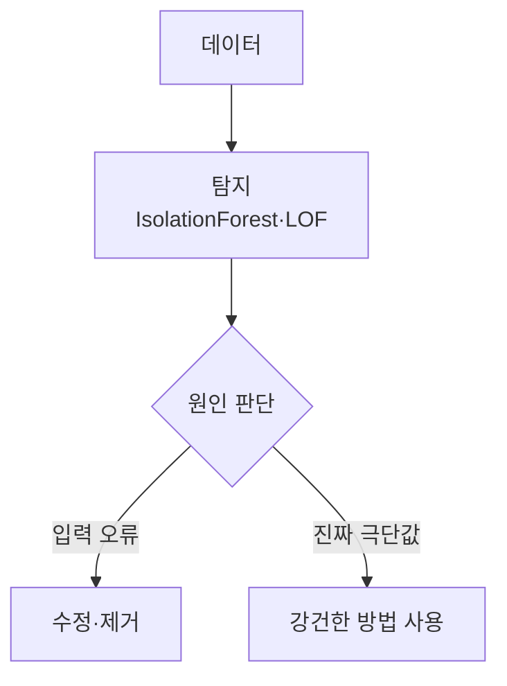
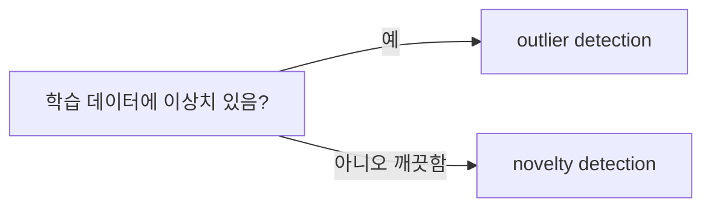

# 이상치 처리 (Outlier Handling)

> 이상치는 대부분의 데이터와 동떨어진 값이다. 이상치 처리는 이를 찾아내고 제거·보정하거나 이상치에 강한 방법을 써서 모델이 흔들리지 않게 하는 일이다.

## 쉽게 말하면
반 평균 점수를 구하는데 입력 실수로 1000점이 하나 있으면 평균이 엉망이 된다. 그 점수를 찾아 고칠지(오타), 그대로 둘지(진짜 천재), 영향을 덜 받는 중앙값을 쓸지 정하는 것이 이상치 처리다.

## 자세히
scikit-learn 문서(Novelty and Outlier Detection) 기준:
- **이상치 탐지(outlier detection)**: 학습 데이터에 이미 이상치가 있다고 보고 밀집 영역에 맞춰 벗어난 점을 찾는다(비지도 이상 탐지). **신규성 탐지(novelty detection)**: 학습 데이터는 깨끗하고 새 관측이 비정상인지 판단(준지도).
- 공통 API: `fit`, `predict`(1=정상, -1=이상치), `decision_function`, `score_samples`. `contamination`이 임계값을 정한다.
- **IsolationForest**: 무작위 분할에서 빨리 고립되는 점이 이상치. 고차원에서도 쓸 만한 기본값. **LocalOutlierFactor**: 이웃 대비 지역 밀도 비교, 밀도가 다른 군집에 적합(`n_neighbors` 기본 20, 이상치가 10% 넘으면 늘림). **EllipticEnvelope**: 가우시안 가정, 저차원. **OneClassSVM**: 깨끗한 데이터의 신규성 탐지, `nu` 조정 필요.
- 처리 선택지(일반 관행): 오타면 수정·제거, 진짜 극단값이면 유지하되 [Huber 손실](#huber-loss)이나 중앙값·로그 변환 같은 강건한 방법 사용. 무조건 삭제는 정보 손실이다.
- 주의: LOF는 `novelty=True`일 때 학습 샘플에 predict를 쓰면 결과가 틀린다.

## 그림으로 보기



## 예시
```python
from sklearn.ensemble import IsolationForest
labels = IsolationForest(random_state=0).fit_predict(X_train)  # -1이 이상치
X_clean = X_train[labels == 1]
```
센서 로그에서 튄 값을 걸러 낸 뒤 학습하거나, 결제 이상 거래 탐지에 활용한다.

## 헷갈리는 것과 비교
| 개념 | 차이 |
|---|---|
| 이상치 탐지 | 학습 데이터 안의 튀는 값 찾기 |
| 신규성 탐지 | 새 데이터가 낯선지 판단 |
| [Huber 손실](#huber-loss) | 이상치를 지우지 않고 영향 줄이기 |
| [MSE vs MAE](#mse-vs-mae) | 손실 선택이 이상치 민감도를 좌우 |

## 더 읽을거리
- [sklearn Novelty and Outlier Detection](https://scikit-learn.org/stable/modules/outlier_detection.html) — 방법 비교와 코드.
