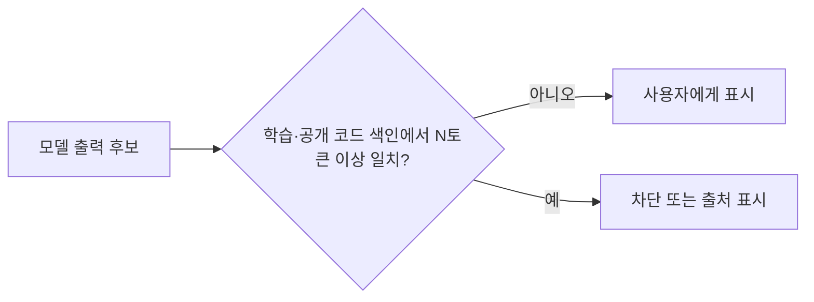
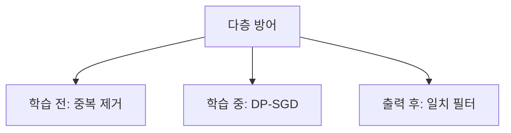

# 출력 암기 필터

> 모델이 내놓은 글을 사용자에게 보여 주기 **전에** 학습 데이터(또는 공개 코드)의 색인과 대조해, 일정 길이 이상 똑같으면 막거나 출처를 붙이는 안전장치다. 학습을 바꾸지 않고 출력 단계에서 암기를 줄인다.

## 쉽게 말하면
작가가 원고를 내기 전에 편집자가 "이 문단 어디서 본 것 같은데?" 하고 기존 책과 대조하는 절차다. 똑같은 문단이 발견되면 빼거나 출처를 달고 나간다. 모델 머릿속을 고치지 않아도 나가는 글만 거른다.

## 자세히
- **GitHub Copilot의 사례**(공식 문서 확인): 인라인 제안과 **주변 코드 약 150자**를 공개 코드 색인과 비교한다. 계정·조직 정책에 따라 일치하는 제안은 **차단되거나 일치 정보와 함께 표시**된다. 일치는 인라인 제안의 1% 미만이다. 한계: 색인에 비공개 저장소·GitHub 밖 코드가 없고, 주기적으로 갱신되어 최신 코드를 놓치거나 이동·삭제된 코드를 가리킬 수 있다. 검색 결과 요약(출처 다양, 직접 열지 않음)은 약 65 어휘/150자 기준 공백 제거 비교를 언급하지만 현재 값이 바뀌었는지는 확인하지 못했다. 소송 소장의 "정확 일치만 보고 약간 바꾼 출력은 못 잡는다"는 지적은 주장일 뿐 판단이 아니다.
- **직접 실행**(`gpt2` 124M 그리디 + 토큰 12-gram 색인; 색인은 MIT·Apache 라이선스 문구 2개에서 만든 120개 12-gram):

| 프롬프트 | 색인과 일치한 12-토큰 창 | 판정 |
|---|---|---|
| "Permission is hereby granted, free of charge, to any person" | 60 | **차단** |
| "Licensed under the Apache License, Version 2.0 (the" | 43 | **차단** |
| "The accountant carried seventeen purple umbrellas across" | 0 | 통과 |
| "In this tutorial we will show how to" | 0 | 통과 |

  라이선스 문구를 이어 쓴 두 출력은 색인과 대량 일치해 걸렸고, 새 문장·일반 튜토리얼 문장은 통과했다. 색인이 작은 장난감이며 실제 서비스는 수십억 토큰 규모의 색인이 필요하다(그래서 블룸 필터나 접미사 배열 같은 구조를 쓴다, 제안).
- **장점**: 모델 재학습이 필요 없다. 규칙(n-gram 길이)을 바꾸기 쉽다.
- **한계**: ① **정확 일치**만 잡으므로 한두 토큰만 바꿔도 통과 ② 색인에 없는 데이터는 못 막음 ③ 색인 보관·질의 비용 ④ 정당한 인용도 막을 수 있음(오탐). 따라서 학습 데이터 쪽 [중복 제거](#training-data-deduplication)·[DP-SGD](#dp-sgd)와 함께 쓰는 다층 방어가 낫다.

## 그림으로 보기

## 예시
- 사내 코딩 도우미에 "공개 코드와 일치하는 제안 차단" 정책을 켜서 라이선스 위험을 줄임.
- 교육: 위 12-gram 필터를 20줄 코드로 직접 만들어 어떤 프롬프트가 걸리는지 실험.

## 헷갈리는 것과 비교
| 개념 | 차이 |
|---|---|
| 출력 암기 필터 | 생성 후 일치 검사 |
| [암기 감사](#memorization-audit) | 배포 전 추출 공격으로 점검 |
| [중복 제거](#training-data-deduplication) | 학습 전에 반복을 줄임 |
| [DP-SGD](#dp-sgd) | 학습 중 개별 영향 제한 |

## 더 읽을거리
- [GitHub Copilot 코드 참조 문서](https://docs.github.com/en/copilot/concepts/completions/code-referencing) — 약 150자 비교, 차단/표시, 한계(열어 확인).
- [Introducing code referencing for GitHub Copilot](https://github.blog/news-insights/product-news/introducing-code-referencing-for-github-copilot) — 기능 소개(검색 결과로만 확인, 열지 않음).
