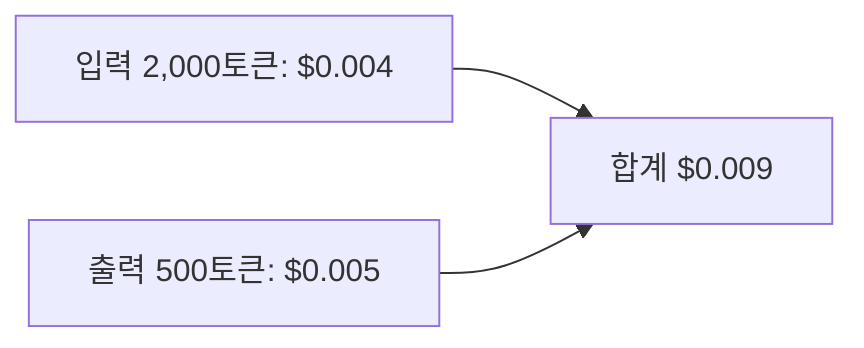
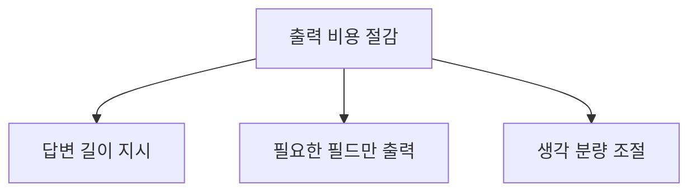

# 출력 토큰 비용

> LLM API에서 **출력 토큰은 입력 토큰보다 단가가 훨씬 비싸다.** Claude 공식 가격표에서는 같은 모델의 출력이 입력의 5배다. 그래서 답변 길이와 생각(thinking) 분량이 비용을 좌우한다. (Claude 가격 표 열람 2026-11-28)

## 쉽게 말하면
택시 요금처럼 "승차 대기"(입력)보다 "실제 이동 거리"(출력)에 요금이 훨씬 붙는다. 길게 돌아가면(긴 답변·긴 생각) 요금이 쑥 오른다.

## 자세히
- 가격표(캐싱 문서의 표, 백만 토큰당 입력 / 출력): **Opus 5 $5 / $25**, Opus 4.8·4.7·4.6·4.5 $5 / $25, **Sonnet 5.5 $2 / $10**, Sonnet 5 $2 / $10, Sonnet 4.6 $3 / $15, **Haiku 5.5 $0.10 / $0.50**(100,000토큰 이하 프롬프트, 초과 시 $0.50 / $2.50), Haiku 4.5 $1 / $5. 모두 출력이 입력의 **5배**. 가격은 바뀔 수 있다.
- 직접 계산(Sonnet 5.5 기준): 입력 2,000토큰+출력 500토큰 = 2,000×$2/1M + 500×$10/1M = $0.004 + $0.005 = **$0.009**. 입력은 4배 많은데 출력 비용이 더 크다.
- **생각 토큰도 출력으로 과금**: 적응형 생각의 생각 토큰은 출력 토큰으로 청구되고 `max_tokens`에 포함된다. 표시되는 요약이 짧아도 전체 생각이 과금된다(Claude 문서, [적응형 생각](#adaptive-thinking)).
- 줄이는 방법(내 정리): ① 프롬프트로 답변 길이·형식 지정 ② 구조화 출력(필요 필드만) ③ [effort](#effort-parameter) 낮추기(Opus 5 문서는 effort가 응답 길이를 안정적으로 줄이지는 않으므로 길이는 프롬프트로 지시하라고 안내) ④ 입력은 [프롬프트 캐싱](#cache-ttl)으로 줄이기(출력은 캐싱 대상 아님).
- 한계: 한국어는 토큰이 더 들어 같은 내용도 출력 비용이 커질 수 있다([언어별 토큰 수](#tokenizer-language)).

## 그림으로 보기

## 예시
- 요약 봇이 매번 장문을 쓰면 하루 1만 건 × 출력 500토큰 = 500만 출력 토큰 = Sonnet 5.5 기준 $50. 3문장으로 제한해 150토큰이면 $15.
- 교육: 같은 요청을 "자세히"와 "3문장"으로 나눠 토큰·비용을 비교.

## 헷갈리는 것과 비교
| 개념 | 차이 |
|---|---|
| 출력 토큰 | 모델이 생성, 단가 높음 |
| 입력 토큰 | 보낸 프롬프트, 캐시 시 크게 할인 |
| [비용 추산표](#cost-estimation-sheet) | 요청 수와 토큰으로 월 비용 계산 |

## 더 읽을거리
- [Prompt caching — Pricing](https://platform.claude.com/docs/en/build-with-claude/prompt-caching#pricing) — 모델별 입력·출력 가격표(읽음).
- [Steering thinking](https://platform.claude.com/docs/en/build-with-claude/thinking-steering-and-cost) — 생각 토큰 과금(읽음).
