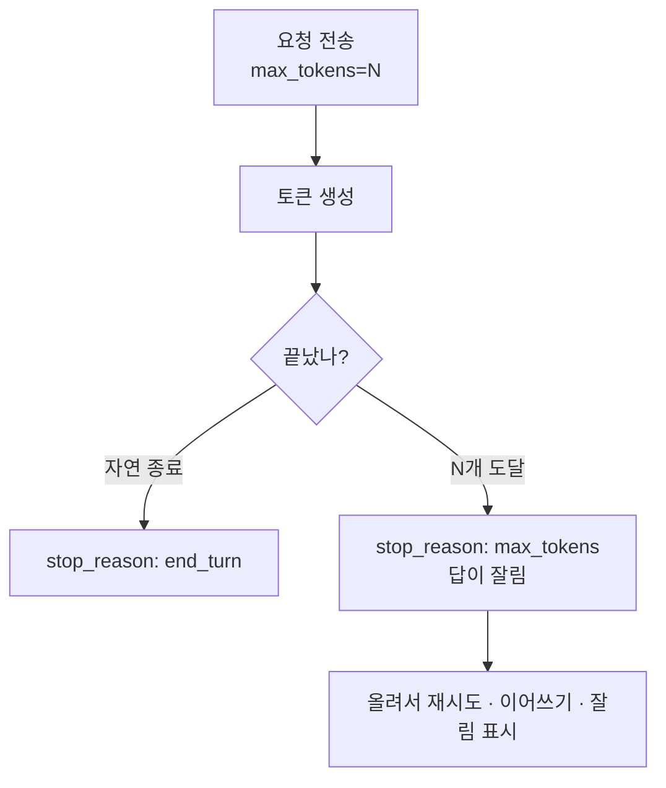

# 최대 출력 토큰

> 모델이 **한 번의 응답에서 생성할 수 있는 토큰의 상한**. API에서는 `max_tokens` 같은 매개변수로 정한다. 목표 길이가 아니라 **천장**이며, 도달하면 답이 중간에 잘린다.

## 쉽게 말하면
편지지를 한 장만 줬을 때, 아무리 할 말이 많아도 한 장이 차면 쓰기가 멈춘다. `max_tokens`는 그 편지지 분량 제한이다. 한 장보다 짧게 쓰고 끝낼 수도 있다.

## 자세히
- **Anthropic Messages API 문서**: `max_tokens`는 "중단 전까지 생성할 최대 토큰 수"이며, 모델이 그보다 일찍 멈출 수 있다. 모델마다 허용 최대값이 다르다.
- **생각(thinking) 토큰도 포함**: 확장 사고를 켜면 생각 토큰이 `max_tokens`에 포함되어, 생각이 길면 보이는 답이 들어갈 자리가 줄어든다(문서 명시).
- **응답이 끝난 이유(`stop_reason`)** (Anthropic 문서 기준):

| 값 | 뜻 |
|---|---|
| `end_turn` | 모델이 자연스럽게 마침 |
| `max_tokens` | 상한에 닿아 **잘림** |
| `stop_sequence` | 지정한 중단 문자열 출력 |
| `tool_use` | 도구 호출 중 |
| `model_context_window_exceeded` | 컨텍스트 창이 가득 참(잘린 것으로 취급) |

- **잘림 처리**(문서 권고): `max_tokens`를 올려 재시도하거나, 멈춘 지점부터 이어 쓰게 하거나, 도구 호출 블록이 잘렸다면(입력 불완전) 더 큰 값으로 재시도하거나, 재시도 불가 시 "잘림" 표시를 붙인다.
- **입력 한도와 구분**: 컨텍스트 윈도우는 입력+출력 전체의 한도, 최대 출력 토큰은 그중 출력 쪽 천장이다. 숫자·한도는 모델·버전마다 달라 공식 문서의 모델 표를 확인해야 한다.
- **실무 팁**: 긴 문서 생성·코드 생성은 단계로 나눠 생성하고, 응답마다 `stop_reason`을 기록·검사해 잘림을 자동 감지한다. 도구 호출이 많은 에이전트는 잘린 `tool_use`를 반드시 처리한다.

## 그림으로 보기


## 예시
```python
resp = client.messages.create(model=MODEL, max_tokens=1024, messages=[...])
if resp.stop_reason == "max_tokens":
    print("[잘림] max_tokens를 올리거나 이어서 생성하세요")
```
- 요약 프롬프트에서 "300자 이내"는 모델 지시이고, `max_tokens`는 하드 천장이라 둘을 함께 쓴다.

## 헷갈리는 것과 비교
| 개념 | 차이 |
|---|---|
| 최대 출력 토큰 | 한 응답의 생성 상한 |
| [컨텍스트 윈도우](#context-window) | 입력+출력 전체 한도 |
| [토큰 예산](#token-budget) | 작업 전체에 쓸 토큰 계획 |
| [max_tokens](#max-tokens) | API 매개변수 이름 쪽 설명 |

## 더 읽을거리
- [Anthropic: Messages API](https://platform.claude.com/docs/en/api/messages) — `max_tokens`와 thinking 토큰 설명.
- [Anthropic: Handling stop reasons](https://platform.claude.com/docs/en/build-with-claude/handling-stop-reasons) — `stop_reason` 값과 잘림 처리.
