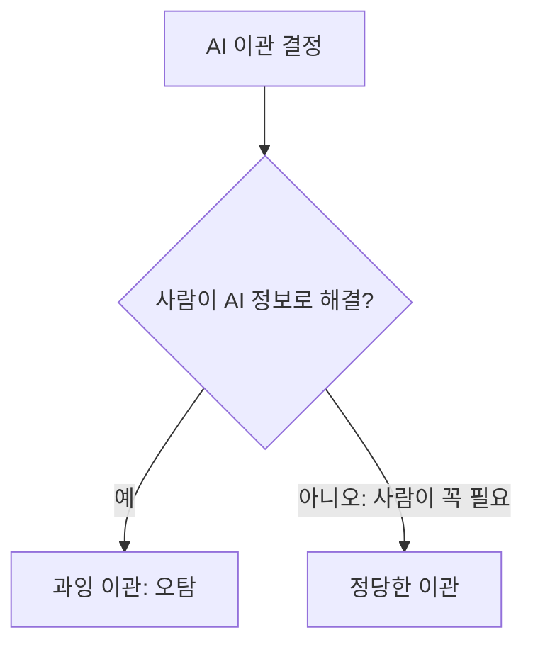
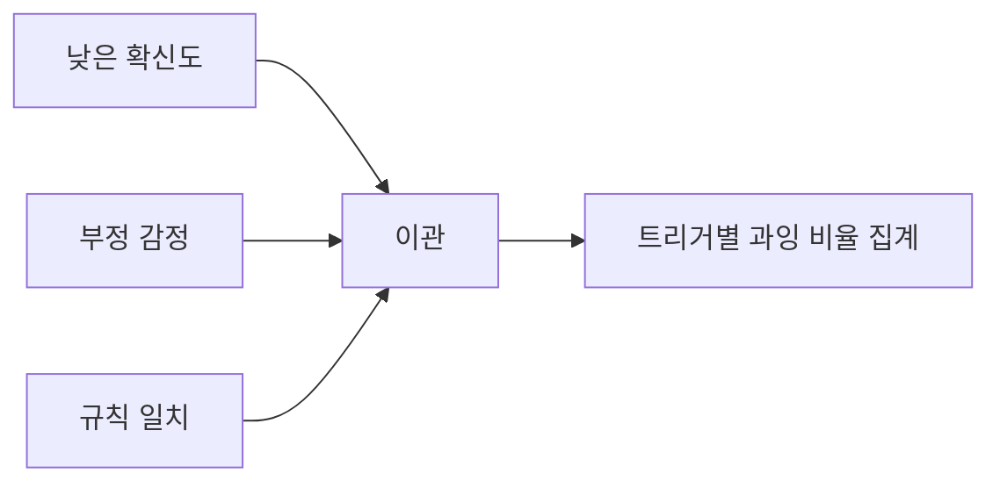

# 과잉 이관

> AI가 사람에게 넘겼지만, 사실 AI가 이미 가진 정보로 풀 수 있었던 이관이다. 이관을 "양성(사람이 필요하다)"으로 예측했는데 틀린 경우라 오탐(false positive)이라 부른다.

## 쉽게 말하면
신입 직원이 모든 문의를 "선배님께 여쭤볼게요" 하고 넘기는 것과 같다. 안전해 보이지만 선배는 이미 답을 알려 줄 수 있는 질문에 시간을 쓰고, 고객은 불필요하게 기다린다.

## 자세히
(Twig 블로그 글 기반, 벤더 글이며 용어는 글이 명시적으로 정의한 것이 아니라 문맥으로 정리했다.)
- **정의**: AI가 이관한 대화를 사람이 "AI가 이미 가지고 있던 정보"로 해결하는 경우(Twig 글의 표현을 바탕으로 정리).
- **원인(글 기반 추론)**: 확신도 임계값이 너무 보수적이거나 감정 민감도가 높아 단순한 직설 표현까지 불만으로 잡는 경우. 글도 감정 임계값을 조정해 과잉 이관을 피하라고 권한다.
- **측정(글에 언급된 방식만)**: 이관 대화 중 AI가 이미 가진 정보로 해결된 비율, 카테고리별 이관률, 대화 기록 검토. 정밀도·재현율 같은 공식은 없다.
- **트리거 귀속**: 낮은 확신도 / 부정 감정 / 비즈니스 규칙 일치 / 조합 중 무엇이 이관을 일으켰는지 기록해 어느 트리거가 과잉을 만드는지 본다(Twig가 그렇게 기록한다고 설명).
- **임계값 예시는 근거 없음**: 확신도 0.8 이상 자율 응답, 0.5~0.8 잠정 답변과 사람 연결 옵션, 0.5 미만 즉시 이관은 SaaS 예시일 뿐 출처가 없다. 초기에는 높게 두라는 권고가 있다.
- **업계 전망의 한계**: Gartner가 성숙한 시스템에서 불필요한 이관을 최대 40% 줄인다는 전망은 링크는 있으나 본문에서 검증되지 않아 벤치마크로 쓰지 않는다.
- **균형**: 과잉을 줄이려 임계값을 올리면 [과소 이관](#late-escalation-false-negative)이 늘어난다. 둘을 같이 본다.

## 그림으로 보기

## 예시
- 이관 건 50개를 표본으로 읽어, 상담원이 첫 메시지에서 이미 요약에 있던 답을 준 건이 몇 개인지 센다.
- "화나요"라는 단어가 들어가면 무조건 이관하는 규칙이 있다면, 그 트리거로 이관된 건의 과잉 비율을 따로 본다.

## 헷갈리는 것과 비교
| 개념 | 차이 |
|---|---|
| 과잉 이관(오탐) | 불필요했던 이관 |
| [과소 이관](#late-escalation-false-negative) | 필요했는데 하지 않거나 늦은 이관 |
| [이관 성공률](#transfer-success-rate) | 이관 건 전체의 성공 정의 |
| 봉쇄율 | 이관하지 않은 비율, 과잉 이관 감소 시 오르지만 품질과 무관 |

## 더 읽을거리
- [Twig: AI에서 라이브 상담원으로 이관은 얼마나 매끄러운가](https://www.twig.so/blog/how-smooth-is-handoff-from-ai-to-live-agent) — 오탐·미탐 관점과 트리거 귀속(직접 열어 확인, 벤더 글, 수치 근거 약함).
