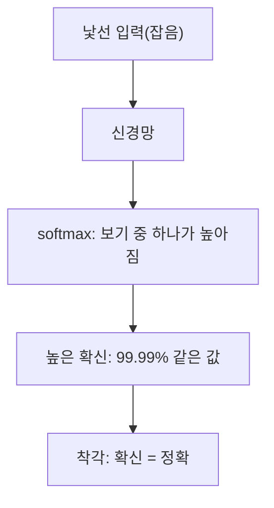
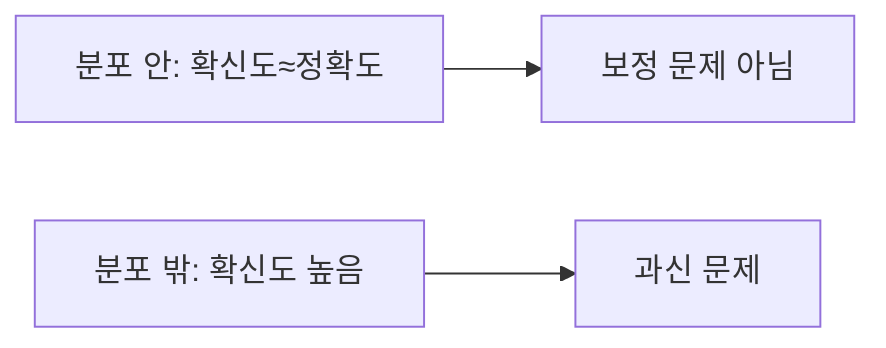

# 신경망의 과신

> 신경망이 **학습 때 본 적 없는 입력(잡음, 낯선 사진)에도 매우 높은 확률로 어떤 클래스라고 답하는** 현상이다. softmax 확률이 "얼마나 확실한가"가 아니라 "여러 후보 중 어느 쪽이 상대적으로 나은가"만 말해 주기 때문에 생긴다.

## 쉽게 말하면
객관식 시험에서 보기가 5개뿐이면, 문제를 전혀 모르는 학생도 "그나마 이게 낫다"며 한 보기에 큰 자신감을 갖고 답을 고른다. 정답이 보기에 없을 수 있다는 선택지가 없는 시험지처럼, 분류 모델에는 "모르겠다"가 기본 출력에 없다.

## 자세히
(Nguyen 등 CVPR 2015 논문 arXiv 1412.1897과 Guo 등 ICML 2017 논문 arXiv 1706.04599의 PDF 앞부분을 직접 확인하고, 작은 MLP로 직접 실험했다.)
- **눈속임 이미지(Nguyen 등)**: 사람 눈에는 **알아볼 수 없는 이미지**인데도 ImageNet·MNIST로 학습한 최신 CNN이 **99.99% 확신**으로 특정 객체라고 분류한 이미지를 진화 알고리즘이나 기울기 상승으로 만들어 보였다(예: 흰 잡음을 사자라고 확신). 그림 1은 ImageNet 모델이 ≥99.6% 확신하는 진화된 이미지를 보여 준다. 즉 **높은 확신 ≠ 올바른 인식**이다. 단, 이 논문의 이미지는 모델을 겨냥해 일부러 만든 것이다.
- **일반 보정 문제(Guo 등)**: 신경망은 정확도는 높아졌지만 **확신도가 실제 정답률과 어긋나는(보정이 나쁜)** 경우가 많다. 논문은 신뢰도가 정확도를 반영하지 않는 현상을 여러 비전·NLP 과제에서 보이고, 후처리 보정법 중 한 개 파라미터의 **온도 스케일링**이 대체로 매우 효과적이라고 보고한다. 보정은 **분포 안** 데이터의 확신도 문제이고, 이 글의 과신은 **분포 밖** 입력의 높은 확신도 문제로 구분된다.
- **직접 실험(digits 손글씨, 은닉 64개 MLP, 학습·분포 안 테스트 정확도 0.971)**
  | 입력 | 평균 최대 확률 | 확률 > 0.9 비율 |
  |---|---|---|
  | 진짜 숫자(테스트) | 0.973 | (정확도 0.971과 일치, ECE 0.010) |
  | **균일 잡음** | **0.884** | **65.5%** |
  | 가우시안 잡음 | 0.882 | 65.0% |
  | 모두 1인 이미지 | **0.999** | **100%** |
  | 모두 0인 이미지 | 0.141 | 0% |
  분포 안 숫자에서는 확신도가 잘 맞지만(ECE 0.010), **의미 없는 잡음 이미지의 65%가 90% 넘는 확신**으로 분류됐다. 모두 1인 이미지는 100%가 0.999 평균 확신으로 같은 클래스로 분류됐다. 모두 0인 이미지는 확신이 낮았다(0.141) — **입력에 따라 과신 정도가 크게 다르다.** 이 실험은 작은 모델·장난감 데이터이며, 일반 규칙이 아니라 현상의 시연이다. 그래서 단순 최대 softmax 임계값 기준(MSP)은 OOD 탐지로 약하다([ODIN](#odin-ood-detection)에서 같은 모델로 FPR95 0.75 관찰).
- **왜 생기나(제안·일반론)**: softmax는 입력 크기가 커지면 확률이 한 클래스로 쏠리고, 학습 데이터 밖의 영역에서 결정 경계가 어떻게 되는지 학습이 제약하지 않는다. 이 설명은 위 논문에서 직접 확인한 것이 아니다.
- **완화(제안)**: ① OOD 탐지 점수(ODIN, 에너지, 마할라노비스 거리 등) 사용 ② 분포 밖 샘플을 학습에 넣는 "기타" 클래스 ③ 온도 스케일링 같은 보정 ④ 확신도 임계값은 검증 데이터로 정하고 "사람에게 넘김" 경로 두기 ⑤ 입력 검증(범위·형식).

## 그림으로 보기

## 예시
- 상품 사진 분류 앱에 사용자가 흐릿한 바닥 사진을 올렸는데 "운동화 93%"로 답하는 경우 → OOD 탐지와 사람 확인 경로를 추가.
- 교육 소재: "AI의 확률 98%를 믿어도 되나?"를 잡음 이미지 실험으로 토론(AI 리터러시).

## 헷갈리는 것과 비교
| 개념 | 차이 |
|---|---|
| 신경망의 과신 | 낯선 입력에도 높은 확신 |
| 보정(calibration) | 분포 안 확신도와 정확도의 일치 |
| [ODIN](#odin-ood-detection) | 과신을 줄여 OOD를 가려내는 방법 |
| [OOD 탐지 AUROC](#auroc-ood) | 탐지 성능을 재는 지표 |

## 더 읽을거리
- [Deep Neural Networks are Easily Fooled (arXiv 1412.1897)](https://arxiv.org/abs/1412.1897) — 알아볼 수 없는 이미지에 99.99% 확신(PDF 앞부분 직접 확인).
- [On Calibration of Modern Neural Networks (arXiv 1706.04599)](https://arxiv.org/abs/1706.04599) — 확신도 보정과 온도 스케일링(PDF 앞부분 직접 확인).
