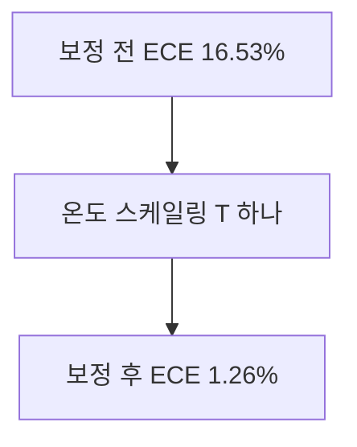

# 과신 모델의 분배 실패

> 최신 신경망은 실제 정확도보다 확신도를 높게 내는 경향이 있어, 확신도로 "자동 처리 vs 사람 검수"를 나누면 틀린 건도 자동 처리로 새어 나간다. 온도 스케일링 같은 보정으로 완화한다.

## 쉽게 말하면
자신감 넘치는 신입이 "99% 확실합니다"라고 하지만 실제로는 70%만 맞힌다면, 그 말만 믿고 검수를 생략하면 사고가 난다. 자신감 표시를 현실에 맞게 고쳐야 한다.

## 자세히
(Guo 외, "On Calibration of Modern Neural Networks", ICML 2017, arXiv 1706.04599 전문을 직접 읽고 확인.)
- **보정(calibration)**: P(Ŷ=Y | P̂=p) = p. **ECE** = Σ (|B_m|/n)·|acc(B_m) − conf(B_m)|, 동일 폭 구간 M=15개.
- **발견**: 10년 전 얕은 네트워크(LeNet)는 잘 보정되었지만 현대의 깊은 네트워크(ResNet-110)는 정확도가 높아도 평균 확신도가 정확도를 크게 웃돈다(과신). 원인 후보: 깊이, 너비, weight decay, 배치 정규화, NLL 과적합.
- **온도 스케일링**: 단일 매개변수 T로 logit을 나눠 softmax(z/T). 검증 세트 NLL로 T를 정하며 T>1이면 확신을 낮추고 **argmax(정확도)는 그대로**.
- **ECE 변화(%)**: CIFAR-100 ResNet-110 16.53→1.26, ResNet-110(SD) 12.67→0.96, WideResNet-32 15.0→2.32, DenseNet-40 10.37→1.18; CIFAR-10 ResNet-110 4.6→0.83; ImageNet DenseNet-161 6.28→1.99, ResNet-152 5.48→1.86. 행렬 스케일링은 여러 경우에 더 나빴다(예: 25.49).
- **분배 실패와의 연결(추정, 논문에 없음)**: 확신도 임계값으로 사람에게 보내는 시스템에서 과신이면 틀린 건이 임계값 위에 몰려 같은 커버리지에서 위험이 확신도가 시사하는 것보다 높다. 보정은 ECE를 낮추지만 순위 자체는 크게 안 바꾼다. 이를 직접 측정한 논문은 이번에 확인하지 못했다.

## 그림으로 보기

## 예시
- 검증 세트로 T를 구해 확신도를 낮춘 뒤 "확신도 0.9 구간의 실제 정확도"를 신뢰도 다이어그램으로 점검.
- 교육 활용: "AI의 자신감 표시를 그대로 믿으면 안 된다"를 ECE로 설명.

## 헷갈리는 것과 비교
| 개념 | 차이 |
|---|---|
| 정확도 | 맞힌 비율 |
| 보정 | 확신도와 실제 맞힘 확률의 일치 |
| [선택적 분류](#selective-classification) | 보정된 확신도로 기권 결정 |

## 더 읽을거리
- [On Calibration of Modern Neural Networks (arXiv 1706.04599)](https://arxiv.org/abs/1706.04599) — ECE·온도 스케일링 표.
