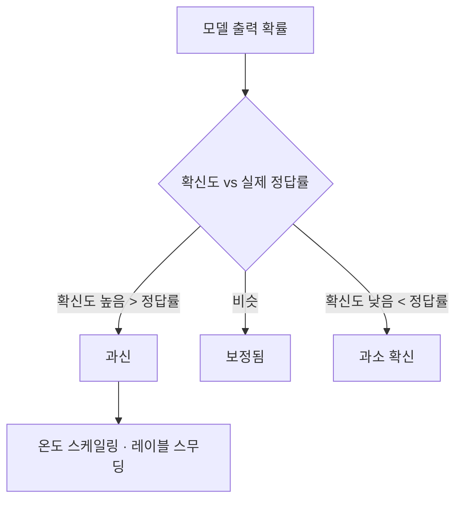

# 과신

> 과신(overconfidence)은 모델이 틀릴 때도 높은 확률(확신도)을 내는 현상이다. 모델 보정이 나쁜 경우의 대표 형태다.

## 쉽게 말하면
시험에서 모르는 문제에도 "100% 확신!"이라 쓰는 학생이다. 점수와 별개로, 믿을 수 없는 자신감 때문에 그 말만 듣고 결정할 수 없다.

## 자세히
- [모델 보정](#model-calibration)의 한 방향이다. Guo 외(2017)는 현대 신경망의 보정이 나쁘다고 보고하지만 초록은 방향을 명시하지 않는다. 같은 분야에서 흔히 "확신도가 정확도보다 높다"는 과신이 관찰된다고 알려져 있으며 이는 논문 본문 확인이 필요하다(주장 수준).
- 보정에 영향을 주는 요소(논문 언급): 깊이, 너비, weight decay, Batch Normalization.
- 완화 방법: [온도 스케일링](#temperature-scaling)으로 학습 후 확신도 조정, [레이블 스무딩](#label-smoothing)으로 학습 중 극단적 확신 억제, 앙상블.
- LLM에서도 말의 자신감(어조)과 실제 정확도는 다를 수 있다. 확신도를 쓰는 시스템은 반드시 검증 데이터로 점검한다.

## 그림으로 보기

## 예시
- 확신도 0.99로 오분류하는 사례가 많으면 자동화 임계값을 믿을 수 없다. 검증 세트에서 임계값별 정답률을 표로 만든다.
- 사람 검토 대상을 "확신도 낮은 것"만으로 정하면 과신 오답이 그대로 통과한다.

## 헷갈리는 것과 비교
| 개념 | 차이 |
| --- | --- |
| 과신 | 확신 > 실제 |
| 환각 | 그럴듯한 거짓 내용을 생성 |
| [모델 보정](#model-calibration) | 확신과 실제의 일치도 전반 |

## 더 읽을거리
- [On Calibration of Modern Neural Networks (arXiv 1706.04599)](https://arxiv.org/abs/1706.04599) — 현대 신경망의 보정 문제
