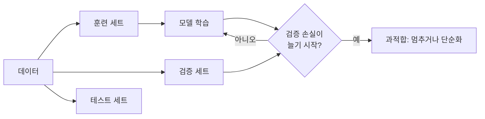
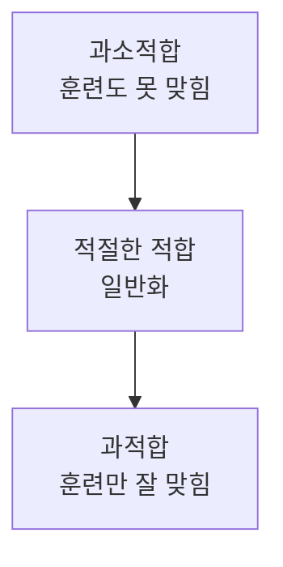

# 과적합과 일반화

> 과적합은 모델이 훈련 데이터를 외워 버려서, 훈련 데이터에서는 잘 맞히지만 처음 보는 데이터에서는 틀리는 상태다. 반대로 새 데이터에서도 잘 맞히는 능력이 일반화다.

## 쉽게 말하면
기출문제 답만 통째로 외운 학생은 기출 모의고사에서 100점을 받지만, 문제가 조금 바뀐 본시험에서는 무너진다. 원리를 이해한 학생이 일반화한 학생이다. AI도 훈련 데이터(기출)를 외우면 실제 현장(본시험)에서 쓸모가 없어진다.

## 자세히
Google Machine Learning Crash Course(2026-11 확인)의 정리:
- **징후**: 훈련 손실과 검증 손실이 처음엔 비슷하게 줄다가, 어느 시점부터 훈련 손실은 계속 줄거나 수렴하는데 **검증 손실은 오히려 늘어난다**. 두 곡선이 비슷하게 유지되면 잘 맞는(fit) 모델이다.
- **과소적합(underfit)**: 훈련 데이터에서도 성능이 나쁜 상태. 과적합과 반대 문제.
- **원인 두 가지**: ① 훈련 세트가 실제 데이터를 충분히 대표하지 못함 ② 모델이 지나치게 복잡함.
- **대응**: 훈련·검증·테스트 세트를 섞어 분포를 비슷하게 하고(시간순 정렬은 분포를 어긋나게 할 수 있음), 계절성은 모든 세트에 고르게 넣고, 모델 복잡도를 낮춘다. 예측이 현실을 바꾸는 피드백 루프(예: 기차표 가격 예측)도 조심한다.
- 일반 실무 기법(이 문서가 다루지 않는 일반 상식): 데이터를 늘리기, 정규화, 조기 종료, 드롭아웃.
- LLM 시대의 변형: 벤치마크 문제가 학습 데이터에 섞이는 오염(contamination)은 "시험문제를 외운" 과적합과 같은 결과를 낳는다.

## 그림으로 보기

## 예시
- 고객 이탈 예측 모델이 훈련 데이터 정확도 99%, 새 데이터 정확도 70%라면 과적합을 의심한다.
- 교육 비유: 학습자에게 같은 예제만 반복시키면 변형 문제에서 막힌다. 다양한 문제를 섞는 것이 일반화 훈련이다.

## 헷갈리는 것과 비교
| 개념 | 차이 |
|---|---|
| 과적합 | 외움: 훈련↑ 새 데이터↓ |
| 과소적합 | 못 배움: 훈련부터 낮음 |
| [학습과 추론](#training-inference) | 과적합은 학습 중 점검, 추론은 사용 단계 |
| [환각](#hallucination) | 과적합이 아니라 생성 시 근거 없는 말 |

## 더 읽을거리
- [ML Crash Course — Overfitting](https://developers.google.com/machine-learning/crash-course/overfitting/overfitting) — 징후·원인·데이터 분할 조건.
