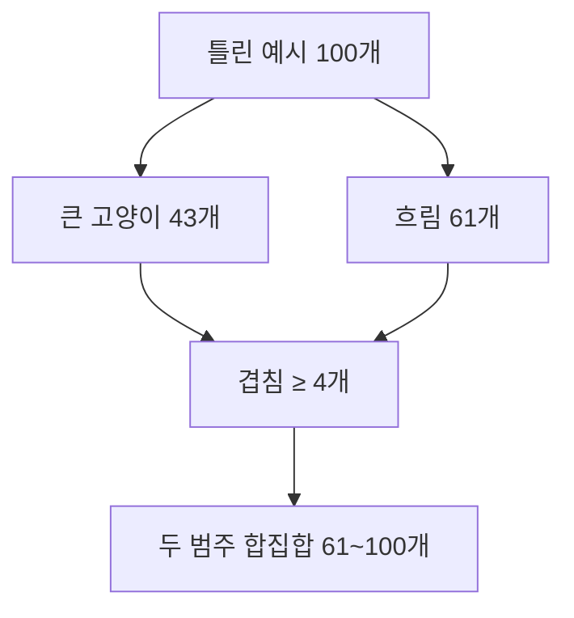
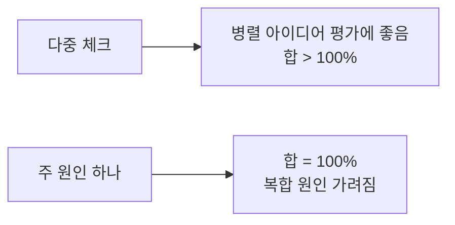

# 중복 오류 범주

> 한 오류 예시는 **여러 범주에 동시에 속할 수 있다**(예: 흐린 사진의 사자). 그래서 범주 비율의 합이 100%를 넘을 수 있고, 두 범주를 고쳤을 때 줄어드는 오류는 비율의 단순 합이 아니라 **합집합**이다.

## 쉽게 말하면
불만 접수 100건 중 "배송 지연" 60건, "포장 불량" 50건이라면 합이 110건이다. 두 문제가 겹친 주문이 최소 10건 있다는 뜻이다. 둘 다 고쳐도 사라지는 불만은 110건이 아니라 겹침을 한 번만 센 건수다.

## 자세히
- **원문 확인(Andrew Ng, Machine Learning Yearning 초안, 15장 "Evaluating multiple ideas in parallel")**: 틀린 개발 세트 약 100개를 보며 스프레드시트에 범주 칸(개, 큰 고양이, 흐림)을 체크한다. 이미지 3은 큰 고양이와 흐림 모두 체크되고, "한 예시가 여러 범주와 연관될 수 있으므로 아래 비율의 합이 100%가 되지 않을 수 있다"고 쓴다. 4개 예시 표에서 개 25%·큰 고양이 50%·흐림 50%(합 125%). 100개 분석 결과는 개 8%, 큰 고양이 43%, 흐림 61%(합 112%).
- **해석 규칙**
  - 단일 범주의 상한은 그 범주 비율 그대로(개를 고치면 최대 8% 감소).
  - 두 범주 A·B를 모두 고칠 때 최대 감소 = |A∪B| = A + B − |A∩B|. 교집합을 모르면 범위만 말할 수 있다: max(A,B) ≤ 합집합 ≤ min(100%, A+B).
  - 위 예(큰 고양이 43%, 흐림 61%): 합이 104%이므로 교집합 ≥ 4%이고 합집합은 61~100% 사이다. 교집합을 직접 세면 정확해진다.
- **범주 설계 두 가지 방식**
  1. **다중 라벨(겹침 허용)**: 한 예시에 여러 범주를 체크. 개선 아이디어를 병렬로 평가할 때 유용. 합이 100%를 넘음.
  2. **주 원인 한 개 지정**: 가장 결정적인 원인 하나만 선택해 합을 100%로 맞춤. 우선순위 판단이 단순하지만 "흐리면서 큰 고양이" 같은 복합 원인이 가려진다.
- **개선 효과 겹침**: 범주 하나를 고쳐도 겹친 예시는 다른 범주 때문에 여전히 틀릴 수 있다. 따라서 "흐림을 고치면 61%가 사라진다"는 것은 겹친 예시도 함께 맞게 된다는 낙관적 가정이다(상한).
- **범주는 반복해서 만든다**: 예시를 보다가 "인스타그램 필터" 같은 새 범주가 떠오르면 열을 추가하고 이미 본 예시를 다시 본다. 가장 쓸모 있는 범주는 개선 아이디어가 있는 범주지만 직관을 쌓는 목적으로는 그렇지 않은 범주도 괜찮다고 한다.
- **한계**: Ng은 이 과정이 "엄밀한 공식이 아니며" 각 범주에서 기대되는 진전과 필요한 작업량도 고려해야 한다고 말한다([효율과 상한](#improvement-efficiency-vs-ceiling)).

## 그림으로 보기



## 예시
```python
import pandas as pd
df = pd.DataFrame({"dog":[1,0,0,0],"great_cat":[0,0,1,1],"blurry":[0,1,1,0]})
print(df.mean())                                # 범주별 비율(합이 100%를 넘을 수 있음)
print((df.great_cat | df.blurry).mean())        # 두 범주를 모두 고칠 때의 상한(합집합)
```
- LLM 답변 오류 분석: "환각"·"형식 위반"·"길이 초과"를 다중 체크로 두고 합집합으로 개선 상한을 계산.

## 헷갈리는 것과 비교
| 개념 | 설명 |
|---|---|
| 겹침 허용 범주 | 한 예시 다중 범주, 합 > 100% 가능 |
| 상호 배타 범주 | 한 예시 한 범주, 합 = 100% |
| 합집합 | 두 범주를 모두 고칠 때의 상한 |
| [범주별 개선 상한](#error-category-ceiling) | 단일 범주의 최대 효과 |

## 더 읽을거리
- [Andrew Ng, Machine Learning Yearning(초안 PDF)](https://home-wordpress.deeplearning.ai/wp-content/uploads/2022/03/andrew-ng-machine-learning-yearning.pdf) — 15장 스프레드시트 예시(본문 열어 확인).
