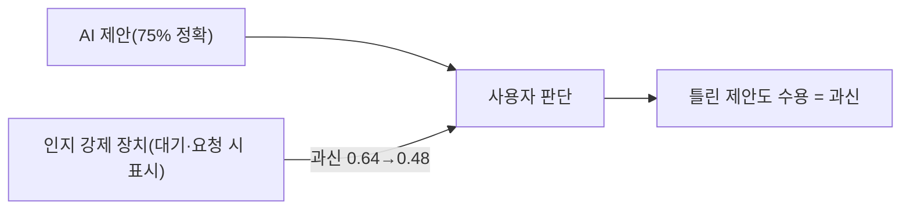
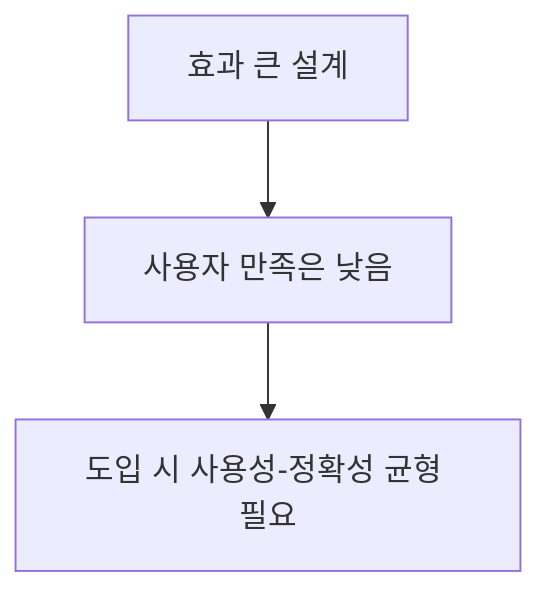

# AI 과신(overreliance)

> 사용자가 AI의 제안이 틀렸을 때도 그대로 받아들이는 현상이다. 설명을 붙여도 줄지 않으며, 일부러 한 번 더 생각하게 만드는 "인지 강제 장치"가 효과가 있지만 사용자는 그 방식을 싫어했다.

## 쉽게 말하면
내비게이션이 잘못된 길을 안내해도 따라가다 호수 앞에 서는 사람과 같다. AI가 대체로 맞기 때문에 틀릴 때도 확인 없이 믿게 된다.

## 자세히
(Buçinca·Malaya·Gajos, "To Trust or to Think", CSCW 2021, arXiv 2102.09692 전문과 Passi & Vorvoreanu 2022 MSR 페이지를 직접 열어 확인.)
- **정의**: "AI의 틀린 출력을 받아들이기 시작하는 것"(Passi & Vorvoreanu, MSR-TR-2022-12, 약 60편 문헌 검토, 목표는 "적절한 의존"). 세부 요인·완화책은 보고서 PDF를 열지 못해 **미확인**.
- **Buçinca 외 실험**: MTurk 199명, 저탄수화물 식단에서 바꿀 재료 고르기. 시뮬레이션 AI 정확도 **75%**, 26문항(틀린 AI 제안 6문항). 비교: 인지 강제 장치(CFF) 3종(요청 시 표시·업데이트·30초 대기) vs 단순 설명 2종(설명, 인라인) vs AI 없음.
- **결과**: 틀린 AI 제안에서 탄수화물 원천 판별 과제의 과신 비율이 단순 설명 **0.64** → CFF **0.48**(p=.003, d=.36). 전체 결정 기준으로는 0.30 대 0.26으로 유의하지 않았다. 올바른 AI에 대한 정확한 의존은 CFF에서 일부 줄었다.
- **역설**: 가장 효과적인 설계는 사용자에게 가장 낮은 평가(신뢰·선호↓, 정신적 부담↑)를 받았다. 신뢰는 과신과 양의 상관. 인지 욕구(Need for Cognition)가 높은 사람이 더 혜택을 봤다.
- 서론 인용: 인간+AI 팀은 보통 사람 단독보다 낫지만 **AI 단독보다는 못한** 경우가 많다.
- 한계: 한 과제·시뮬레이션 AI의 결과다.

## 그림으로 보기

## 예시
- 사전 라벨 승인 UI에 "AI 제안을 보기 전에 먼저 라벨을 고르게" 하는 순서 강제.
- 교육 활용: 일부러 틀린 AI 제안을 섞은 실습으로 과신을 체감.

## 헷갈리는 것과 비교
| 개념 | 차이 |
|---|---|
| 과신(overreliance) | 틀린 AI 제안도 수용 |
| 과소의존 | 맞는 AI 제안도 무시 |
| [자동화 편향](#automation-bias-annotation) | 라벨링 맥락의 같은 계열 현상 |

## 더 읽을거리
- [To Trust or to Think (arXiv 2102.09692)](https://arxiv.org/abs/2102.09692) — 인지 강제 장치 실험.
- [Overreliance on AI: Literature Review (MSR)](https://www.microsoft.com/en-us/research/publication/overreliance-on-ai-literature-review/) — 정의·개요(페이지 확인).
