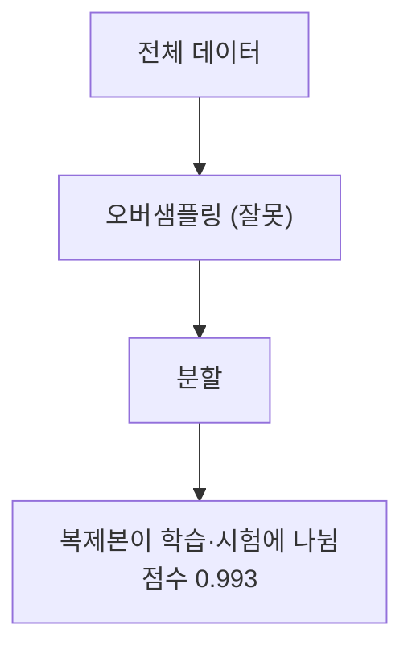
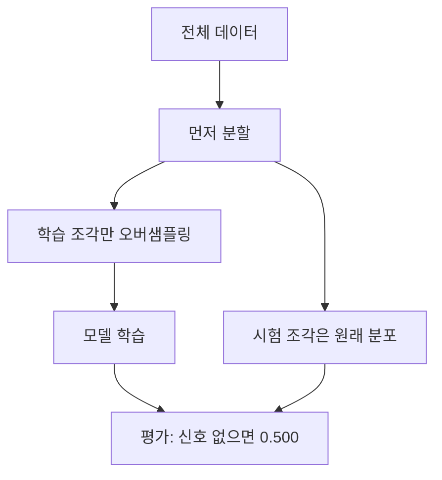

# 분할 전 오버샘플링

> 소수 클래스를 늘리는 오버샘플링(복제·SMOTE 등)을 교차검증이나 분할 전에 전체 데이터에 적용하면, 같은 표본(또는 그 복제본)이 학습과 시험에 동시에 들어가 점수가 크게 부풀려진다. 오버샘플링은 학습 조각 안에서만 해야 한다.

## 쉽게 말하면
시험 문제 한 개를 열 장 복사해 문제집 전체에 섞은 뒤 일부를 시험으로 빼면, 시험 문제의 복사본이 이미 연습 문제에 들어 있다. 학생은 연습 때 본 문제를 시험에서 다시 만난다. 복사는 시험지를 가른 뒤, 연습 문제 쪽에서만 해야 한다.

## 자세히
- **근거(imbalanced-learn 공통 함정 문서, 열람)**: 분할 전에 전체 데이터를 리샘플링하면 누수가 생겨 성능이 좋아 보인다. 시험 세트가 실제 클래스 분포를 더는 반영하지 못하고, 리샘플러가 나중에 시험에 들어갈 표본을 쓰기 때문이다. 문서의 성인 소득 데이터(소수 클래스 약 1.1%, 균형 정확도) 실험에서 전체를 언더샘플링한 뒤 CV하면 CV 점수 0.724 대 보류 세트 0.698로 과대평가였고, `imblearn.Pipeline`으로 학습 조각에서만 하면 0.732 대 0.727로 거의 일치했다. 해법은 리샘플러를 imblearn `Pipeline` 안에 넣는 것이다.
- **직접 해 본 극단 실험(무작위 특성 10개, 표본 400개, 양성 약 10%, 신호 없음, 랜덤 포레스트, 균형 정확도, 20번 반복)**: 소수 클래스를 복제해 전체를 균형 맞춘 뒤 5겹 CV를 하면 균형 정확도가 0.993이었고, 각 학습 조각 안에서만 복제하면 0.500이었다. 신호가 없는데 0.99가 나온 것은 복제본이 학습과 시험에 나뉘어 들어가 모델이 복제본을 외웠기 때문이다. 단순 복제라는 극단적 사례이며, SMOTE는 합성 표본이라 복제만큼 극단적이지 않을 수 있지만 같은 원리의 누수 위험이 있다.
- **올바른 절차(해석)**: ① 먼저 분할 ② 학습 조각에서만 오버샘플링 ③ 시험 조각은 원래 분포 그대로 ④ 교차검증이면 오버샘플러를 파이프라인 단계로 넣어 폴드마다 자동 적용([Pipeline으로 누수 막기](#sklearn-pipeline-leakage-guard)).
- **지표 선택**: 불균형 데이터는 정확도 대신 균형 정확도·재현율·PR-AUC를 쓰고, 시험 조각은 실제 분포로 유지한다([다수 클래스 기준선](#majority-class-baseline)).

## 그림으로 보기

## 예시
- 사기 탐지(사기 1%)에서 SMOTE를 쓸 때 `imblearn.pipeline.make_pipeline(SMOTE(), 모델)`을 `cross_val_score`에 넣는다.
- 교육 활용: 무작위 데이터에서 복제 후 분할(0.99)과 분할 후 복제(0.50)를 비교해 누수의 크기를 체감한다.

## 헷갈리는 것과 비교
| 개념 | 차이 |
| --- | --- |
| 분할 전 오버샘플링 | 누수, 점수 부풀림 |
| 분할 후 학습 조각 오버샘플링 | 올바름 |
| [Pipeline으로 누수 막기](#sklearn-pipeline-leakage-guard) | 폴드마다 자동 적용 |
| [정답 섞기 점검](#shuffled-label-sanity-check) | 누수 진단 |

## 더 읽을거리
- [imbalanced-learn: Common pitfalls](https://imbalanced-learn.org/stable/common_pitfalls.html) — 리샘플링 누수와 Pipeline 해법, 수치 비교
