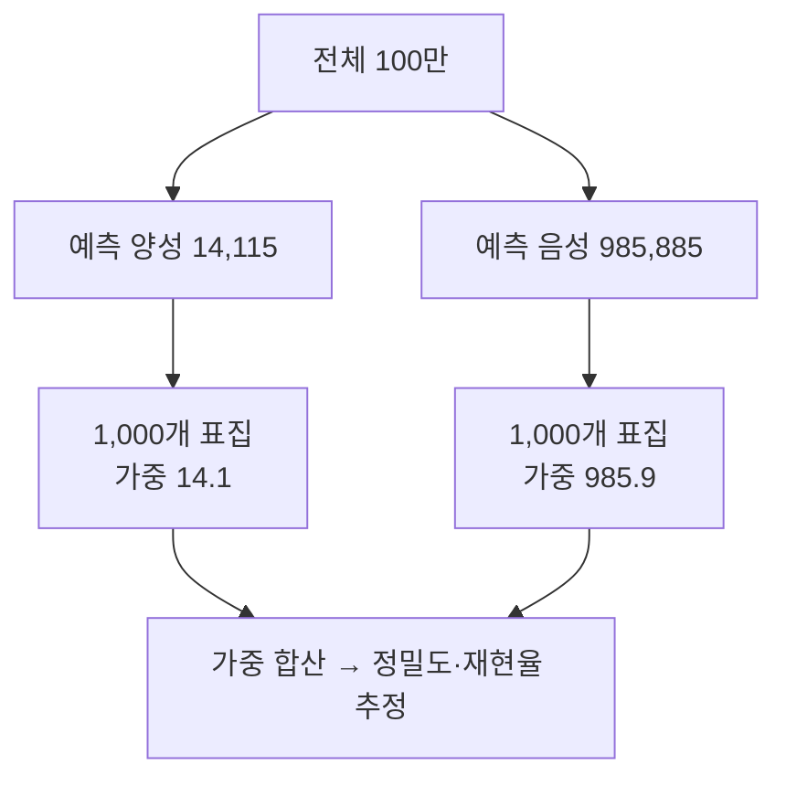

# 평가용 과표집

> 양성이 드문 데이터에서 라벨링 예산이 한정될 때, **모델이 양성이라고 예측한 항목을 더 많이 뽑아 라벨링하고 뽑힐 확률의 역수로 가중**해 정밀도·재현율을 추정하는 방법이다. 무작위로 뽑으면 양성이 거의 안 들어와 추정이 불안정하다.

## 쉽게 말하면
도둑 1명이 섞인 군중 1만 명 중 무작위 2천 명을 조사하면 도둑이 거의 안 걸린다. 경찰이 의심한 사람들을 더 집중해 조사하고, "의심군은 전체의 몇 %를 대표하는지" 가중치로 보정하면 적은 예산으로 정확한 수치를 얻는다.

## 자세히
- **시뮬레이션 설정(직접 실행, 모집단 100만 개, 양성 비율 0.5%, 분류기 TPR 0.85·FPR 0.01 → 양성 5,006개, 예측 양성 14,115개, 진짜 정밀도 0.301·재현율 0.848)**. 라벨링 예산 2,000개로 300회 반복.
  | 표집 방식 | 정밀도 추정(평균, 표준편차) | 재현율 추정(평균, 표준편차) |
  |---|---|---|
  | 무작위 2,000개 | 0.295, **0.095** | 0.838, 0.127 |
  | 예측 양성 50% 과표집 + 역가중 | 0.299, **0.015** | 0.866, 0.138 |
  무작위 표본에는 예측 양성이 평균 약 28개, 양성이 약 10개만 들어와 정밀도 추정의 표준편차가 0.095였다. 예측 양성을 절반으로 과표집하고 가중하면 **정밀도 표준편차가 0.015로 6분의 1**이 됐다. 평균은 둘 다 진짜 값 근처라 가중하면 편향이 없다.
- **재현율은 개선이 작다**: 재현율의 분모는 전체 양성인데 대부분 예측 음성 쪽에 있는 누락 양성(FN)을 찾으려면 **예측 음성 쪽에서도 충분한 표본**이 필요하다. 위 설정에서 재현율 표준편차는 0.127→0.138로 개선이 없었다. 재현율이 중요하면 예측 음성 쪽도 과표집(또는 점수가 높은 음성)하는 설계가 필요하다.
- **추정식(층화 추정)**: 층(예측 양성/음성)별로 표본의 양성 비율을 구하고 층 크기를 곱해 합산한다. TP 추정 = (예측 양성 층 크기/표본 수)×표본 내 양성 수, FP·FN도 같은 가중치. 코드에서는 항목마다 가중치 `w`(층 크기/층 표본 수)를 저장해 합산한다.
- **주의**
  1. **가중을 꼭 한다**: 가중 없이 과표집 표본의 정밀도를 말하면 [시험 세트 비율 불일치](#test-prior-mismatch)와 같은 왜곡.
  2. 표집 확률이 0인 층이 없어야 한다(0이면 편향).
  3. 모델이 바뀌면 층도 바뀌므로 표본을 새로 뽑거나 가중을 다시 계산.
  4. 가중치가 큰 항목이 있으면 분산이 커진다(표본 크기 점검).
  5. 신뢰구간은 층화 표집 공식이나 부트스트랩으로 계산.
- 합성 데이터의 한 설정이며 실제 결과는 분류기 점수 분포에 따라 다르다.

## 그림으로 보기

## 예시
- 콘텐츠 신고 분류기 정밀도 측정: 하루 10만 건 중 예측 양성 5천 건에서 500건, 예측 음성에서 500건을 표집해 라벨링하고 가중 합산.
- 교육: 설문조사의 층화 표본과 가중 보정 개념을 AI 평가에 적용.

## 헷갈리는 것과 비교
| 개념 | 차이 |
|---|---|
| 평가용 과표집 | 예측 양성을 더 뽑고 가중 보정 |
| 학습용 오버샘플링(SMOTE 등) | 학습 데이터를 늘림(평가에 쓰면 안 됨) |
| [시험 세트 비율 불일치](#test-prior-mismatch) | 과표집 후 가중하지 않으면 생기는 왜곡 |
| 무작위 표집 | 단순하지만 희귀 클래스 추정 불안정 |

## 더 읽을거리
- [Saito & Rehmsmeier 2015, PLOS ONE](https://journals.plos.org/plosone/article?id=10.1371/journal.pone.0118432) — 불균형 데이터에서 정밀도가 비율에 의존하는 이유.
- [scikit-learn 사용자 가이드: 분류 지표](https://scikit-learn.org/stable/modules/model_evaluation.html) — 정밀도·재현율 정의와 가중 옵션(`sample_weight`).
