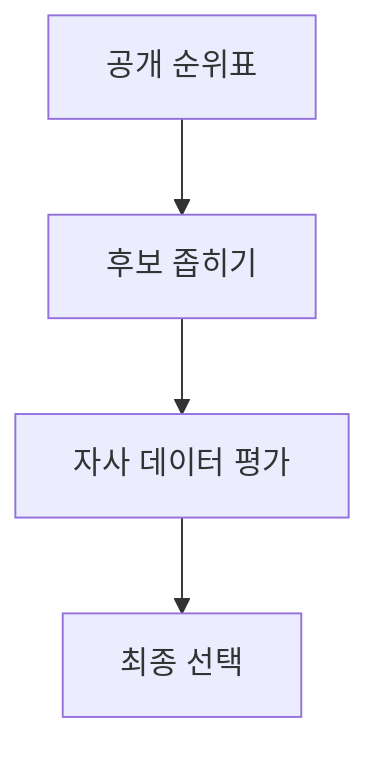

# 자사 데이터로 직접 평가

> 자사 데이터로 직접 평가는 공개 순위표나 벤치마크 점수에 의존하지 않고, 우리 업무에서 실제로 나오는 질문·입력 100~300개 이상에 후보 모델을 돌려 우리 기준으로 점수를 매기는 일이다. 순위표는 선택의 출발점일 뿐이고 도입 결정은 이 평가로 한다.

## 쉽게 말하면
신입 사원을 뽑을 때 공개 모의 면접 점수보다 우리 팀 실제 업무 샘플을 풀게 해 보는 편이 정확하다. 평가 문항이 우리 일과 닮을수록 점수가 우리 현장 성과와 닮는다.

## 자세히
- **성공 기준 먼저(Anthropic Building Evaluations 문서, 2026-11 열람)**: 기준은 구체적(특정 작업의 정확도), 측정 가능(F1·정확도·응답 시간 또는 잘 정의된 척도), 달성 가능(벤치마크·이전 실험·전문가 지식 기반), 관련성(용도에 맞음)이어야 한다. 예: "다양한 트윗 1만 개 보류 세트에서 F1 0.85 이상, 응답의 95%가 200ms 이내". 대부분의 사용 사례는 작업 충실도·일관성·관련성·어조·개인정보 보호·지연·가격 같은 다차원 평가가 필요하다.
- **설계 원칙(같은 문서)**: ① 작업 특화: 실제 업무 분포를 반영하고 무관한 입력, 너무 긴 입력, 유해 입력, 애매한 사례 같은 경계 사례를 포함 ② 가능하면 자동화(객관식·문자열 일치·코드 채점·LLM 채점) ③ 양이 질보다 우선: 자동 채점되는 많은 문항이 손으로 채점하는 소수 문항보다 낫다.
- **채점 방식(같은 문서의 표)**: 정확 일치(레이블된 트윗 1,000개의 감성 분류), 코사인 유사도(FAQ 50군 의역 질문의 일관성), ROUGE-L(참조 요약 200건), LLM 리커트 척도(어조 목표가 있는 고객 문의 100건), LLM 이진 분류(환자 질의 500건에서 개인정보 포함 여부). LLM 채점은 답을 만든 모델과 다른 모델로 하라고 권한다.
- **문항 수 감각(앞선 노드와 연결, 직접 계산)**: 같은 문항으로 두 모델을 짝으로 비교하고 불일치 10%·차이 5%p를 80% 검정력으로 가려내려면 약 340문항이 필요하다([평가셋 크기 계획](#eval-set-size-planning)). 100~300개는 큰 차이(10%p 이상)만 가릴 수 있고, 작은 차이는 비용·지연 등 다른 기준으로 판단한다([작은 차이를 넘는 모델 선택](#model-choice-beyond-small-gaps)).
- **함정(해석)**: 문항이 같은 문서·고객에서 반복해 나오면 [군집 표본](#clustered-samples-ci) 문제가 생기고, 프롬프트를 여러 번 고쳐 최고 점수만 보고하면 [선택적 점수 공개](#selective-score-disclosure)와 같은 편향이 생긴다. 최종 점수는 [보류 평가 세트](#held-out-eval-set)에서 한 번만 낸다.
- **만드는 순서(해석)**: ① 실제 로그·문의에서 무작위로 표본 추출(개인정보 처리) ② 경계 사례 10~20% 포함([경계 사례 예시](#edge-case-examples)) ③ 정답·채점 기준 확정 ④ 자동 채점 구축 ⑤ 모델·프롬프트 비교 ⑥ 분기마다 재실행.

## 그림으로 보기

## 예시
- 고객센터 챗봇 후보 3개를 실제 문의 200건으로 평가해 정확 일치와 LLM 채점으로 점수를 내고, 비용·지연과 함께 표로 비교한다.
- 교육 활용: 학습자가 자기 업무에서 질문 30개를 모아 두 모델을 비교하는 미니 평가를 만들어 보게 한다.

## 헷갈리는 것과 비교
| 개념 | 차이 |
| --- | --- |
| 공개 벤치마크 | 일반 능력의 지표. 우리 업무와 다를 수 있음 |
| 자사 데이터 평가 | 우리 업무 분포에서의 성능 |
| [리더보드 작은 격차](#leaderboard-small-gap) | 상위 주제. 순위표 격차의 해석 한계 |
| [평가셋 크기 계획](#eval-set-size-planning) | 필요한 문항 수 계산 |

## 더 읽을거리
- [Anthropic: Building evaluations](https://platform.claude.com/docs/en/test-and-evaluate/develop-tests) — 성공 기준·설계 원칙·채점 방식
