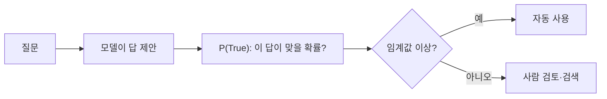
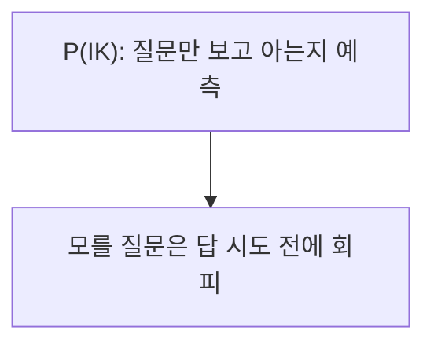

# P(True) 자기 평가

> **P(True)** 는 모델이 자기가 낸 답이 **맞을 확률**을 스스로 평가하게 하는 방법이다. 같은 연구에서 질문만 보고 "내가 이 답을 아는가"를 예측하는 **P(IK)** 도 다뤘다.

## 쉽게 말하면
시험을 보고 나서 "이 답, 맞을 확률 몇 %?"라고 스스로 점수를 매기는 것이다. 잘 보정된 학생은 90%라고 한 문제를 실제로 90% 맞힌다.

## 자세히
(Kadavath 외, "Language Models (Mostly) Know What They Know", arXiv 2207.05221 초록 확인)
- **P(True)**: 모델이 답을 제안한 뒤 그 답이 맞을 확률을 평가. 초록은 이 방식이 **좋은 성능·보정·스케일링**을 보인다고 보고하며, 판단 전에 **자기 샘플을 여러 개 고려**하면 성능이 오른다.
- **P(IK)**: 제안된 답 없이 질문만 보고 "I know"일 확률을 예측하도록 학습. 예측을 잘 하고 과제 간 부분적으로 일반화하지만 **새 과제에서는 보정에 어려움**이 있다.
- 구체 수치는 초록에 없다.
- 활용(권고): 신뢰도가 낮은 답은 사람 검토나 검색으로 넘기는 임계값 라우팅([신뢰도 임계값 라우팅](#confidence-threshold-routing)). 단 모델의 자기 평가는 틀릴 수 있어 내 데이터로 보정 정확도를 측정한다.

## 그림으로 보기



## 예시
```
질문: ... 
제안 답: ...
이 답이 맞을 확률을 0~1로 평가하고 근거를 한 줄로 써 줘.
```

## 헷갈리는 것과 비교
| 개념 | 차이 |
|---|---|
| P(True) | 제안한 답의 정답 확률 |
| P(IK) | 질문만 보고 아는지 예측 |
| [자기 일관성](#self-consistency) | 샘플 다수결로 신뢰 확보 |
| 보정(calibration) | 확률과 실제 정확도의 일치 |

## 더 읽을거리
- [Language Models (Mostly) Know What They Know](https://arxiv.org/abs/2207.05221)
