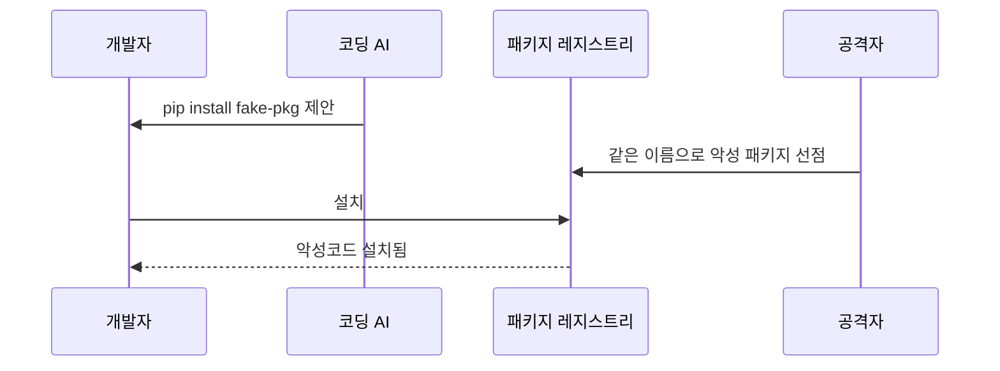
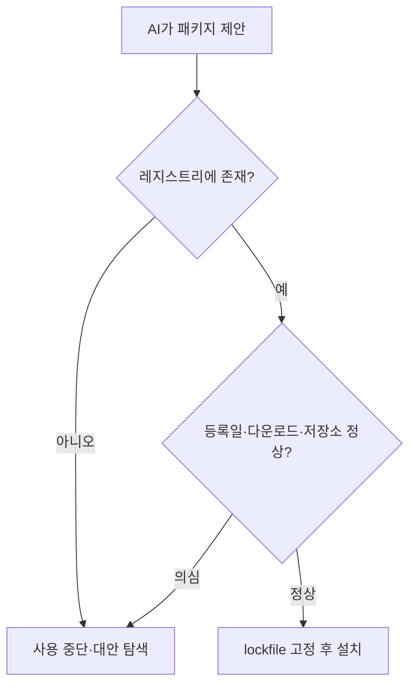

# 패키지 할루시네이션

> AI가 코드를 쓰면서 **존재하지 않는 라이브러리 이름**을 그럴듯하게 지어내는 현상이다. 공격자가 그 이름을 먼저 등록해 악성코드를 심어 두면, 설치하는 순간 감염된다(슬롭스쿼팅, slopsquatting).

## 쉽게 말하면
길 안내 앱이 없는 가게 주소를 알려 주는 것과 같다. 그런데 사기꾼이 "AI가 자주 알려 주는 그 주소"에 미리 가짜 가게를 차려 놓았다. 지도를 믿고 찾아간 사람은 가짜 가게에 들어간다.

## 자세히
- **발생 규모**(Spracklen 등 2025 연구, 언론 보도 기준): 16개 코드 생성 모델, 약 57.6만 개 Python·JavaScript 샘플에서 추천 패키지의 약 5분의 1이 존재하지 않았고 고유한 가짜 이름이 약 20.5만 개였다. 오픈소스 모델 평균 약 21.7%, 상용 모델은 더 낮다(매체별 수치가 다름: GPT-4 5.2% 또는 GPT-4 Turbo 3.59%).
- **반복성**: 환각을 낸 프롬프트 500개를 10번 재실행했을 때 43%의 가짜 이름이 매번 다시 나왔다. 그래서 공격자가 이름을 예측해 선점할 수 있다. 다만 연구·Socket 분석에서 **실제 공격 사례는 확인되지 않았다**고 보도됐다.
- **그럴듯함**: 가짜 이름 중 약 38%는 실제 패키지와 어느 정도 비슷했고, 단순 오타형은 13%뿐이었다.
- **용어**: Python Software Foundation의 Seth Larson이 slopsquatting이라 불렀다. 2023년 Bar Lanyado가 환각 이름의 빈 패키지를 올려 3개월에 3만 건 이상 다운로드된 실험이 선례다.
- **대응 체크리스트**: ① AI가 제안한 패키지는 설치 전에 레지스트리(npm·PyPI)에서 실제 존재·다운로드 수·등록일·저장소 링크 확인 ② 새로 생긴 이름·다운로드 극소 패키지는 의심 ③ lockfile로 버전 고정, 의존성 스캐너(Socket, `npm audit`, Dependabot) 사용 ④ 설치 스크립트(postinstall) 실행 제한 ⑤ AI에게 "이 패키지가 실제 존재하는지 공식 문서로 확인해 줘" 요구.

## 그림으로 보기

## 예시
- 바이브코딩 중 에이전트가 `npm install react-auth-helper-pro`를 실행하려 할 때, 승인 전에 npmjs.com에서 주 다운로드 수와 저장소를 확인한다.
- 프롬프트 예: "의존성을 추가하기 전에 패키지 이름, 공식 저장소 URL, 최신 버전, 마지막 릴리스 날짜를 표로 보여 주고 내 승인을 기다려."

## 헷갈리는 것과 비교
| 개념 | 차이 |
|---|---|
| 패키지 할루시네이션 | AI가 없는 이름을 지어냄 |
| 슬롭스쿼팅 | 그 환각 이름을 선점해 악용하는 공격 |
| 타이포스쿼팅 | 사람의 오타(`reqeusts`)를 노리는 선점 |
| 의존성 혼동 | 사내 패키지 이름을 공개 레지스트리에 같은 이름으로 올림 |
| [XSS](#xss) | 브라우저 쪽 공격. 이건 공급망 공격 |

## 더 읽을거리
- [Dark Reading: AI Code Tools Widely Hallucinate Packages](https://www.darkreading.com/application-security/ai-code-tools-widely-hallucinate-packages) — 연구 규모와 핵심 수치.
- [Socket: Slopsquatting](https://socket.dev/blog/slopsquatting-how-ai-hallucinations-are-fueling-a-new-class-of-supply-chain-attacks) — 반복성·유사도 분석과 대응.
- [Wikipedia: Slopsquatting](https://en.wikipedia.org/wiki/Slopsquatting) — 용어 기원과 2023년 실험.
