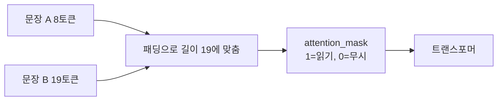
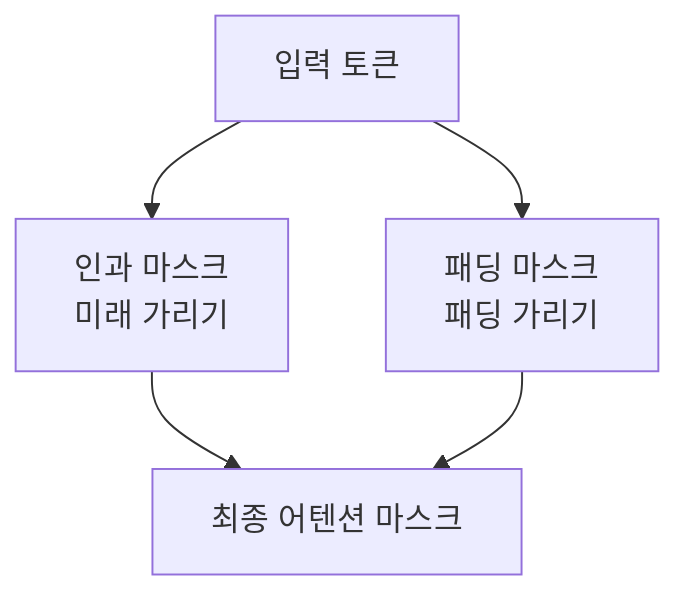

# 패딩 마스크 (Padding Mask)

> 길이가 다른 문장을 한 배치로 묶으려고 짧은 문장 뒤(또는 앞)에 채운 패딩 토큰을, 모델이 읽지 않도록 가리는 0/1 마스크(`attention_mask`)다.

## 쉽게 말하면
시험지 답안 칸이 10칸인데 5글자만 쓴 학생은 나머지 5칸에 줄을 긋는다. 채점자는 줄 그은 칸을 무시한다. 패딩 토큰이 줄 그은 칸이고 마스크가 "여긴 보지 마"라는 표시다.

## 자세히
Hugging Face 용어집(Glossary) 기준:
- 모델은 배치를 하나의 텐서로 받으므로 문장 길이를 맞춰야 한다(예: BERT 토크나이저로 길이 8과 19 문장 → 짧은 쪽에 0을 채움).
- `tokenizer([a, b], padding=True)`가 패딩하고 `attention_mask`를 함께 돌려준다. BERT 계열에서 **1은 읽을 토큰, 0은 패딩**이다.
- 마스크가 없으면 패딩이 의미 없는 입력으로 어텐션에 섞여 결과가 달라진다(일반적 설명).
- 패딩 위치(좌/우)는 모델에 따라 다르다. 디코더 전용 생성 모델에서는 보통 왼쪽 패딩을 쓴다(HF 용어집에는 없는 일반적 관행 — 확인 필요).
- 패딩 마스크는 [인과 마스크](#attention-mask)(미래 토큰 가리기)와 별개이며, 실제로는 두 마스크를 합쳐 쓴다.

## 그림으로 보기



## 예시
```python
tok = BertTokenizer.from_pretrained("google-bert/bert-base-cased")
batch = tok(["This is a short sequence.", "This is a rather long sequence. It is at least longer than the sequence A."], padding=True)
print(batch["attention_mask"])
# 첫 문장: [1,1,1,1,1,1,1,1,0,0,0,...]
```

## 헷갈리는 것과 비교
| 개념 | 차이 |
|---|---|
| 패딩 마스크 | 채운 토큰을 무시 |
| [인과 마스크](#attention-mask) | 미래 토큰을 못 보게 |
| [양방향 어텐션](#bidirectional-attention) | 미래도 보게 하는 쪽(마스크가 다름) |
| 토큰 타입 ID | 두 문장을 구분(0/1) |

## 더 읽을거리
- [HF Glossary: attention mask](https://huggingface.co/docs/transformers/glossary) — 패딩과 attention_mask 예제.
