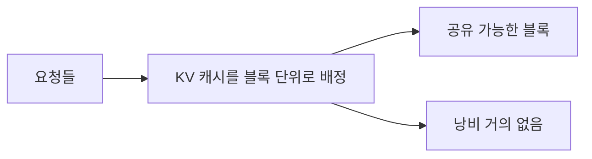
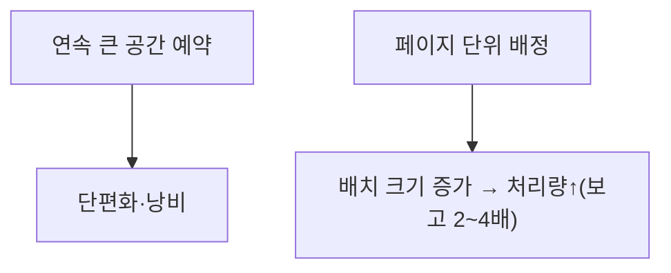

# PagedAttention과 vLLM

> LLM 서빙에서 **KV 캐시를 운영체제의 가상 메모리·페이징처럼 작은 블록 단위로 관리**해 메모리 낭비를 줄이는 방법(PagedAttention)과 이를 쓴 서빙 시스템 vLLM. (Kwon 외, SOSP 2023, arXiv 2309.06180, 초록 읽음)

## 쉽게 말하면
식당 좌석을 예약 인원만큼 미리 큰 테이블로 잡아 두면 빈 자리가 많이 낭비된다. 작은 의자 단위로 필요할 때마다 배정하면 더 많은 손님을 받을 수 있다.

## 자세히
- 문제(초록): KV 캐시 관리가 비효율적이면 **단편화와 중복**으로 메모리가 낭비되고 **배치 크기가 제한**된다([VRAM 예산](#vram-budgeting)).
- 해법: **PagedAttention**은 OS의 가상 메모리·페이징 방식으로 KV 캐시를 관리하는 어텐션 알고리즘. 이를 기반으로 만든 **vLLM**은 KV 캐시의 **거의 0에 가까운 낭비**와 요청 내·요청 간 **유연한 KV 캐시 공유**를 목표로 한다.
- 보고된 효과(저자): 같은 지연에서 FasterTransformer, Orca보다 **처리량 2~4배**. 긴 시퀀스, 큰 모델, 복잡한 디코딩일수록 이득이 크다.
- 연결: 메모리 절감은 [KV 양자화](#kv-quantization)처럼 값 크기를 줄이는 방법과 달리 **배치 방식**으로 낭비를 줄이는 접근이다(해석). 둘을 함께 쓸 수 있다.
- 한계: 수치는 2023년 비교 대상과 설정의 결과이며 오늘날 최적화된 서빙 엔진과의 비교는 이 출처로 확인하지 못했다. 소스 코드는 공개돼 있다.

## 그림으로 보기

## 예시
- 동시 요청이 많은 사내 챗봇 서버에 vLLM을 사용해 같은 GPU에서 더 많은 사용자를 처리.
- 교육: OS 메모리 관리 개념(페이징)을 LLM 서빙에 빗대어 설명.

## 헷갈리는 것과 비교
| 개념 | 차이 |
|---|---|
| PagedAttention | KV 캐시를 블록 단위로 관리 |
| [KV 양자화](#kv-quantization) | KV 값을 낮은 비트로 저장 |
| [어텐션](#attention-mechanism) | 이 방법이 서빙을 최적화하는 연산 |

## 더 읽을거리
- [PagedAttention 논문](https://arxiv.org/abs/2309.06180) — vLLM과 효과(초록 읽음).
