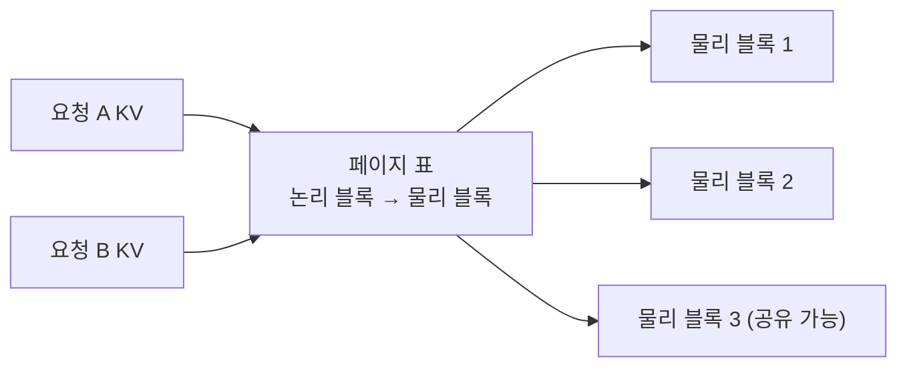

# PagedAttention

> PagedAttention은 운영체제의 가상 메모리·페이징에서 착안해 KV 캐시를 고정 크기 페이지로 나눠 관리하는 어텐션 방식으로, vLLM의 핵심이다.

## 쉽게 말하면
호텔 객실을 "한 손님에게 최대 길이만큼 연속된 층 전체"로 미리 잡아 두면 빈방이 낭비된다. 필요한 만큼 방(페이지) 단위로 흩어 배정하고 장부(페이지 표)로 관리하면 낭비가 거의 없다.

## 자세히
vLLM 논문(arXiv 2309.06180, 2026-11 확인):
- **문제**: 처리량을 높이려면 큰 배치가 필요한데, 요청마다 KV 캐시가 크고 생성 중 크기가 변한다. 비효율적 관리는 **단편화와 중복 복사**로 메모리를 낭비해 배치 크기를 제한한다.
- **해법**: PagedAttention으로 KV 캐시를 블록(페이지) 단위로 관리, 이를 기반으로 **vLLM** 서빙 시스템 구축. KV 캐시 낭비를 "거의 0"으로 줄이고 요청 내·요청 간 캐시 **공유**를 가능케 한다고 주장.
- **성과(논문 주장)**: FasterTransformer·Orca 같은 최신 시스템보다 같은 지연 시간에서 처리량 **2–4배**. 긴 시퀀스·큰 모델·복잡한 디코딩일수록 이득이 큼.
- 공유 예: 같은 프롬프트에서 여러 답을 뽑는 병렬 샘플링·빔 서치는 앞부분 캐시를 공유할 수 있다(논문 핵심 활용처, 일반 설명).
- [KV 캐시](#kv-cache)가 왜 메모리를 많이 쓰는지는 해당 노드, 하드웨어 배경은 [GPU 메모리 계층](#gpu-memory-hierarchy).

## 그림으로 보기

## 예시
vLLM으로 모델을 서빙하면 PagedAttention이 기본 적용되어 같은 GPU에서 더 많은 동시 요청을 처리한다. 사내 LLM 서버 비용 절감 논의에서 자주 거론된다.

## 헷갈리는 것과 비교
| 개념 | 차이 |
|---|---|
| PagedAttention | KV 캐시 메모리 관리 방식 |
| [FlashAttention](#flash-attention) | 어텐션 계산의 메모리 이동 최소화 |
| [KV 캐시](#kv-cache) | 관리 대상 자체 |
| 연속 배칭(continuous batching) | 요청 스케줄링 — 함께 쓰이는 서빙 기법 |

## 더 읽을거리
- [Efficient Memory Management for LLM Serving with PagedAttention](https://arxiv.org/abs/2309.06180) — 원 논문 초록.
