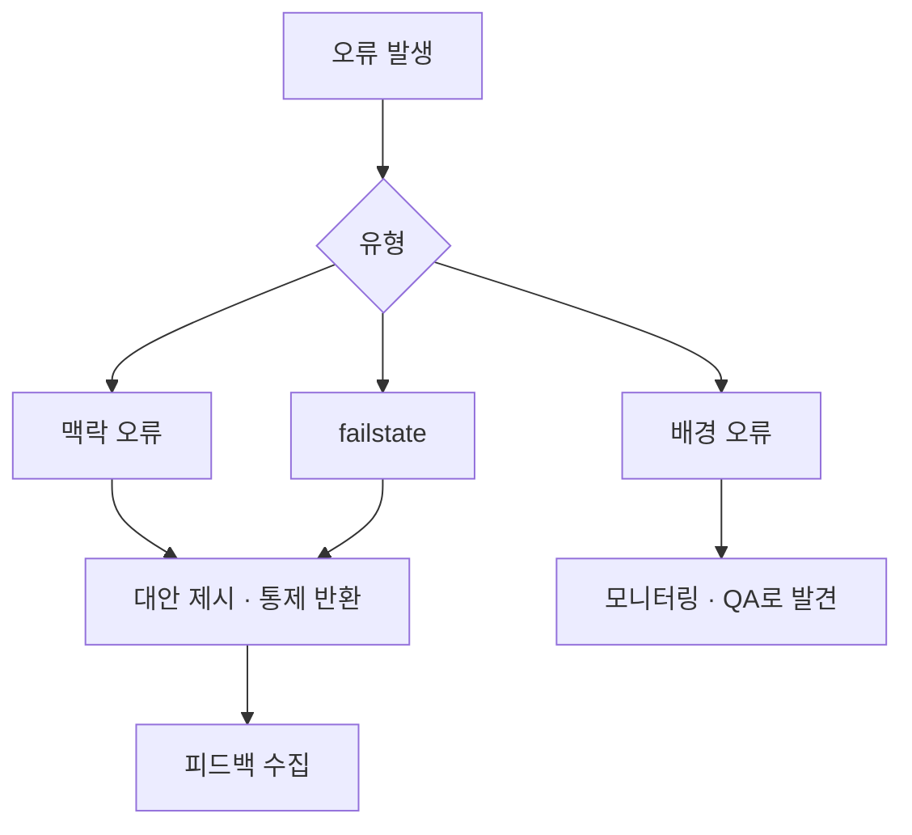

# PAIR 오류와 부드러운 실패

> AI는 확률적이라 실패가 불가피하므로, 오류를 피하려 하기보다 찾기 쉽고 사용자 중심으로 복구되게 설계해야 한다는 PAIR 가이드북의 장이다.

## 쉽게 말하면
내비게이션이 길을 잘못 안내해도 "경로를 다시 계산합니다"와 대안이 나오면 괜찮다. 아무 말 없이 멈추면 불안하다.

## 자세히
Google PAIR 원문 요약(직접 확인):
- 오류는 기대에 따라 사용자가 정의한다. 고위험(건강·안전·금융), 초보자, 다중작업, 낮은 확신 출력에서 위험이 커진다.
- **사용자가 인지하는 오류**: 맥락 오류(설계대로지만 상황 가정이 틀림), failstate(능력 한계).
- **인지 못 하는 오류**: happy accident(우연히 도움), 배경 오류(틀렸는데 아무도 모름 — 별도 QA·스트레스 테스트).
- **원인**: 학습 데이터·예측, 입력, 관련성(확신·타이밍), 시스템 위계 충돌.
- **설계 관행**: 한계를 구체적으로 설명, 약한 가정에 행동하지 않기, 다음 경로 제시, 사람에게 매끄럽게 통제권 돌려주기, 피드백 받기, 오남용 대비, 지속 모니터링, 겸손한 어조.

## 그림으로 보기

## 예시
음성 비서가 이해 못 했을 때 "다시 말씀해 주세요" 대신 "일정 추가인가요, 알람인가요?"로 후보를 제시.

## 헷갈리는 것과 비교
| 개념 | 차이 |
|---|---|
| 부드러운 실패 | 오류를 전제로 설계 |
| [HAX 틀렸을 때](#hax-when-wrong) | 같은 취지의 UX 지침 |
| [불확실할 때 범위 좁히기](#graceful-degradation-ai) | 구체 설계 |

## 더 읽을거리
- [People + AI Guidebook](https://pair.withgoogle.com/guidebook/) — Google PAIR 가이드북 전체.
