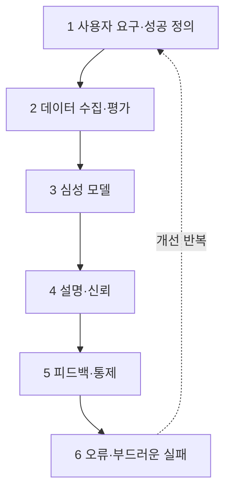

# Google PAIR 가이드북

> Google의 PAIR(People + AI Research) 팀이 만든 "사람 중심 AI 제품" 설계 가이드. 제품 개발 순서를 따라 6개 장으로 나뉘고 장마다 워크시트가 있다.

## 쉽게 말하면
AI 제품을 만드는 팀을 위한 요리책이다. "이 문제에 AI가 정말 필요한가?"부터 "틀렸을 때 어떻게 부드럽게 실패하나?"까지, 단계마다 던질 질문과 실습지를 준다.

## 자세히
- **연혁**: 2019 공개 → 2021 개편 → 2023 생성형 AI 시대에 맞춰 장 구성 갱신(PAIR 블로그). 계속 바뀌는 '살아 있는 문서'이며 CC BY-NC-SA 4.0 라이선스.
- **6개 장(검색 결과 기준, 장 본문은 직접 읽지 못함)**:
  1. User Needs + Defining Success — AI가 필요한 문제인지, 성공 기준은 무엇인지
  2. Data Collection + Evaluation — 데이터 수집·평가
  3. Mental Models — 사용자가 AI를 어떻게 이해하는지, 기대 설정
  4. Explainability + Trust — 설명과 신뢰 보정
  5. Feedback + Control — 피드백·사용자 통제
  6. Errors + Graceful Failure — 오류 유형과 부드러운 실패
- 각 장에 PDF 워크시트가 있어 팀 워크숍에 바로 쓴다.
- **HAX와 차이**: HAX는 상호작용 행동 18개 체크리스트, PAIR는 개발 단계별 질문과 사례 중심.

## 그림으로 보기

## 예시
- 신규 AI 기능 기획 워크숍: 1장 워크시트로 "AI 없이 규칙으로 풀 수 있나?"를 먼저 점검하고, 3장으로 사용자가 AI에 갖는 기대를 적는다.
- 출시 전: 6장으로 최악 오류 시나리오와 복구 경로를 설계한다.

## 헷갈리는 것과 비교
| 개념 | 차이 |
|---|---|
| PAIR 가이드북 | 개발 단계별 6장, 워크시트 |
| [Microsoft HAX 18개 지침](#hax-guidelines) | 상호작용 시점별 18개 지침 |
| [AI 확신도 표시](#ai-confidence-display) | 4장 신뢰 보정의 구체 기법 |

## 더 읽을거리
- [PAIR Guidebook](https://pair.withgoogle.com/guidebook/) — 공식 사이트(JS 렌더링으로 본문은 직접 확인 못 함)
- [Updating the Guidebook in the age of generative AI](https://medium.com/people-ai-research/updating-the-people-ai-guidebook-in-the-age-of-generative-ai-cace6c846db4) — 2023 개정 배경
- [Meet the redesigned People + AI Guidebook](https://medium.com/people-ai-research/meet-the-redesigned-people-ai-guidebook-218463a8f13e) — 2021 개편
- [Codelab: Building Trusted AI Products](https://codelabs.developers.google.com/codelabs/pair-guidebook) — 실습
