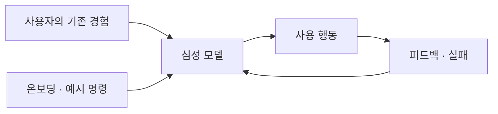

# PAIR 심성 모델

> 심성 모델은 사용자가 시스템이 어떻게 작동하고 자기 행동이 어떤 영향을 주는지에 대해 가진 이해이며, 이것이 제품 실제와 어긋나면 좌절·오용·이탈이 생긴다.

## 쉽게 말하면
새 가전을 쓸 때 옛날 가전의 감으로 버튼을 누르다 실패하는 것과 같다. AI는 시간이 지나며 변하기까지 해서 기대를 맞추는 설계가 더 필요하다.

## 자세히
Google PAIR 원문 요약(직접 확인):
- 사용자는 기존 해법의 심성 모델을 가져온다. AI는 사람이 고려하지 않는 신호(예: 메일 보낸 시각)를 쓸 수 있다.
- **단계적 온보딩**: 할 수 있는 것과 없는 것을 솔직히, 기술 대신 이점 중심으로, 관련 시점에 기능 소개, 되돌릴 수 있는 저위험 행동으로 실험.
- **공동 학습**: 피드백이 개인화로 이어짐을 설명, 암묵·명시 피드백 구분, 반영 시점 안내, 실패 시 비AI 대안 제공, 큰 변경 때 재온보딩.
- **인간 같은 기대**: 이름·"나" 말투 같은 의인화는 과신·실망·의도치 않은 기만을 낳을 수 있다. 알고리즘임을 쉬운 말로 밝히고 초능력처럼 묘사하지 않는다.

## 그림으로 보기

## 예시
챗봇 첫 화면에 "저는 AI이고 틀릴 수 있어요. 이런 요청을 잘해요" 예시 3개를 보여 기대를 맞춘다.

## 헷갈리는 것과 비교
| 개념 | 차이 |
|---|---|
| 심성 모델 | 사용자 머릿속 이해 |
| [HAX G1·G2](#hax-toolkit) | 능력·정확도를 명확히 하라는 지침 |
| [AI 환각](#hallucination) | 기대와 달리 틀리는 현상 |

## 더 읽을거리
- [People + AI Guidebook](https://pair.withgoogle.com/guidebook/) — Google PAIR 가이드북 전체.
