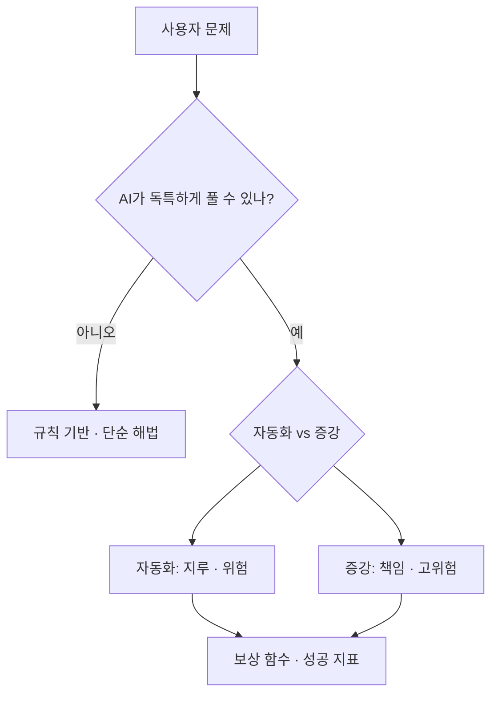

# PAIR 사용자 요구·성공 정의

> PAIR 가이드북의 이 장은 기술이 아니라 사용자 문제에서 출발해 AI가 정말 필요한지, 자동화와 증강 중 무엇이 맞는지, 성공을 어떻게 정의할지 정하게 한다.

## 쉽게 말하면
망치를 들고 모든 걸 못으로 보지 말라는 얘기다. "AI로 뭘 할까?"가 아니라 "이 문제를 어떻게 풀까, 그중 AI가 유독 잘하는 부분은?"을 먼저 묻는다.

## 자세히
Google PAIR 가이드북 원문 요약(직접 확인):
- **AI가 잘 맞는 일**: 개인화 추천, 미래 예측, 자연어 이해, 부류 인식, 사기처럼 드물고 변하는 사건 탐지.
- **규칙 기반이 나은 일**: 예측 가능성이 핵심, 정보가 고정, 오류 비용이 매우 큼, 완전한 투명성 필요, 속도·비용 우선.
- **자동화 vs 증강**: 지루하거나 위험한 일은 자동화(사람이 검토·되돌리기 가능), 즐기는 일·책임이 큰 일·고위험은 증강해 사람이 통제.
- **보상 함수**: AI가 성공·실패를 판단하는 기준이 곧 사용자 경험. 여러 직군이 함께 설계.
- **성공 정의**: 오류를 결과의 무게로 가중(위양성 vs 위음성), 정밀도·재현율 균형, 장기 영향, 포용성, "지표가 임계값 아래면 조치"를 미리 정함.

## 그림으로 보기

## 예시
사내 문서 분류: 오분류 비용이 낮고 지루하면 자동화, 계약 검토는 사람이 최종 판단하는 증강으로 설계.

## 헷갈리는 것과 비교
| 개념 | 차이 |
|---|---|
| PAIR 사용자 요구 | 문제부터 시작 |
| [HAX Toolkit](#hax-toolkit) | 구현 단계 지침 |
| [AI 리터러시](#literacy) | 사용자 쪽 판단 능력 |

## 더 읽을거리
- [People + AI Guidebook](https://pair.withgoogle.com/guidebook/) — Google PAIR 가이드북 전체.
