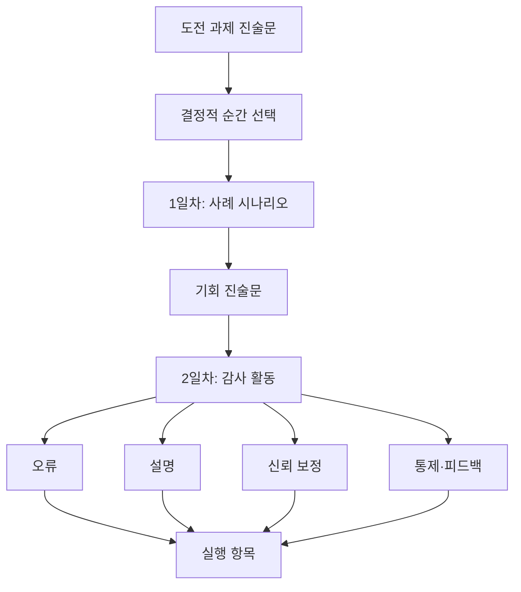

# PAIR 워크시트 활용

> Google PAIR의 People + AI Guidebook에 딸린 워크시트·워크숍 키트. 가이드북 지침을 팀이 자기 제품에 적용해 보는 실습 도구다.

## 쉽게 말하면
요리책(가이드북)을 읽는 것과 실제로 요리해 보는 것은 다르다. 워크시트는 "우리 재료로 이 레시피를 해 보는 연습장"이다. 팀이 모여 제품의 구체적 순간을 놓고 질문에 답하면 지침이 우리 제품의 결정으로 바뀐다.

## 자세히
- **구성**: 가이드북 챕터마다 워크시트가 있고, 전체를 묶은 PDF도 제공된다. 가이드북은 2019-05-08 공개, 2021-05-18 개정(2판). 라이선스 CC BY-NC-SA 4.0.
- **워크숍 키트(진행자 가이드 확인)**: 원격 우선, 직접 진행 가능, 1시간 심화부터 2일 스프린트까지 조절한다. 슬라이드·시나리오 문서가 따로 있다. 기본은 2일 구성:
  - **1일차(공간 이해)**: 사례 시나리오(제품 밖에서 AI 영향 생각하기) → 기회 진술문(선택한 "결정적 순간"의 사용자 문제·관련 패턴·해법 정리).
  - **2일차(해법 만들기)**: 오류 감사(errors audit), 설명 가능성 감사, AI 온보딩, **신뢰 보정**([사용자 과의존](#user-overreliance) 방지), 통제 감사(자동화 수준 ↔ 위험), 피드백 감사, 데이터 헤드라인(데이터 작업의 좋은·나쁜 신문 제목 쓰기).
- 한 시간짜리로 줄일 때는 진행자가 도전 과제 진술문·결정적 순간·기회 진술문을 미리 준비해 둬야 한다.
- 진행자는 기본 워크숍 진행 지식이 있다고 가정한다.

## 그림으로 보기

## 예시
- 사내 상담 챗봇 팀이 반나절 워크숍: 결정적 순간 = "챗봇이 모를 때". 오류 감사로 실패 유형을 나열하고, 통제 감사로 사람 이관 지점을 정한다.
- 교육 설계자가 PAIR 신뢰 보정 활동을 수강생 과제로 변형.

## 헷갈리는 것과 비교
| 개념 | 차이 |
|---|---|
| 가이드북 본문 | 패턴·원칙 설명 |
| 워크시트 | 팀이 자기 제품에 적용하는 질문지 |
| 워크숍 키트 | 슬라이드·시나리오·진행 가이드 묶음 |

## 더 읽을거리
- [PAIR Guidebook Workshop Facilitator's Guide](https://pair.withgoogle.com/guidebook-v2/workshop/Guidebook-Workshop-Facilitator-Guide.pdf) — 활동 목록·2일 일정·준비 체크리스트
- [People + AI Guidebook](https://pair.withgoogle.com/guidebook-v2/) — 가이드북 본문
