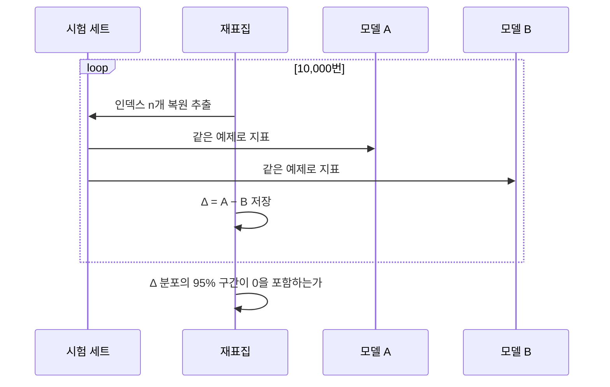

# 짝지은 부트스트랩 모델 비교

> 같은 시험 세트에서 두 모델을 평가할 때, **같은 예제 번호 묶음**을 복원 추출해 두 모델의 지표 차이를 반복 계산하고, 그 차이 분포로 "A가 정말 B보다 나은가"를 판단하는 방법.

## 쉽게 말하면
두 학생이 같은 시험지를 풀었다. 문제를 무작위로 다시 뽑아 "이 문제 묶음에서는 누가 이겼나"를 수천 번 가정해 본다. 어려운 문제가 뽑히면 둘 다 점수가 내려가므로 공통 난이도는 상쇄되고 **둘의 차이만** 남는다.

## 자세히
- **절차**: ① 시험 예제 n개의 인덱스를 복원 추출 ② **같은 인덱스**로 모델 A·B의 지표를 각각 계산 ③ 차이 Δ=A−B 저장 ④ 1,000~10,000번 반복 ⑤ Δ의 2.5%·97.5% 분위수가 0을 포함하지 않으면 5% 수준에서 유의(검색으로 확인한 논문들의 공통 관행).
- **p값 읽는 법**: Δ ≤ 0인 반복의 비율이 단측 p값(근사). 양측은 약 2배. 부트스트랩 p값은 근사이며 여러 비교를 하면 다중 비교 보정이 필요하다.
- **왜 짝을 맞추나**: 같은 예제의 예측은 서로 상관돼 있어 따로 뽑으면 분산이 커진다. 짝 재표집은 이 의존성을 보존해 더 민감하다.
- **복합 지표에 강점**: F1처럼 예제별 합이 아닌 지표는 일반 검정(맥니마 등)을 쓰기 어렵지만, 부트스트랩은 지표를 그대로 재계산하면 된다. 출처 중 하나(EPFL 기술 보고서)는 F1이 예제별 오류의 합 구조를 깨 표준 검정이 맞지 않는다고 설명한다.
- **리더보드 맥락**: arXiv 2305.10452는 챌린지 순위의 작은 격차가 통계적으로 의미 있는지 부트스트랩 재표집으로 판단하자고 제안한다(MeOffendEs@IberLEF 2021 사례; 초록만 확인, 짝 재표집 여부는 본문 미확인).
- **한계**: 예제가 독립이어야 함(그룹이면 [군집 부트스트랩](#cluster-bootstrap)), 모델 학습 변동은 반영 안 됨(같은 시드의 고정 모델 비교), 시험 n이 작으면 불안정.

## 그림으로 보기



## 예시
```python
import numpy as np
rng = np.random.default_rng(0)
def paired_boot(y, pa, pb, metric, B=10000):
    n = len(y); d = []
    for _ in range(B):
        i = rng.integers(0, n, n)
        d.append(metric(y[i], pa[i]) - metric(y[i], pb[i]))
    return np.percentile(d, [2.5, 97.5]), np.mean(np.array(d) <= 0)
```
- 새 프롬프트 vs 기존 프롬프트(LLM 평가 1,000문항, 정답 여부)를 비교할 때 사용.

## 헷갈리는 것과 비교
| 방법 | 대상 | 비고 |
|---|---|---|
| 짝지은 부트스트랩 | 임의 지표 | 계산량 큼 |
| [맥니마 검정](#mcnemar-test) | 이진 정오답 | 불일치 쌍만 사용 |
| [보정 t-검정](#nadeau-bengio-corrected-ttest) | CV 점수 | 분할 겹침 보정 |
| 독립 부트스트랩 | 두 구간 비교 | 상관 무시, 비효율 |

## 더 읽을거리
- [Comparison of classifiers in challenge scheme (arXiv 2305.10452)](https://arxiv.org/abs/2305.10452) — 리더보드 격차를 부트스트랩으로 평가(초록만 열람).
- [EPFL: F1 유의성 검정 보고서](https://infoscience.epfl.ch/record/83071/files/rr04-34.pdf?version=1) — 검색 결과로만 확인(미열람).
