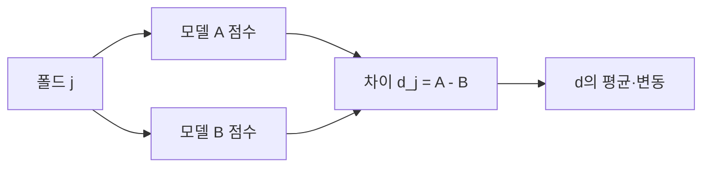
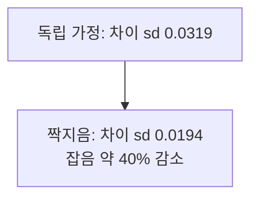

# 짝지은 점수 비교

> 두 모델을 같은 분할에서 평가했다면 폴드마다 점수 차이를 구해 그 차이들을 분석한다. 폴드가 어려운지 쉬운지는 두 모델에 똑같이 작용하므로 차이를 보면 그 영향이 상쇄되어 비교가 더 선명해진다.

## 쉽게 말하면
같은 학생 10명이 교재 A와 B로 각각 시험을 봤다면, 학생마다 "A 점수 − B 점수"를 계산한다. 원래 공부를 잘하는 학생과 못하는 학생의 차이는 두 점수에 똑같이 들어 있어서 뺄셈으로 사라지고, 교재의 효과만 남는다.

## 자세히
- **절차**: ① 같은 분할기로 두 모델을 평가([비교용 k 고정](#fixed-k-for-comparison)) ② 폴드별 차이 d_j = A_j − B_j ③ d의 평균과 변동을 본다 ④ 필요하면 보정 검정으로 판단([교차검증으로 모델 비교](#model-comparison-cv)).
- **직접 해 본 실험(유방암 데이터 569개, 표준화+로지스틱 회귀 C=1 대 C=0.05, 10겹×5회=50개 점수)**: 평균은 0.9782 대 0.9719로 차이 0.0064였다. 각 모델 점수의 표준편차는 0.0214와 0.0236이고, 두 모델의 폴드별 점수 상관은 0.63이었다. 점수를 독립이라고 보고 합친 차이의 표준편차는 0.0319인데, 같은 폴드끼리 짝지어 뺀 차이의 표준편차는 0.0194로 약 40% 작았다. 폴드의 난이도가 공통이라 짝지으면 잡음이 줄어든다.
- **폴드 승패 표**: 50개 폴드에서 A가 앞선 폴드 21개, 동점 17개, B가 앞선 폴드 12개였다. 평균 차이는 작지만 A가 더 자주 앞서거나 비겼다. 정확도는 폴드 크기가 작아 동점이 많이 나온다.
- **한계(해석)**: 짝지은 폴드 점수도 학습 데이터가 겹쳐 독립이 아니다([점수 비독립성](#score-non-independence)). 일반 쌍체 t-검정은 여전히 과신하므로 보정이 필요하다. 짝 비교는 "변동을 줄이는 설계"이지 "독립성을 만드는 설계"가 아니다.
- **쓰는 곳**: A/B 프롬프트·모델을 같은 문제 세트로 비교할 때도 같은 원리다. 문제별 점수 차이를 본다.

## 그림으로 보기

## 예시
- `d = scores_a - scores_b` 후 `(d>0).sum()`, `(d==0).sum()`, `(d<0).sum()`으로 승·무·패를 센다.
- 교육 활용: 같은 문제 20개에 두 프롬프트를 적용해 문제별 정답 여부(0/1) 차이로 "어느 쪽이 더 자주 이겼나"를 세어 보는 실습.

## 헷갈리는 것과 비교
| 개념 | 차이 |
| --- | --- |
| 짝지은 비교 | 같은 폴드의 차이를 분석 |
| 독립 두 표본 비교 | 폴드 난이도를 상쇄하지 못함 |
| [교차검증으로 모델 비교](#model-comparison-cv) | 보정 t-검정까지 |
| [비교용 k 고정](#fixed-k-for-comparison) | 짝을 만드는 전제 |

## 더 읽을거리
- [scikit-learn: Statistical comparison of models using grid search](https://scikit-learn.org/stable/auto_examples/model_selection/plot_grid_search_stats.html) — 폴드 점수 상관과 보정
