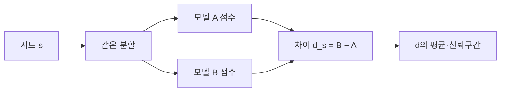

# 시드별 짝지은 비교

> 두 모델을 **같은 시드(같은 분할·같은 데이터 순서)** 로 돌려 시드마다 점수 **차이**를 구한 뒤 그 차이를 분석하는 방법. 시드가 공통으로 만드는 변동이 차이에서 상쇄돼, 작은 개선도 훨씬 잘 드러난다.

## 쉽게 말하면
다이어트 약을 평가할 때 "A그룹 평균 vs B그룹 평균"보다 "같은 사람의 복용 전·후 체중 차이"를 보는 편이 사람 간 체중 차이를 지워 줘서 더 선명하다.

## 자세히
- **직접 실행**(numpy·scipy 시뮬레이션: 모델 B의 진짜 우위 +0.01, 시드마다 공통 분할 효과 sd 0.02, 모델 고유 노이즈 sd 0.005, 시드 10개, 2,000회 반복, p<0.05 검출 비율):

| 검정 | 검출률 |
|---|---|
| 짝지은 t검정(`ttest_rel`) | **0.986** |
| 독립 t검정(`ttest_ind`) | 0.024 |

  공통 분할 효과가 큰 경우 짝을 무시하면 거의 아무것도 못 찾는다(독립 검정은 짝지어진 데이터에서 보수적이 되어 5%보다 낮게 나오기도 한다).
- **절차**: ① 시드 s마다 분할을 고정, ② 모델 A·B를 같은 분할에서 학습·평가, ③ d_s = B−A 계산, ④ d의 평균과 신뢰구간(또는 `ttest_rel`, Wilcoxon 부호순위)을 본다.
- **주의**: 시드 간 학습·평가가 독립이 아니다(훈련 데이터 겹침) → 교차검증 기반 t검정은 분산을 과소 추정할 수 있다(Nadeau & Bengio 계열의 보정 t검정이 제안됨). 시뮬레이션의 가정은 시드가 독립이라는 것이다.

## 그림으로 보기


## 예시
```python
from scipy import stats
d = np.array(B_scores) - np.array(A_scores)   # 같은 시드 순서
print(d.mean(), stats.ttest_rel(B_scores, A_scores).pvalue)
```
- 프롬프트 두 버전을 같은 평가 질문 세트에서 질문별 점수 차이로 비교하는 것도 같은 아이디어다.

## 헷갈리는 것과 비교
| 개념 | 차이 |
|---|---|
| 짝지은 비교 | 같은 시드·분할에서 차이를 분석 |
| 독립 비교 | 시드를 서로 무관하게 취급, 공통 변동이 남아 둔함 |
| [분할 시드 vs 모델 시드](#split-seed-vs-model-seed) | 어떤 변동을 짝지어 상쇄하는지 이해 |
| [점수 평균의 표준오차](#standard-error-of-mean-score) | 짝지은 차이 d의 SE로 확장 |

## 더 읽을거리
- [scipy.stats.ttest_rel](https://docs.scipy.org/doc/scipy/reference/generated/scipy.stats.ttest_rel.html) — 대응표본 t검정.
- [scikit-learn: Statistical comparison of models using grid search](https://scikit-learn.org/stable/auto_examples/model_selection/plot_grid_search_stats.html) — 교차검증 점수 비교 시 보정 t검정 예시.
